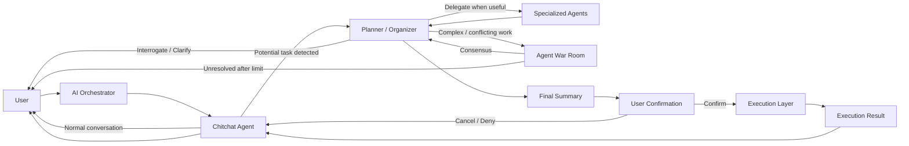

## Orchestration and Organizer

- AI Orchestrator is a thin coordination layer.
- Chitchat Agent is the default conversational entry point and lightweight orchestrator.
- Planner / Organizer Agent is activated only when focused task planning is required.
- Chitchat Agent detects potential task transitions and can request user confirmation before entering Planner mode.
- Planner / Organizer owns:
  - User interrogation and clarification.
  - Gathering information required for the requested task.
  - Dynamic delegation to specialized agents.
  - Calling specialized agents during interrogation when their knowledge or capability is useful.
  - Coordinating parallel specialized-agent work.
  - Managing Agent War Room workflows for complex or conflicting tasks.
  - Limiting unresolved Agent War Room debate to a defined number of rounds before requesting user judgment.
  - Summarizing the complete plan and gathered information.
  - Requesting final user confirmation before execution.
- Specialized Agents are independently discoverable and auto-registerable capabilities, similar to Tools and Knowledge sources.
- Execution Layer owns controlled execution after final user confirmation.
- Execution results are returned to the conversational flow.
- After execution or planner cancellation, the system returns to Chitchat mode.
- Planner mode can end without execution when the user cancels or denies final confirmation.
- The AI Orchestrator does not directly execute tools, own domain-specific business logic, or replace specialized agents.

Target interaction flow:

