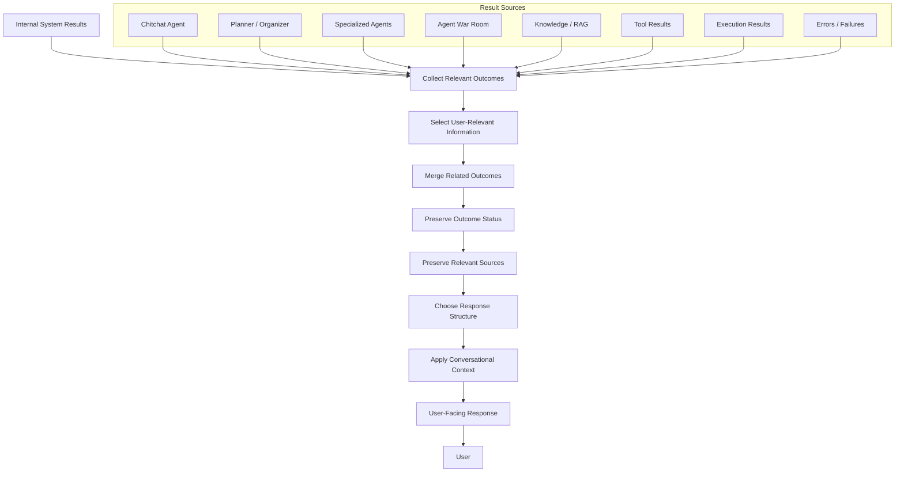

# Response Assembly

## Purpose

Response Assembly is responsible for transforming internal system outcomes into coherent, contextually appropriate, user-facing responses.

It acts as the boundary between Purrfect's internal execution and intelligence systems and the user's conversational experience.

Response Assembly is responsible for determining how information should be communicated to the user after an operation, conversation, planning workflow, tool execution, knowledge retrieval, or multi-agent process.

The central principle is:

> The user should experience one coherent assistant, regardless of how many internal components participated in producing the result.

The internal system may involve:

- Chitchat Agent.
- Planner / Organizer.
- Specialized Agents.
- Agent War Room.
- Tools.
- Knowledge Retrieval.
- Execution Layer.
- Multiple model calls.

The user should not be required to understand the internal architecture unless the system intentionally exposes relevant information.

---

## Core Responsibility

Response Assembly owns the transformation from internal system outcomes into a coherent user-facing response.

Conceptually:

```text
Internal System
    │
    ├── Chitchat Result
    ├── Planner Result
    ├── Specialized Agent Result
    ├── War Room Result
    ├── Knowledge Result
    ├── Tool Result
    ├── Execution Result
    └── Error / Failure Result
            │
            ▼
    Response Assembly
            │
            ▼
    User-Facing Response
```

Response Assembly should ensure that the final response:

- Answers the user's request.
- Communicates relevant results.
- Preserves important context.
- Clearly communicates failures.
- Does not expose unnecessary internal complexity.
- Maintains conversational continuity.
- Matches the current conversational state.

---

## 1. Produce a Single Coherent User Experience

Purrfect should present itself as one assistant.

Internal components should not create a fragmented experience.

For example:

```text
User
    │
    ▼
Chitchat Agent
    │
    ▼
Planner / Organizer
    │
    ├── Specialized Agent A
    ├── Specialized Agent B
    └── Agent War Room
            │
            ▼
    Execution Layer
            │
            ▼
    Response Assembly
            │
            ▼
          User
```

The user should not receive a series of unrelated internal responses such as:

```text
Agent A: Here's my answer.

Agent B: I disagree.

Agent C: I think something else.

Planner: I have decided.

Tool: Done.

```

Unless the system explicitly intends to expose an internal process, Response Assembly should combine the relevant outcomes into one coherent response.

---

## 2. Assemble Results From Multiple Sources

Response Assembly should be able to combine information produced by multiple internal components.

Potential sources include:

- Chitchat Agent.
- Planner / Organizer.
- Specialized Agents.
- Agent War Room.
- Knowledge Retrieval.
- Tool execution.
- External services.
- Execution Layer.
- Memory.
- Validation results.

Example:

```text
Planner
    │
    ├── Dinner recommendation
    ├── Shopping list
    └── Calendar scheduling result
            │
            ▼
    Response Assembly
            │
            ▼
    One coherent response
```

Response Assembly should determine which results are relevant to the user's current interaction.

---

## 3. Preserve User Intent

Response Assembly should ensure that the final response remains aligned with the user's original request.

Internal processing may introduce:

- Additional questions.
- Agent suggestions.
- Alternative solutions.
- Execution results.
- Errors.
- Warnings.

The final response should still be anchored to what the user actually asked.

Response Assembly should avoid allowing internal agent discussions to distort or replace the user's objective.

---

## 4. Preserve Conversational Continuity

Responses should feel like a continuation of the existing conversation.

Response Assembly should consider:

- Current conversational mode.
- Recent conversation context.
- Current task state.
- User's latest request.
- Previous commitments.
- Previous answers.
- Current execution state.

Example:

```text
User:
"Okay, let's do that."

```

The final response must understand what "that" refers to from the active conversational context.

Response Assembly should not treat every result as an isolated response.

---

## 5. Handle Chitchat Responses

For normal conversation, Response Assembly should support lightweight responses.

Example:

```text
User:
"How's your day?"

Response:
"Pretty good! Ready to help you with whatever you're working on."
```

Chitchat responses should not unnecessarily expose:

- Agent routing.
- Planner state.
- Tool registry information.
- Agent War Room activity.
- Internal execution traces.

Simple conversations should remain simple.

---

## 6. Handle Planner / Organizer Responses

Planner / Organizer workflows may produce multiple intermediate interactions.

Response Assembly should support:

- Clarification questions.
- Interrogation questions.
- Progress updates.
- Missing-information requests.
- Planning summaries.
- Confirmation requests.
- Cancellation responses.
- Execution results.

Example:

```text
Planner
    │
    ▼
"How many people are you cooking for?"
```

Then:

```text
Planner
    │
    ▼
"Got it. I have enough information to prepare the plan."
```

Then:

```text
Planner
    │
    ▼
"Here's the complete plan. Shall I proceed?"
```

Each response should feel like part of one continuous interaction rather than separate system transitions.

---

## 7. Handle Specialized Agent Results

Specialized Agents should generally not communicate directly with the user.

Their results should return to the internal workflow.

```text
Specialized Agent
        │
        ▼
Planner / Organizer
        │
        ▼
Response Assembly
        │
        ▼
User
```

Response Assembly should present specialized-agent results as part of the unified Purrfect response.

For example:

```text
Internal:

Nutrition Agent:
"Four people. Recommend 500g chicken."

Shopping Agent:
"Need chicken, rice, vegetables."

Planner:
"Plan complete."

User-facing:

"For four people, I'd suggest chicken rice with stir-fried vegetables.
You'll need about 500g of chicken, rice, and mixed vegetables."
```

The user should not need to know which Agent produced each individual piece of information.

---

## 8. Handle Agent War Room Results

Agent War Room discussions may involve:

- Multiple proposals.
- Conflicting opinions.
- Competing solutions.
- Consensus.
- Unresolved disagreement.

Response Assembly should communicate the final relevant outcome rather than exposing the entire internal debate by default.

Example:

```text
War Room:

Agent A:
Solution A.

Agent B:
Solution B.

Agent C:
Solution A is safer.

Result:
Consensus = Solution A.
```

User-facing response:

```text
"I recommend Solution A because it provides the safest approach
while meeting the current requirements."
```

The internal debate should remain internal unless:

- The user explicitly asks to see it.
- Transparency is required.
- The disagreement itself is relevant.
- The system intentionally exposes the reasoning summary.

Response Assembly should not expose private model reasoning.

---

## 9. Handle War Room Uncertainty

If the Agent War Room cannot reach sufficient confidence within the allowed process, Response Assembly should communicate the uncertainty clearly.

Example:

```text
"The agents reached two viable approaches, but there isn't enough
information to confidently choose between them.

Option A is better if X.
Option B is better if Y.

Which direction would you prefer?"
```

The user should receive:

- The unresolved decision.
- The relevant options.
- The reason the system cannot confidently choose.
- The information required for resolution.

Response Assembly should not fabricate certainty.

---

## 10. Present Planning Summaries

When Planner / Organizer completes interrogation, Response Assembly should help present the final plan before execution.

The summary may include:

- User objective.
- Gathered requirements.
- Important constraints.
- Decisions made.
- Selected approach.
- Planned actions.
- Expected outcomes.
- Relevant warnings.

Example:

```text
Here's what I have:

Goal:
Prepare dinner for four people.

Requirements:
- Japanese food.
- No seafood.
- Dinner at 7 PM.

Plan:
- Buy chicken, rice, and vegetables.
- Prepare chicken teriyaki.
- Serve at 7 PM.

Ready to proceed?
```

The final summary should be understandable without requiring the user to reconstruct the interrogation process.

---

## 11. Present Final Confirmation

Before controlled execution, Response Assembly should present the relevant information required for user confirmation.

The response should make clear:

- What will happen.
- What actions will be taken.
- Which important parameters are involved.
- Any meaningful risks or side effects.

The user should be able to make an informed decision.

Example:

```text
I've prepared the plan:

1. Add the dinner items to your shopping list.
2. Schedule a reminder for 6 PM.
3. Set the dinner event for 7 PM.

Would you like me to proceed?
```

Response Assembly should not perform the confirmation itself.

The Planner / Organizer and execution workflow remain responsible for the state transition.

Response Assembly is responsible for communicating the confirmation request clearly.

---

## 12. Handle User Cancellation

If the user cancels a Planner workflow, Response Assembly should communicate the cancellation naturally.

Example:

```text
User:
"Never mind, cancel it."

Response:
"No problem. I won't execute the plan."
```

The system should return to the appropriate conversational state.

Cancellation should not leave the user feeling that the system is stuck inside Planner mode.

---

## 13. Handle Execution Results

After execution, Response Assembly should communicate the outcome.

Execution results may include:

- Success.
- Partial success.
- Failure.
- Timeout.
- Retry.
- External-service error.
- Validation failure.

Example:

```text
Execution:
Calendar event created successfully.

Response:
"Done — I've added the dinner event for 7 PM."
```

For partial success:

```text
"Done with most of it. The shopping list was created, but I couldn't
schedule the reminder because the calendar service is unavailable."
```

The response should accurately reflect the actual execution result.

---

## 14. Never Claim Unsuccessful Execution as Successful

Response Assembly must not present an action as completed when execution did not succeed.

Examples of invalid responses:

```text
"Done!"
```

when the tool failed.

Or:

```text
"I've sent the message."
```

when the message was never sent.

Response Assembly should rely on authoritative execution results.

The system should distinguish between:

- Planned.
- Requested.
- Attempted.
- Succeeded.
- Partially succeeded.
- Failed.
- Cancelled.

These states should not be conflated.

---

## 15. Handle Partial Execution

Execution may complete some actions while others fail.

Response Assembly should communicate the actual outcome.

Example:

```text
Plan:
1. Create calendar event.
2. Send Telegram reminder.
3. Add shopping list.

Result:
1. Success.
2. Success.
3. Failed.
```

User-facing response:

```text
"Done with two of the three actions.

- Calendar event created.
- Telegram reminder sent.
- Shopping list could not be created because the storage service
  is currently unavailable."
```

The response should avoid hiding partial failures.

---

## 16. Handle Errors

Response Assembly should convert internal errors into useful user-facing communication.

Internal:

```text
HTTP 503
ConnectionError
ToolExecutionException
ValidationError
```

User-facing:

```text
"I couldn't complete that because the calendar service is
temporarily unavailable."
```

The response should:

- Explain what happened.
- Avoid unnecessary technical noise.
- Preserve useful error details when appropriate.
- Clearly communicate whether anything was executed.
- Suggest the next required action when applicable.

Response Assembly should not hide failures that materially affect the user's task.

---

## 17. Preserve Important Technical Details

Response Assembly should simplify technical details where appropriate but should not remove information required for the user to make decisions.

Example:

```text
Technical:
Tool returned HTTP 429 after three retries.
```

Potential user-facing response:

```text
"I couldn't complete the request because the service is currently
rate-limiting requests. Nothing was changed."
```

For a technical user who explicitly asks for details, more information may be included.

Response Assembly should adapt the level of technical detail to the context.

---

## 18. Support User-Requested Transparency

Although internal Agent communication should normally remain hidden, users may request visibility.

Examples:

```text
"Why did you choose this?"

"Which agents did you use?"

"Show me the alternatives."

"What did the war room decide?"

"Why couldn't you decide?"
```

Response Assembly should support appropriate transparency without exposing private model reasoning.

Possible outputs include:

- Agent roles used.
- Sources consulted.
- Tools executed.
- High-level decision factors.
- Alternative options.
- Execution traces.
- Relevant confidence or uncertainty.
- High-level disagreement summaries.

The system should expose useful operational transparency without exposing hidden chain-of-thought or private reasoning.

---

## 19. Source-Aware Responses

When information originates from external knowledge or tools, Response Assembly should preserve relevant source attribution.

Potential source information includes:

- Knowledge source.
- Document.
- URL.
- Tool.
- External service.
- Timestamp.
- Retrieval date.

Example:

```text
According to the project architecture document,
Context Assembly is responsible for...
```

Or:

```text
The weather service reports 31°C as of 6:30 PM.
```

Source attribution should be included when it improves trust, traceability, or user understanding.

---

## 20. Distinguish Facts, Suggestions, and Actions

Response Assembly should clearly distinguish between different types of information.

Examples:

```text
Fact:
"The weather is 31°C."

Suggestion:
"I recommend bringing an umbrella."

Planned action:
"I can add a reminder."

Executed action:
"I added the reminder."
```

The system should not present suggestions as facts or planned actions as completed actions.

---

## 21. Maintain Conversational Mode Transitions

Response Assembly should support the transition between internal workflow states.

Typical flow:

```text
Chitchat
    │
    ▼
Planner / Organizer
    │
    ▼
Interrogation
    │
    ▼
Summary
    │
    ▼
User Confirmation
    │
    ├── Cancel / Deny
    │       │
    │       ▼
    │    Chitchat
    │
    └── Confirm
            │
            ▼
        Execution
            │
            ▼
        Result
            │
            ▼
        Chitchat
```

The user should experience these transitions naturally.

Response Assembly should not expose internal state transitions unless useful or explicitly requested.

---

## 22. Support Multi-Intent Responses

A single user request may contain multiple independent or related outcomes.

Example:

```text
User:
"Remind me to call Mom at 9 PM tomorrow.
Also, what should I buy for dinner?"
```

The system may produce:

```text
Task A:
Reminder.

Task B:
Dinner recommendation.
```

Response Assembly should combine the results coherently.

Example:

```text
"Done — I've set a reminder to call Mom at 9 PM tomorrow.

For dinner, since you're cooking for four, I'd suggest chicken
teriyaki with rice and vegetables. You'll need..."
```

The user should not receive disconnected responses from separate internal workflows.

---

## 23. Preserve Independent Outcomes

Although responses should be coherent, independent task outcomes should remain distinguishable.

Example:

```text
"Done with the reminder.

For dinner, I'd recommend..."
```

Response Assembly should avoid merging unrelated results into an ambiguous statement.

---

## 24. Avoid Over-Assembly

Response Assembly should not unnecessarily combine information that should remain separate.

For example:

```text
Simple request:
"What time is it?"
```

Should not become:

```text
According to the time tool, the current time is...
The Tool Registry selected...
The Chitchat Agent processed...
The Context Assembly prepared...
```

The user should receive the simplest response appropriate for the request.

---

## 25. Avoid Internal Architecture Leakage

The default user experience should not expose internal implementation details such as:

- Agent Registry.
- Tool Registry.
- Context Assembly.
- Memory pipeline.
- Internal routing.
- Agent War Room mechanics.
- Prompt architecture.
- Model routing.
- Internal agent identifiers.

Unless explicitly requested or intentionally surfaced, these should remain internal.

---

## 26. Response Length

Response Assembly should produce responses appropriate to the user's request and the complexity of the result.

Simple tasks should receive simple responses.

Complex tasks may require structured responses.

Potential formats include:

- Short conversational response.
- Bullet list.
- Numbered steps.
- Summary.
- Table.
- Structured plan.
- Warning.
- Error explanation.

Response Assembly should avoid unnecessary verbosity.

The complexity of the internal system should not automatically determine the length of the user-facing response.

---

## 27. Response Structure

For complex outcomes, Response Assembly may organize information into predictable sections.

Potential structure:

```text
Summary
    │
    ▼
Key Results
    │
    ▼
Important Details
    │
    ▼
Warnings / Limitations
    │
    ▼
Next Action
```

The structure should be adapted to the actual task.

Not every response requires every section.

---

## 28. Response and Memory Boundary

Response Assembly may use relevant memory to maintain continuity, but it does not own memory persistence.

The boundary is:

```text
Memory
    │
    │ Relevant Memory
    ▼
Context Assembly
    │
    │ Response Context
    ▼
Response Assembly
    │
    ▼
User
```

Response Assembly should not independently decide to permanently store information.

If a response reveals information that should become memory, the appropriate Memory workflow should handle persistence.

---

## 29. Response and Context Assembly Boundary

The boundary is:

```text
Context Assembly
    │
    │ Information Required for Response
    ▼
Response Assembly
    │
    │ User-Facing Communication
    ▼
User
```

Context Assembly answers:

> "What information is needed to generate the response?"

Response Assembly answers:

> "How should the result be communicated to the user?"

Response Assembly should not become responsible for retrieving all required context itself.

---

## 30. Response and Planner / Organizer Boundary

Planner / Organizer owns the task workflow.

Response Assembly communicates the current workflow state.

```text
Planner / Organizer
    │
    ├── Question
    ├── Summary
    ├── Confirmation
    ├── Cancellation
    └── Completed Plan
            │
            ▼
    Response Assembly
            │
            ▼
          User
```

Response Assembly should not independently decide:

- Whether interrogation is complete.
- Whether a task should execute.
- Whether confirmation is required.
- Whether a task should be cancelled.

Those decisions belong to the relevant workflow components.

---

## 31. Response and Specialized Agent Boundary

Specialized Agents produce domain-specific results.

Response Assembly communicates the relevant results.

```text
Specialized Agent
    │
    │ Domain Result
    ▼
Planner / Organizer
    │
    │ Consolidated Outcome
    ▼
Response Assembly
    │
    ▼
User
```

Specialized Agents should not normally communicate directly with the user.

Response Assembly should maintain a unified assistant identity.

---

## 32. Response and Agent War Room Boundary

The Agent War Room is responsible for multi-agent collaboration and conflict resolution.

Response Assembly is responsible for communicating the resulting outcome.

```text
Agent War Room
    │
    │ Consensus / Uncertainty
    ▼
Planner / Organizer
    │
    │ Final Decision Context
    ▼
Response Assembly
    │
    ▼
User
```

Response Assembly should not participate in the internal debate.

---

## 33. Response and Execution Boundary

The Execution Layer is the authoritative source of execution status.

Response Assembly communicates that status.

```text
Execution Layer
    │
    │ Execution Result
    ▼
Response Assembly
    │
    ▼
User
```

Response Assembly must not infer success from intent or planning.

For example:

```text
Plan:
"Send message."

Execution:
Failed.

Response:
"The message could not be sent."
```

Not:

```text
"Message sent."
```

---

## 34. Response and AI Orchestrator Boundary

The AI Orchestrator coordinates system-level flow.

Response Assembly handles user-facing communication.

```text
AI Orchestrator
    │
    │ Workflow Result
    ▼
Response Assembly
    │
    │ User Response
    ▼
User
```

The AI Orchestrator should not become responsible for manually composing every user-facing response.

Response Assembly should not become a hidden general-purpose orchestrator.

---

## Response Assembly Flow

The target architecture is:



The intended flow is:

```text
Internal Results
        ↓
Collect Relevant Outcomes
        ↓
Select User-Relevant Information
        ↓
Merge Related Results
        ↓
Preserve Success / Failure / Uncertainty
        ↓
Preserve Relevant Sources
        ↓
Choose Appropriate Response Structure
        ↓
Adapt to Conversational Context
        ↓
User-Facing Response
```

---

## Response Assembly Principles

- The user should experience one coherent assistant.
- Internal agent boundaries should normally remain invisible.
- Multiple internal results should be combined when they belong to one user request.
- Independent outcomes should remain distinguishable.
- Simple tasks should produce simple responses.
- Complex tasks may produce structured responses.
- Execution status must be accurately represented.
- Failed actions must never be presented as successful.
- Partial execution must be clearly communicated.
- Uncertainty must not be hidden.
- The system should not fabricate confidence.
- Important source information should be preserved when relevant.
- Facts, suggestions, plans, and completed actions should remain distinguishable.
- User intent should remain the anchor of the response.
- Conversational continuity should be preserved.
- Internal architecture should not leak unnecessarily.
- Agent War Room debates should normally remain internal.
- Private model reasoning must not be exposed.
- User-requested transparency should be supported where appropriate.
- Response complexity should not exceed what the user needs.
- Response Assembly should not execute actions.
- Response Assembly should not approve actions.
- Response Assembly should not own task planning.
- Response Assembly should not own memory persistence.
- Response Assembly should not own knowledge retrieval.
- Response Assembly should not own tool discovery.
- Response Assembly should not own agent discovery.
- Response Assembly should not become a hidden monolithic orchestrator.

---

## Response Assembly Must Not

Response Assembly must not:

- Execute tools.
- Modify external systems.
- Approve execution.
- Bypass confirmation requirements.
- Decide that a plan is ready for execution.
- Replace the Planner / Organizer.
- Replace Specialized Agents.
- Participate in Agent War Room decision-making.
- Store long-term memory.
- Own the Knowledge Registry.
- Own the Tool Registry.
- Own the Agent Registry.
- Invent execution results.
- Claim success without authoritative execution confirmation.
- Hide meaningful failures.
- Hide meaningful partial failures.
- Fabricate certainty when the system is uncertain.
- Expose private model reasoning.
- Expose internal architecture unnecessarily.
- Become a second AI Orchestrator.
- Become responsible for every internal workflow decision.

---

## Done When

- [ ] Response Assembly has a clearly defined responsibility boundary.
- [ ] Internal results can be transformed into coherent user-facing responses.
- [ ] Multiple agent results can be combined into one response.
- [ ] Independent outcomes remain distinguishable.
- [ ] Chitchat responses remain lightweight.
- [ ] Planner interrogation responses maintain conversational continuity.
- [ ] Planning summaries can be presented clearly.
- [ ] Final confirmation requests can be communicated clearly.
- [ ] User cancellation can be communicated naturally.
- [ ] Specialized Agent results can be presented through the unified assistant.
- [ ] Agent War Room outcomes can be summarized.
- [ ] War Room uncertainty can be communicated honestly.
- [ ] Execution results are communicated accurately.
- [ ] Successful execution is distinguished from planned execution.
- [ ] Partial execution is communicated accurately.
- [ ] Failed execution is communicated accurately.
- [ ] Errors are converted into useful user-facing information.
- [ ] Important technical details can be preserved when relevant.
- [ ] User-requested transparency can be supported.
- [ ] Relevant sources can be communicated.
- [ ] Facts, suggestions, plans, and completed actions remain distinguishable.
- [ ] Conversational mode transitions remain natural.
- [ ] Multi-intent results can be assembled coherently.
- [ ] Response length is appropriate to task complexity.
- [ ] Response structure is appropriate to the result.
- [ ] Internal architecture is not unnecessarily exposed.
- [ ] Private model reasoning is not exposed.
- [ ] Response Assembly does not execute actions.
- [ ] Response Assembly does not approve execution.
- [ ] Response Assembly does not own task planning.
- [ ] Response Assembly does not own memory persistence.
- [ ] Response Assembly does not own knowledge retrieval.
- [ ] Response Assembly does not own tool discovery.
- [ ] Response Assembly does not own agent discovery.
- [ ] Response Assembly does not become a hidden monolithic orchestrator.