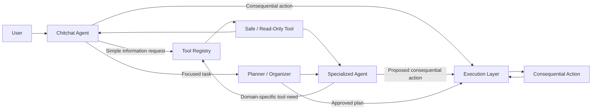
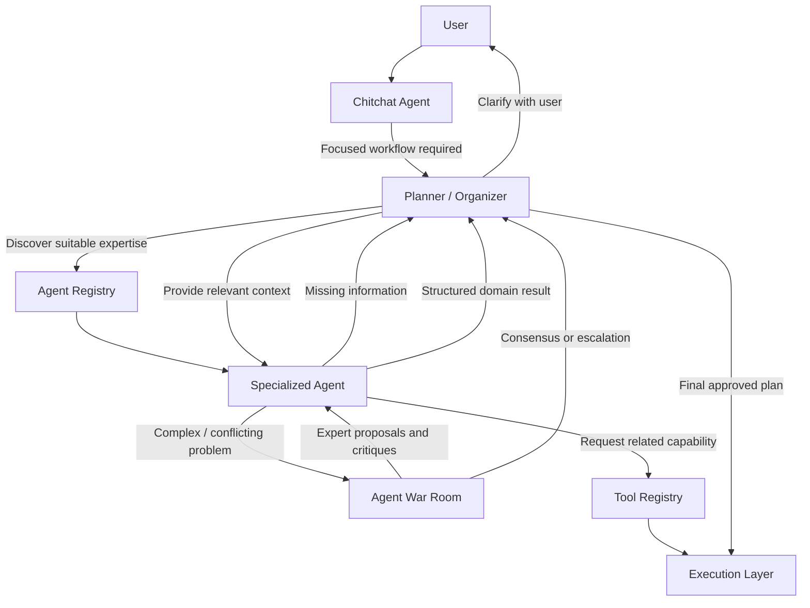

## Specialized Agents

Specialized Agents are domain-focused reasoning components responsible for solving problems within clearly defined areas of expertise.

A Specialized Agent is not a generic mini-assistant.

Each agent should have a clearly bounded:

- Scope
- Domain expertise
- Responsibilities
- Expected inputs
- Expected outputs
- Related tools
- Relevant knowledge sources, where applicable

The purpose of Specialized Agents is to provide deeper domain-specific reasoning while keeping the overall system modular and efficient.

### Responsibilities

#### 1. Domain Expertise

A Specialized Agent owns reasoning and decision-making within a defined domain.

Responsibilities may include:

- Domain-specific analysis.
- Domain-specific planning.
- Recommendations.
- Domain-specific validation.
- Identifying risks and constraints.
- Evaluating possible solutions.
- Producing domain-specific conclusions.

The agent should remain within its defined expertise rather than becoming a general-purpose assistant.

---

#### 2. Domain-Specific Information Requirements

A Specialized Agent should determine what information is required to solve its assigned problem.

It should be able to report:

- Information already available.
- Information that is missing.
- Information that is ambiguous.
- Information that requires clarification.
- Information that is optional but useful.

The agent reports these requirements to the Planner / Organizer.

The Specialized Agent does not directly interrogate the user in the initial architecture.

The Planner / Organizer remains responsible for deciding how and when missing information should be gathered from the user.

---

#### 3. Domain Reasoning

A Specialized Agent processes the relevant context provided by the Planner / Organizer and applies its domain expertise to produce useful results.

The agent should receive only the context relevant to its assigned work where practical.

This reduces unnecessary context and token usage while keeping domain reasoning focused.

The agent may:

- Analyze provided information.
- Compare possible approaches.
- Generate recommendations.
- Identify dependencies.
- Evaluate constraints.
- Propose structured plans.
- Validate domain-specific requirements.

---

#### 4. Structured Results

Specialized Agents should return structured results that can be consumed by the Planner / Organizer.

Potential result information includes:

- Domain.
- Result.
- Recommendations.
- Missing information.
- Clarification requirements.
- Confidence or certainty metadata.
- Proposed actions.
- Risks or constraints.
- Supporting knowledge or sources.
- Tool usage metadata.

The exact output contract will be defined separately.

The agent should not be required to produce user-facing prose when structured information is sufficient.

The Planner / Organizer is responsible for combining and summarizing specialized-agent results when necessary.

---

#### 5. Minimum Necessary Agent Delegation

The Planner / Organizer should use the minimum number of Specialized Agents necessary to solve a problem effectively.

The existence of multiple specialized agents should not automatically result in multiple agent calls.

If a single Specialized Agent has sufficient expertise and access to the required shared tools, that agent should handle the work.

Multiple Specialized Agents should be involved only when:

- A single agent does not have sufficient expertise.
- Independent domain perspectives are valuable.
- The task contains genuinely separate domains.
- A conflict or uncertainty requires independent evaluation.
- A War Room workflow is explicitly beneficial.

Shared tools should reduce unnecessary agent fragmentation.

For example, if one Specialized Agent can solve a complete workflow by using several related shared tools, the system should prefer one agent call rather than unnecessarily delegating each tool-related operation to a separate agent.

The optimization goal is:

> Solve the problem with the minimum necessary agent involvement while maintaining sufficient reasoning quality.

---

#### 6. Multi-Agent Collaboration

Specialized Agents may participate in multi-agent workflows when a problem requires multiple areas of expertise.

The Planner / Organizer coordinates these interactions.

Specialized Agents may:

- Work in parallel.
- Provide independent recommendations.
- Evaluate another agent's output.
- Supply domain-specific information to another agent.
- Contribute to a shared solution.

Agents should not be invoked simply to increase the number of participants.

The Planner / Organizer should determine whether collaboration provides meaningful value.

---

#### 7. Agent War Room Participation

Specialized Agents may participate in an Agent War Room when complex, ambiguous, or conflicting problems require multiple expert perspectives.

A War Room may allow agents to:

- Present independent proposals.
- Challenge assumptions.
- Critique other proposals.
- Identify risks.
- Defend their recommendations.
- Revise their positions.
- Work toward consensus.

Each agent should remain within its defined domain expertise.

The Planner / Organizer coordinates the War Room and determines when:

- Consensus has been reached.
- Further discussion is unnecessary.
- The discussion has exceeded the allowed number of rounds.
- User judgment is required.

If the War Room cannot resolve a disagreement within the configured limit, the Planner / Organizer should escalate the decision to the user.

Specialized Agents do not independently decide when the system should ask the user for final judgment.

---

#### 8. Dynamic Discovery and Auto-Registration

Specialized Agents should be discoverable through the Agent Registry.

Agents should expose metadata describing their capabilities, including where applicable:

- Agent identity.
- Name.
- Version.
- Domain.
- Scope.
- Expertise.
- Supported task types.
- Input requirements.
- Output contract.
- Related tools.
- Related knowledge sources.
- Collaboration capabilities.
- War Room capabilities.
- Availability or lifecycle status.

The Planner / Organizer should be able to discover suitable agents through registry metadata rather than relying on hardcoded agent mappings.

The system should support automatic agent registration where practical.

The architecture should avoid requiring the central orchestration logic to be rewritten whenever a new Specialized Agent is introduced.

---

#### 9. Related Shared Tool Usage

Specialized Agents may use tools relevant to their domain.

Tools should remain shared system capabilities rather than being permanently embedded inside individual agents.

Agents may discover and use shared tools through the Tool Registry when those tools are relevant to their current task.

However, not every tool invocation needs to pass through a long-running Planner / Organizer workflow.

The system should distinguish between:

- Immediate information retrieval.
- Non-consequential read operations.
- Domain-specific analysis support.
- Consequential or state-changing actions.
- Multi-step execution workflows.

For example:

> User: "What's the phone number for the fire department?"

The Chitchat Agent may directly use a web traversal or search tool to retrieve the information and respond to the user.

There is no need to enter Planner mode when:

- The user's intent is sufficiently clear.
- No significant information is missing.
- The operation is read-only or non-consequential.
- No multi-step planning is required.
- No user confirmation is necessary.

Similarly, a Specialized Agent may directly invoke relevant tools during its own reasoning when immediate tool access is required to complete its assigned work.

Examples include:

- Web traversal for current information.
- Map or location services for geographic information.
- Search services for external data.
- Calculator or conversion tools.
- Read-only APIs.
- Other safe, non-destructive capabilities.

These tools may execute immediately as part of the agent's current reasoning flow.

For consequential or state-changing operations, the system should instead route the proposed action through the appropriate validation and execution controls.

Examples include:

- Creating or modifying calendar events.
- Sending messages.
- Sending emails.
- Changing external data.
- Deleting resources.
- Triggering external workflows.
- Performing other irreversible or potentially harmful actions.

The distinction is therefore not:

> "Agents cannot execute tools directly."

The distinction is:

> "Agents may directly use safe, immediate capabilities when appropriate, while consequential actions must pass through controlled execution."

Shared tools should therefore support both direct-use and controlled-execution patterns.

The Tool Registry therefore remains responsible for discovering and describing capabilities, while the calling agent determines when a capability is useful.

The system should avoid unnecessary Planner / Organizer activation for simple requests.

The goal is to preserve the lowest-cost execution path that can safely solve the user's request.

> **Simple request → direct capability use.**
>
> **Complex request → Planner / Organizer.**
>
> **Consequential action → controlled execution.**
>
> **Complex domain problem → Specialized Agent.**
>
> **Conflicting expert opinions → Agent War Room.**

---

#### 10. No Direct User Communication

In the initial architecture, Specialized Agents must not communicate directly with the user.

All user-facing interaction should pass through the Planner / Organizer or the normal conversational flow.

The Specialized Agent reports to the Planner / Organizer:

- Results.
- Recommendations.
- Missing information.
- Clarification requirements.
- Conflicts.
- Risks.
- Proposed actions.

The Planner / Organizer decides:

- Whether to ask the user for additional information.
- How to phrase the question.
- Whether another Specialized Agent should be called.
- Whether the current information is sufficient.
- Whether the workflow should continue.
- Whether the user should make a judgment.

This maintains a single coherent conversational experience.

The user should not feel that the system is switching between multiple independent assistants.

---

#### 11. Future Direct Agent Interaction

Direct user communication from selected Specialized Agents may be considered in a future architecture phase.

This is intentionally deferred until:

- The core agent architecture is stable.
- Agent coordination is reliable.
- Context boundaries are well defined.
- User experience requirements justify direct interaction.

Any future direct interaction should be explicitly scoped to appropriate agents and workflows.

It should not become the default behavior of the system.

---

### Responsibility Boundary

The responsibility of each major component is separated as follows:

### Responsibility Summary

| Component | Primary Responsibility |
|---|---|
| Chitchat Agent | Normal conversation and lightweight conversational routing |
| AI Orchestrator | Thin coordination of major system flows |
| Planner / Organizer | Interrogation, clarification, delegation, coordination, and planning |
| Agent Registry | Discovery and lifecycle management of Specialized Agents |
| Specialized Agent | Domain-specific reasoning, analysis, planning, and validation |
| Agent War Room | Structured multi-agent debate and conflict resolution |
| Tool Registry | Discovery and metadata management of available tools |
| Execution Layer | Controlled execution of approved actions |
| Memory | Persistence and retrieval of relevant system and user context |

### Architectural Principles

- Specialized Agents must have clearly defined domain boundaries.
- Specialized Agents should expose explicit capabilities through metadata.
- Specialized Agents should be dynamically discoverable.
- Specialized Agents should be auto-registerable where practical.
- The Planner / Organizer should invoke the minimum number of agents necessary.
- Shared tools should be reused across agents rather than duplicated inside agents.
- Specialized Agents should return structured information whenever practical.
- Specialized Agents should not directly communicate with users in the initial architecture.
- Specialized Agents should not bypass validation or controlled execution.
- Specialized Agents should not own global conversation flow.
- Specialized Agents should not become hidden general-purpose assistants.
- Specialized Agents should participate in Agent War Rooms only when multiple expert perspectives provide meaningful value.
