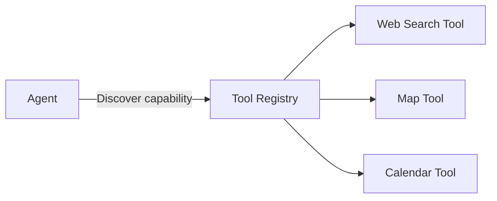
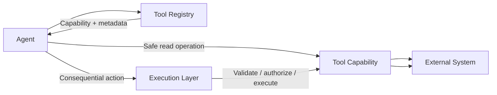
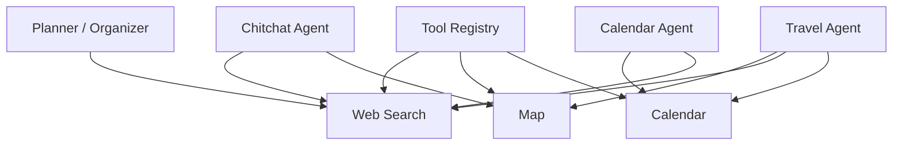
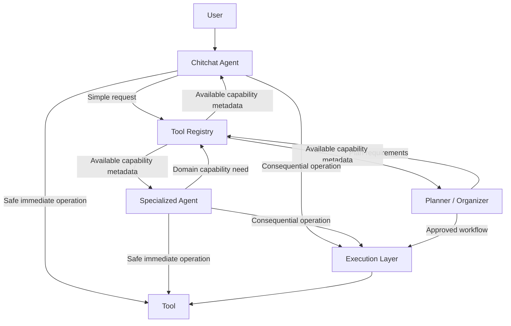

## Tool Registry

The Tool Registry is the central capability discovery system for Purrfect.

It maintains metadata describing available tools and provides a standardized mechanism for agents and other system components to discover capabilities without hardcoding tool implementations into the AI orchestration layer.

The Tool Registry does not own domain-specific reasoning.

The Tool Registry does not decide which tool should be used for a user's request.

The Tool Registry does not replace the Execution Layer.

Its primary responsibility is to answer:

> "What capabilities are available, what can they do, and how can the system use them?"

---

### Responsibilities

#### 1. Tool Discovery

The Tool Registry maintains a catalog of available tools.

Agents and system components should be able to discover tools dynamically based on their capabilities rather than relying on hardcoded tool mappings.

Potential discovery metadata includes:

- Tool name.
- Tool identity.
- Version.
- Description.
- Capability.
- Supported operations.
- Input schema.
- Output schema.
- Required parameters.
- Optional parameters.
- Related domains.
- Availability status.
- Execution requirements.
- Risk classification.
- Permission requirements.

Example:



The registry should expose enough metadata for an agent to determine whether a tool is relevant to its current problem.

---

#### 2. Tool Metadata

Every registered tool should provide standardized metadata.

The metadata should describe the capability without requiring the agent to inspect the implementation itself.

Potential metadata structure:

```text
Tool
├── identity
├── name
├── version
├── description
├── capabilities
├── operations
├── input_schema
├── output_schema
├── execution_mode
├── risk_level
├── permissions
├── availability
└── lifecycle_status
```

The exact schema will be defined during implementation.

The metadata should be optimized for machine discovery while remaining understandable to developers and operators.

---

#### 3. Dynamic Registration

Tools should be dynamically registerable where practical.

Adding a new tool should ideally require:

1. Implementing the tool.
2. Defining its metadata.
3. Registering the tool.
4. Making the capability available to the system.

The central AI orchestration logic should not require modification every time a new tool is introduced.

This allows Purrfect to grow its capabilities without turning the AI Orchestrator into a hardcoded tool dispatcher.

---

#### 4. Auto-Registration

The Tool Registry should support automatic tool registration where practical.

Tools may be discovered from configured locations, packages, plugins, or other supported sources.

Auto-registration should validate the tool metadata before making the capability available to the system.

Potential validation may include:

- Required metadata exists.
- Tool identity is valid.
- Tool version is valid.
- Input schema is valid.
- Output schema is valid.
- Capability definitions are valid.
- No conflicting tool identity exists.
- Tool implementation can be loaded successfully.

A tool that fails registration validation should not become an active system capability.

---

#### 5. Capability Discovery

The Tool Registry should support capability-oriented discovery rather than requiring agents to know exact tool names.

For example, an agent should be able to request capabilities conceptually equivalent to:

```text
Need:
- current web information
- geographic lookup
- calendar event creation
```

The registry can then provide matching available tools.

This allows agents to reason about capabilities rather than implementation-specific tool names.

The exact discovery mechanism may use metadata filtering, semantic matching, embeddings, or a combination of approaches.

The Tool Registry should therefore act as the capability index for the system.

---

#### 6. Tool Selection Support

The Tool Registry may assist agents in discovering suitable tools, but it should not own the final reasoning decision about which tool to use.

The responsibility boundary is:

- **Tool Registry** → Describes available capabilities.
- **Agent** → Determines which capability is relevant.
- **Planner / Organizer** → Coordinates tool requirements when planning a larger workflow.
- **Execution Layer** → Controls consequential execution.

For simple requests, a Chitchat Agent may discover and use a safe tool directly.

For example:

> "What's the phone number for the fire department?"

The Chitchat Agent may:

1. Identify that current external information is required.
2. Discover a web search capability.
3. Invoke the safe retrieval operation.
4. Receive the result.
5. Respond to the user.

Planner mode is unnecessary because the request is simple, clear, and non-consequential.

---

#### 7. Direct Tool Usage

The Tool Registry should support tools that can be used immediately by agents.

Examples include:

- Web traversal.
- Web search.
- Map lookup.
- Geolocation lookup.
- Calculator.
- Unit conversion.
- Read-only APIs.
- Public information retrieval.

These tools may execute directly as part of an agent's current reasoning flow when:

- The request is clear.
- The operation is safe.
- The operation is read-only or non-consequential.
- No user confirmation is required.

The registry should not force every tool invocation through the Planner / Organizer.

The system should prefer the simplest safe execution path.

---

#### 8. Controlled Execution Integration

The Tool Registry should also describe tools that require controlled execution.

A tool's metadata should indicate whether an operation is:

- Read-only.
- Non-consequential.
- State-changing.
- Destructive.
- Irreversible.
- Confirmation-required.

The Tool Registry provides this metadata.

The Execution Layer is responsible for enforcing the associated execution policy.

For example:



The Tool Registry must not become an authorization bypass.

A tool being discoverable does not automatically mean that every agent may execute every operation it exposes.

---

#### 9. Tool Operation-Level Metadata

A single tool may expose multiple operations with different risk levels.

For example, a Calendar tool might provide:

```text
Calendar Tool

Operations:
- list_events
  risk: read_only
  confirmation: not_required

- find_available_time
  risk: read_only
  confirmation: not_required

- create_event
  risk: state_change
  confirmation: required

- update_event
  risk: state_change
  confirmation: required

- delete_event
  risk: destructive
  confirmation: required
```

The Tool Registry should therefore support metadata at both:

- Tool level.
- Operation level.

This allows agents to safely use read-only operations without unnecessarily triggering confirmation workflows while still protecting consequential actions.

---

#### 10. Shared Capability Model

Tools should be reusable across multiple agents.

A tool should not be permanently owned by a single Specialized Agent unless there is a strong architectural reason to do so.

For example:



This shared capability model reduces duplicated integrations and allows multiple agents to benefit from the same underlying system capabilities.

---

#### 11. Tool Lifecycle Management

The Tool Registry should manage the lifecycle state of registered tools.

Potential lifecycle states include:

- Registered.
- Available.
- Disabled.
- Unavailable.
- Deprecated.
- Failed validation.
- Removed.

The registry should allow the system to determine whether a capability is currently usable.

A tool may remain registered while temporarily unavailable.

Agents should receive availability information when selecting capabilities.

---

#### 12. Tool Versioning

Tools should support versioning where compatibility may change.

Version metadata should allow the system to distinguish between incompatible tool contracts or operation schemas.

Future versions may support:

- Tool version negotiation.
- Backward compatibility.
- Deprecation policies.
- Migration paths.

The initial implementation should avoid unnecessary complexity unless versioning becomes necessary.

---

#### 13. Tool Observability

The Tool Registry should provide metadata that helps the system understand tool usage.

Useful metadata may include:

- Tool identity.
- Operation.
- Version.
- Invocation source.
- Execution mode.
- Success or failure.
- Latency.
- Error category.

The registry itself does not need to own execution tracing.

Execution traces should be owned by the appropriate observability or execution-tracing system.

The registry should expose enough identity metadata for those systems to record which capability was used.

---

#### Responsibility Boundary

The Tool Registry should remain focused on capability discovery and metadata.



The responsibility boundaries are:

| Component | Responsibility |
|---|---|
| Tool Registry | Discover, describe, register, validate, and expose tool capabilities |
| Chitchat Agent | Use simple capabilities directly when appropriate |
| Planner / Organizer | Coordinate tool requirements for focused workflows |
| Specialized Agent | Use tools relevant to its domain expertise |
| Execution Layer | Validate and control consequential tool execution |
| Tool | Perform the actual capability operation |
| Observability / Tracing | Record tool usage and execution metadata |

---

### Architectural Principles

- Tools are first-class system capabilities.
- Tools should be dynamically discoverable.
- Tools should expose standardized metadata.
- Tools should be auto-registerable where practical.
- Tool metadata should describe both capability and execution requirements.
- Tool selection should be capability-oriented rather than hardcoded.
- Agents may directly use safe, immediate tools when appropriate.
- Consequential operations must pass through controlled execution.
- Tool registration must not imply unrestricted execution authority.
- Tool implementations should remain independent from the AI Orchestrator.
- Tools should be reusable across multiple agents.
- Tool lifecycle and availability should be observable.
- Tool Registry should not become a hidden execution engine.
- Tool Registry should not own domain-specific reasoning.
- Tool Registry should not become a monolithic router for every system decision.

### Done When

- [ ] Tools can be registered through a standardized contract.
- [ ] Tool metadata can be discovered by agents.
- [ ] Tool capabilities can be searched or filtered.
- [ ] Tool operations expose structured input and output schemas.
- [ ] Tool risk and execution requirements are represented in metadata.
- [ ] Safe read-only tools can be used directly by appropriate agents.
- [ ] Consequential tools integrate with the Execution Layer.
- [ ] Tool registration does not require modifying the AI Orchestrator.
- [ ] Tool lifecycle and availability can be determined programmatically.
- [ ] Tool identity and operation metadata can be included in execution traces.