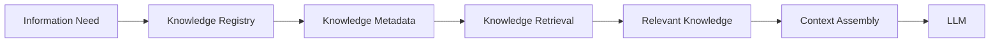
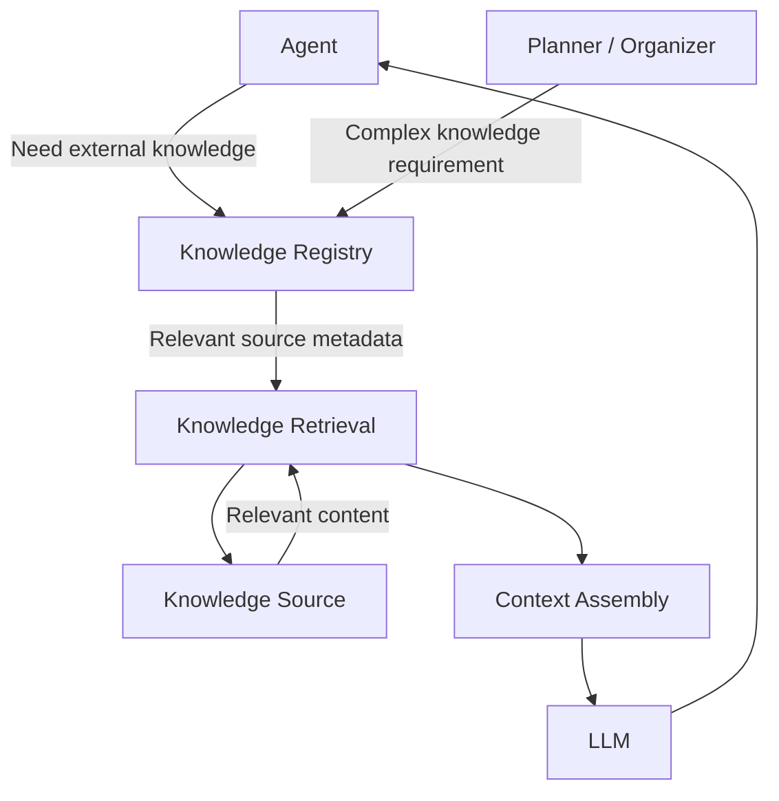
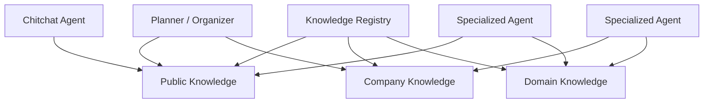
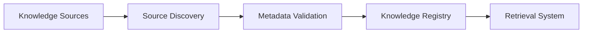

# Knowledge Registry

## Purpose

The Knowledge Registry is the central discovery and metadata system for Purrfect's external knowledge sources.

It maintains structured metadata describing available knowledge sources and allows agents and system components to discover relevant knowledge without loading entire knowledge bases into the LLM context.

The Knowledge Registry treats knowledge as a first-class system capability, similar to how the Tool Registry treats tools as first-class capabilities.

The registry should answer:

> "What knowledge is available, where does it come from, what does it cover, and how can the system find the relevant information?"

The Knowledge Registry does not own the entire RAG pipeline.

It does not directly decide what the user should be told.

It does not replace Knowledge Retrieval or Context Assembly.

---

## Responsibilities

### 1. Knowledge Source Discovery

The Knowledge Registry maintains a catalog of available knowledge sources.

Knowledge sources may include:

- Documents.
- Document collections.
- Internal knowledge bases.
- External knowledge repositories.
- Structured datasets.
- API-backed knowledge.
- Application-specific reference data.
- User-provided knowledge.
- Domain-specific knowledge packages.

The registry should allow agents and system components to discover knowledge sources based on metadata rather than requiring them to know the exact storage location or implementation.

For example, an agent may need:

```text
Knowledge needed:
- Thai emergency services
- Current public contact information
- Location-specific information
```

The registry may identify relevant knowledge sources without requiring the agent to inspect every available document or database.

---

### 2. Knowledge Metadata

Every registered knowledge source should expose standardized metadata.

Potential metadata includes:

- Knowledge source identity.
- Name.
- Version.
- Description.
- Domain.
- Topics.
- Tags.
- Language.
- Geographic scope.
- Temporal scope.
- Source type.
- Source location.
- Update frequency.
- Freshness information.
- Access requirements.
- Retrieval capabilities.
- Availability status.
- Lifecycle status.

Example:

```text
Knowledge Source
├── identity
├── name
├── version
├── description
├── domain
├── topics
├── tags
├── language
├── geographic_scope
├── temporal_scope
├── source_type
├── freshness
├── retrieval_capabilities
├── access_requirements
├── availability
└── lifecycle_status
```

The exact metadata schema will be defined during implementation.

Metadata should be optimized for machine discovery while remaining understandable to developers and operators.

---

### 3. Metadata-First Knowledge Discovery

Purrfect should prefer metadata-first discovery before retrieving large amounts of knowledge.

The system should avoid sending an entire knowledge base to the LLM simply because the system needs to answer one question.

Instead, the expected flow is:

1. Identify the information need.
2. Search available knowledge source metadata.
3. Select relevant knowledge sources.
4. Retrieve only relevant content.
5. Assemble the required context.
6. Provide the selected context to the LLM.

This follows the same architectural principle as the Tool Registry.

Tools expose metadata describing available capabilities.

Knowledge sources expose metadata describing available information.

The system uses metadata to determine what should be retrieved.



The goal is to reduce:

- Unnecessary token usage.
- Retrieval latency.
- Irrelevant context.
- Context window pressure.

The goal is also to improve:

- Retrieval precision.
- Traceability.
- Source attribution.
- System observability.

---

### 4. Knowledge Source Registration

Knowledge sources should be registered through a standardized contract.

A registration process should define:

- Knowledge source identity.
- Metadata.
- Source type.
- Retrieval interface.
- Availability.
- Ownership or origin where applicable.
- Version information.

The central AI orchestration logic should not require modification when a new knowledge source is introduced.

Adding a new knowledge source should ideally involve:

1. Preparing or connecting the knowledge source.
2. Defining its metadata.
3. Registering the source.
4. Making it discoverable.
5. Making its retrieval interface available.

---

### 5. Auto-Registration

The Knowledge Registry should support automatic registration where practical.

Knowledge sources may be discovered from:

- Configured directories.
- Document repositories.
- Plugin packages.
- External knowledge systems.
- Application modules.
- Other supported providers.

Auto-registration should validate the source metadata before making it available.

Potential validation may include:

- Required metadata exists.
- Source identity is valid.
- Version is valid.
- Source type is supported.
- Retrieval interface is valid.
- Metadata schema is valid.
- Source is accessible.
- No conflicting identity exists.

A source that fails registration validation should not become an active knowledge capability.

---

### 6. Knowledge Source Lifecycle

The registry should manage the lifecycle state of knowledge sources.

Potential states include:

- Registered.
- Available.
- Updating.
- Unavailable.
- Disabled.
- Deprecated.
- Failed validation.
- Removed.

A knowledge source may remain registered while temporarily unavailable.

Agents and retrieval systems should be able to determine whether a source is currently usable.

The registry should not silently expose unavailable sources as active retrieval targets.

---

### 7. Knowledge Versioning and Freshness

Knowledge may change over time.

The registry should expose metadata that allows the system to understand the freshness and version of available information.

Potential metadata includes:

- Source version.
- Last updated timestamp.
- Last indexed timestamp.
- Expected update frequency.
- Freshness status.
- Validity period.

This allows the system to distinguish between:

- Stable reference knowledge.
- Frequently changing information.
- Potentially stale information.
- Time-sensitive information.

The registry does not necessarily own the indexing process.

It provides the metadata required for other components to make informed retrieval decisions.

---

### 8. Knowledge Scope and Boundaries

Knowledge sources should have clearly defined scopes.

A source may describe:

- What domain it covers.
- What topics it contains.
- What geographic area it applies to.
- What time period it represents.
- What languages it supports.
- What type of questions it can answer.

This allows the retrieval system to avoid selecting knowledge sources that are technically available but irrelevant.

For example:

```text
Source A
Domain: Software Engineering
Topics: Python, FastAPI, PostgreSQL

Source B
Domain: Travel
Topics: Thailand, Bangkok, Hotels

Source C
Domain: Company Internal Policies
Topics: Leave, Benefits, Security
Access: Internal Only
```

An agent asking about Bangkok hotels should not need to inspect the contents of the software engineering knowledge source.

---

### 9. Knowledge Access and Permissions

Knowledge availability does not automatically mean that every agent or request may access it.

The registry may expose access metadata such as:

- Public.
- Internal.
- User-specific.
- Role-restricted.
- Agent-restricted.
- Authentication-required.

The registry describes access requirements.

The appropriate authorization and security layers remain responsible for enforcing access control.

The Knowledge Registry must not become an authorization bypass.

---

### 10. Retrieval Integration

The Knowledge Registry should integrate with the Knowledge Retrieval system without becoming the retrieval engine itself.

The responsibility boundary is:

- **Knowledge Registry** → Describes and exposes available knowledge sources.
- **Knowledge Retrieval** → Finds relevant knowledge.
- **Context Assembly** → Selects and structures retrieved content for model consumption.
- **LLM / Agent** → Reasons over the provided knowledge.
- **Planner / Organizer** → Coordinates knowledge requirements for complex workflows.

Example:



The registry should not be responsible for ranking every retrieved chunk or assembling the final LLM prompt.

Those responsibilities belong to the retrieval and context systems.

---

### 11. Support for Multiple Retrieval Strategies

The Knowledge Registry should not assume that every knowledge source uses the same retrieval technology.

Different sources may use:

- Vector search.
- Keyword search.
- Metadata filtering.
- SQL queries.
- Graph queries.
- API calls.
- Hybrid retrieval.
- Structured lookup.
- External search providers.

The registry should describe the retrieval capabilities supported by each knowledge source.

For example:

```text
Knowledge Source: Company Policies

Retrieval Capabilities:
- semantic_search
- keyword_search
- metadata_filtering

Knowledge Source: Employee Database

Retrieval Capabilities:
- structured_query

Knowledge Source: Public Web

Retrieval Capabilities:
- web_search
- web_traversal
```

This allows the retrieval system to select an appropriate retrieval strategy without forcing every knowledge source into a single storage model.

---

### 12. Shared Knowledge Access

Knowledge sources should be reusable across multiple agents.

A knowledge source should not be permanently owned by a single Specialized Agent unless there is a strong architectural reason to do so.

For example:



This allows different agents to use shared knowledge infrastructure while maintaining domain-specific reasoning boundaries.

---

### 13. Knowledge Traceability

Knowledge retrieval should be traceable.

The system should be able to determine:

- Which knowledge source was selected.
- Which version was used.
- Which retrieval strategy was used.
- Which documents or records were retrieved.
- Which chunks or items contributed to the response.
- When the knowledge was retrieved.
- What metadata influenced source selection.

The Knowledge Registry should provide stable source identity and metadata that allow retrieval and response traces to reference the original source.

The registry itself does not own the full retrieval trace.

Execution or observability systems should record the actual retrieval event.

---

### 14. Knowledge Source Auto-Discovery

The Knowledge Registry may eventually support automatic discovery of new knowledge sources.

For example:



This could allow Purrfect to discover new knowledge capabilities without modifying the central AI orchestration logic.

Automatic discovery should remain controlled.

The system should not blindly index or expose every discovered source.

Registration should respect:

- Security.
- Access control.
- Metadata validity.
- Source ownership.
- Lifecycle policies.
- Resource constraints.

---

## Responsibility Boundary

The Knowledge Registry should remain focused on knowledge source discovery and metadata.

| Component | Responsibility |
|---|---|
| Knowledge Registry | Discover, register, describe, validate, and expose knowledge sources |
| Knowledge Retrieval | Retrieve relevant knowledge from available sources |
| Context Assembly | Select and structure retrieved information for model context |
| Chitchat Agent | Use simple knowledge retrieval when appropriate |
| Planner / Organizer | Coordinate knowledge requirements for focused workflows |
| Specialized Agent | Apply domain expertise to retrieved knowledge |
| Agent Registry | Discover and manage Specialized Agents |
| Execution Layer | Control consequential external actions |
| Observability / Tracing | Record retrieval and knowledge usage metadata |

The Knowledge Registry should not:

- Own domain-specific reasoning.
- Replace Knowledge Retrieval.
- Replace Context Assembly.
- Own the LLM.
- Decide the final answer.
- Become a monolithic RAG engine.
- Bypass access control.
- Automatically expose every discovered knowledge source.

---

## Architectural Principles

- Knowledge is a first-class system capability.
- Knowledge sources should be dynamically discoverable.
- Knowledge sources should expose standardized metadata.
- Knowledge sources should be auto-registerable where practical.
- Metadata should be used before retrieving large amounts of content.
- The system should retrieve only relevant knowledge where practical.
- Knowledge retrieval should be separated from conversational memory.
- Knowledge sources should be reusable across multiple agents.
- Different knowledge sources may use different retrieval strategies.
- Knowledge source identity and version should be traceable.
- Knowledge availability should be observable.
- Knowledge access must respect authorization and security requirements.
- The Knowledge Registry should not become a hidden monolithic RAG system.
- The Knowledge Registry should describe knowledge capabilities rather than own domain reasoning.

---

## Done When

- [ ] Knowledge sources can be registered through a standardized contract.
- [ ] Knowledge metadata can be discovered programmatically.
- [ ] Knowledge sources can be searched or filtered through metadata.
- [ ] Knowledge source scope and domain are explicitly represented.
- [ ] Knowledge source availability and lifecycle can be determined.
- [ ] Knowledge source version and freshness metadata are available.
- [ ] Knowledge retrieval can select sources using registry metadata.
- [ ] Multiple retrieval strategies can be represented.
- [ ] Knowledge sources can be shared across multiple agents.
- [ ] Knowledge retrieval is traceable to a specific source and version.
- [ ] Knowledge access requirements are represented and enforced by appropriate security layers.
- [ ] New knowledge sources can be introduced without modifying the AI Orchestrator.