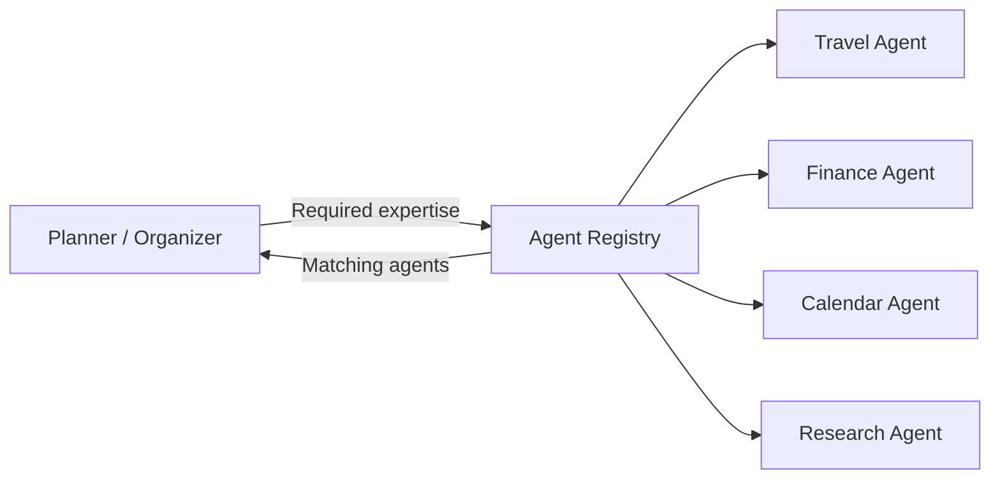
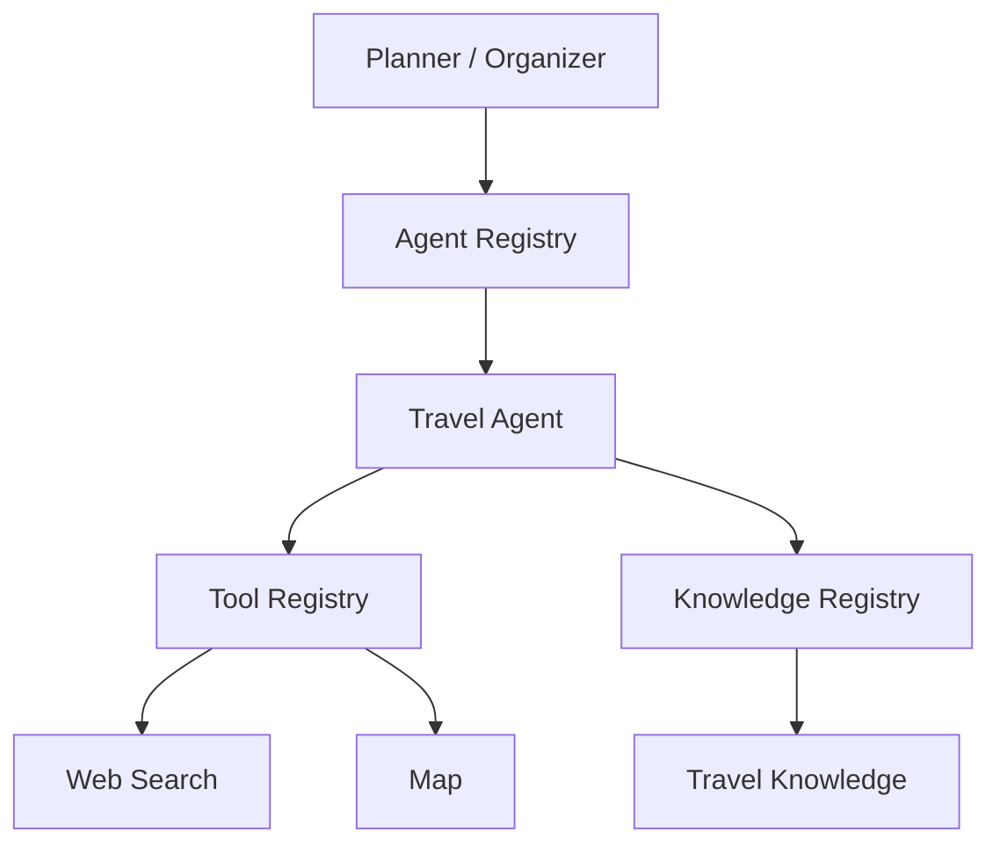
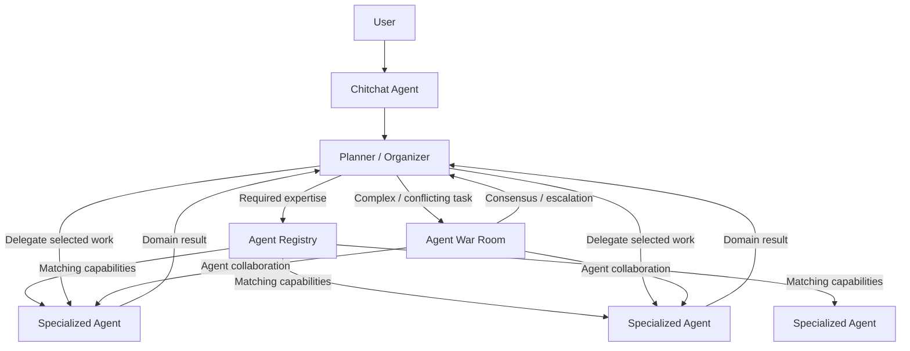

# Agent Registry

## Purpose

The Agent Registry is the central discovery and metadata system for Purrfect's Specialized Agents.

It maintains structured metadata describing available agents and allows the Planner / Organizer and other system components to discover suitable domain expertise dynamically.

The Agent Registry treats Specialized Agents as first-class system capabilities, similar to how the Tool Registry treats tools and the Knowledge Registry treats knowledge sources.

The registry should answer:

> "What specialized agents are available, what expertise do they provide, what can they handle, and what do they need to do their work?"

The Agent Registry does not own agent reasoning.

It does not own task planning.

It does not decide the final workflow.

It does not replace the Planner / Organizer.

Its primary responsibility is to make Specialized Agents discoverable, describable, and manageable.

---

## Responsibilities

### 1. Agent Discovery

The Agent Registry maintains a catalog of available Specialized Agents.

The Planner / Organizer should be able to discover agents based on their capabilities and expertise rather than relying on hardcoded agent mappings.

For example, the Planner / Organizer may determine that a task requires:

```text
Required expertise:
- Travel planning
- Geographic reasoning
- Hotel selection
- Local transportation
```

The Agent Registry should be able to identify agents whose registered capabilities match those requirements.



The registry should expose enough metadata for the Planner / Organizer to determine which agents are potentially relevant.

The registry should not make the final delegation decision.

---

### 2. Agent Metadata

Every registered Specialized Agent should expose standardized metadata.

Potential metadata includes:

- Agent identity.
- Agent name.
- Version.
- Description.
- Domain.
- Scope.
- Expertise.
- Supported task types.
- Supported input types.
- Expected input schema.
- Expected output schema.
- Required information.
- Optional information.
- Related tools.
- Related knowledge sources.
- Supported collaboration modes.
- War Room participation capabilities.
- Availability status.
- Lifecycle status.

Example:

```text
Specialized Agent
├── identity
├── name
├── version
├── description
├── domain
├── scope
├── expertise
├── supported_tasks
├── input_schema
├── output_schema
├── required_information
├── optional_information
├── related_tools
├── related_knowledge
├── collaboration_capabilities
├── war_room_capabilities
├── availability
└── lifecycle_status
```

The exact metadata contract will be defined during implementation.

Metadata should be machine-readable while remaining understandable to developers and operators.

---

### 3. Explicit Scope Definition

Every Specialized Agent should have a clearly defined scope.

The Agent Registry should expose enough information to prevent agents from becoming generic, overlapping "do everything" assistants.

Agent metadata should clarify:

- What the agent is responsible for.
- What the agent is good at.
- What the agent is not designed to handle.
- Which domains it covers.
- Which task types it supports.
- Which capabilities it depends on.

For example:

```text
Agent: Travel Planner

Scope:
- Travel planning
- Destination research
- Itinerary design
- Transportation planning

Expertise:
- Trip structure
- Geographic planning
- Travel logistics

Not responsible for:
- Financial investment advice
- Medical advice
- General software engineering
```

Clear scope allows the Planner / Organizer to make better delegation decisions.

---

### 4. Capability Discovery

The registry should support capability-oriented agent discovery.

The Planner / Organizer should not need to know the exact agent name before delegation.

For example:

```text
Need:
- Plan a family trip.
- Compare destinations.
- Build an itinerary.
```

The registry may return:

```text
Potential Agents:

Travel Planner
Confidence: High
Capabilities:
- Destination planning
- Itinerary generation
- Travel logistics

Research Agent
Confidence: Medium
Capabilities:
- General information research
- Source comparison
```

The Planner / Organizer remains responsible for deciding which agent or combination of agents should actually be used.

The registry provides discovery information rather than replacing reasoning.

---

### 5. Agent Input Requirements

Agents should declare what information they require to perform their work.

Metadata may describe:

- Required information.
- Optional information.
- Preferred context.
- Input format.
- Minimum information needed to begin reasoning.

For example:

```text
Agent: Travel Planner

Required:
- Destination or travel objective.
- Approximate travel dates.

Optional:
- Budget.
- Number of travelers.
- Preferred transportation.
- Accommodation preferences.
```

This information allows the Planner / Organizer to determine whether:

- The agent can begin immediately.
- Additional interrogation is required.
- Another agent should be called first.
- The user needs to provide clarification.

The Agent Registry exposes these requirements.

The Planner / Organizer decides how they should be handled.

---

### 6. Agent Output Contract

Registered agents should expose their expected output structure.

Potential output categories include:

- Domain analysis.
- Recommendations.
- Proposed plan.
- Missing information.
- Clarification requirements.
- Risks.
- Constraints.
- Confidence metadata.
- Tool requirements.
- Knowledge requirements.
- Execution proposals.

The exact output contract should be standardized where practical.

The Planner / Organizer should be able to consume agent results consistently without requiring every agent to return a completely different format.

---

### 7. Dynamic Registration

Specialized Agents should be dynamically registerable.

Adding a new agent should ideally require:

1. Implementing the agent.
2. Defining its metadata.
3. Registering the agent.
4. Making the agent available to the system.

The central AI orchestration logic should not require modification whenever a new Specialized Agent is introduced.

This allows Purrfect to expand its domain expertise without turning the AI Orchestrator or Planner / Organizer into a hardcoded agent dispatcher.

---

### 8. Auto-Registration

The Agent Registry should support automatic agent registration where practical.

Agents may be discovered from:

- Configured directories.
- Packages.
- Plugins.
- Modules.
- External agent providers.
- Other supported discovery mechanisms.

Auto-registration should validate agent metadata before making the agent available.

Potential validation may include:

- Required metadata exists.
- Agent identity is valid.
- Version is valid.
- Scope is defined.
- Input schema is valid.
- Output schema is valid.
- Declared dependencies are valid.
- Agent implementation can be loaded.
- No conflicting agent identity exists.

An agent that fails registration validation should not become an active system capability.

---

### 9. Agent Selection Support

The Agent Registry may assist the Planner / Organizer in identifying suitable agents, but it should not own final agent selection.

The responsibility boundary is:

- **Agent Registry** → Describes available agents.
- **Planner / Organizer** → Determines which agents should be involved.
- **Specialized Agent** → Performs domain-specific reasoning.
- **Agent War Room** → Coordinates multi-agent debate when necessary.
- **AI Orchestrator** → Coordinates major system-level flows.

The Planner / Organizer should prefer the minimum number of agents necessary to solve the problem.

The existence of multiple matching agents does not mean all of them should be called.

---

### 10. Minimum Necessary Agent Invocation

The Agent Registry should provide enough metadata to support efficient agent selection.

Purrfect should avoid unnecessary agent invocation because each agent call may introduce:

- Additional token usage.
- Additional latency.
- Additional context assembly.
- Additional complexity.
- Additional opportunities for conflicting outputs.

If one agent can solve the task using its own expertise and shared tools, the Planner / Organizer should prefer that agent.

Multiple agents should be involved only when there is meaningful value in doing so.

For example:

```text
Task:
"Plan a 5-day family trip to Bangkok."

Possible agents:
- Travel Agent
- Food Agent
- Transportation Agent
- Budget Agent

Preferred initial approach:

Travel Agent
    ├── Shared Map Tool
    ├── Shared Web Search
    └── Shared Knowledge

Only delegate further when:
- The Travel Agent lacks required expertise.
- A separate domain requires deeper reasoning.
- Independent evaluation is valuable.
- A conflict requires multiple expert perspectives.
```

The Agent Registry supports this decision by exposing agent capabilities and boundaries.

The Planner / Organizer remains responsible for minimizing agent usage.

---

### 11. Agent Dependencies

Agents may declare dependencies on shared system capabilities.

Potential dependencies include:

- Tools.
- Knowledge sources.
- Other agents.
- External services.

Dependencies should be represented as metadata where practical.

For example:

```text
Agent: Travel Planner

Related Tools:
- Web Search
- Map
- Calendar

Related Knowledge:
- Travel Knowledge
- Destination Knowledge

Optional Agent Dependencies:
- Budget Agent
```

The registry should expose dependency information so the Planner / Organizer can understand whether an agent is capable of handling a task.

The registry should not automatically invoke all declared dependencies.

Dependency metadata describes potential requirements.

---

### 12. Shared Tools and Knowledge

Specialized Agents should reuse shared system capabilities.

The Agent Registry should allow agents to declare related tools and knowledge sources without permanently embedding those capabilities into the agent.

For example:



This keeps:

- Agent expertise.
- Tool capabilities.
- Knowledge sources.

as separate architectural concerns.

An agent should not duplicate a shared tool or knowledge source simply because it uses it frequently.

---

### 13. Agent Collaboration Metadata

Agents should be able to declare whether they support collaborative workflows.

Potential collaboration metadata includes:

- Can participate in parallel work.
- Can critique another agent's result.
- Can review proposed plans.
- Can provide independent recommendations.
- Can participate in Agent War Room.
- Can act as a domain reviewer.
- Can resolve specific conflict types.

This metadata helps the Planner / Organizer determine whether an agent is suitable for a multi-agent workflow.

---

### 14. Agent War Room Capability

The Agent Registry should expose whether an agent can participate in an Agent War Room.

For example:

```text
Agent: Software Architecture Agent

War Room:
- Supported: Yes
- Role: Architecture Reviewer
- Can propose solutions: Yes
- Can critique proposals: Yes
- Can evaluate trade-offs: Yes
```

Another agent may be registered as:

```text
Agent: Cost Optimization Agent

War Room:
- Supported: Yes
- Role: Cost Reviewer
- Can propose solutions: Yes
- Can critique proposals: Yes
- Can evaluate cost impact: Yes
```

The Planner / Organizer can then construct a War Room using agents whose expertise is relevant to the problem.

The Agent Registry does not run the War Room.

It only provides the metadata required to discover suitable participants.

---

### 15. Agent Lifecycle Management

The registry should manage the lifecycle state of registered agents.

Potential states include:

- Registered.
- Available.
- Busy.
- Unavailable.
- Disabled.
- Deprecated.
- Failed validation.
- Removed.

The exact lifecycle model may evolve as Purrfect introduces persistent or remote agents.

The registry should allow the system to determine whether an agent is currently usable.

---

### 16. Agent Versioning

Agents should support version metadata.

Versioning may become important when:

- Input contracts change.
- Output contracts change.
- Agent expertise changes.
- Dependencies change.
- Behavior changes significantly.

Future versions may support:

- Agent version compatibility.
- Contract version negotiation.
- Deprecation policies.
- Migration paths.

The initial implementation should avoid unnecessary versioning complexity unless required.

---

### 17. Agent Health and Availability

The Agent Registry should expose whether a registered agent is currently available.

Potential availability information includes:

- Enabled / disabled.
- Loaded / unloaded.
- Healthy / unhealthy.
- Available dependencies.
- Model availability.
- Knowledge availability.
- Tool availability.

This allows the Planner / Organizer to avoid selecting an agent that cannot currently operate.

The registry should not silently treat an unavailable agent as usable.

---

### 18. Agent Observability

The Agent Registry should provide stable identity metadata that allows agent activity to be traced.

Useful trace metadata may include:

- Agent identity.
- Agent version.
- Invocation source.
- Parent workflow.
- Task identifier.
- Collaboration context.
- War Room identifier.

The registry does not own execution tracing.

The execution and observability systems should record actual agent invocation events.

The registry provides the stable identity needed to make those traces meaningful.

---

### 19. No Direct User Communication by Default

Agent registration should not automatically grant an agent the ability to communicate directly with the user.

In the initial architecture, Specialized Agents remain internal reasoning components.

Their results should return through the Planner / Organizer or appropriate conversational flow.

The registry may eventually support metadata for agents that are explicitly authorized for direct user interaction, but this should be a future capability rather than the default.

Potential future metadata:

```text
direct_user_interaction:
    supported: false
    enabled: false
```

This keeps the initial architecture centered around a single coherent conversational experience.

---

## Responsibility Boundary

The Agent Registry should remain focused on agent discovery and lifecycle metadata.



The responsibility boundaries are:

| Component | Responsibility |
|---|---|
| Agent Registry | Discover, register, describe, validate, and manage Specialized Agents |
| Planner / Organizer | Select and coordinate agents for the current task |
| Specialized Agent | Perform domain-specific reasoning |
| Agent War Room | Coordinate structured multi-agent debate |
| Tool Registry | Provide shared tool capability discovery |
| Knowledge Registry | Provide shared knowledge source discovery |
| AI Orchestrator | Coordinate major system-level flows |

The Agent Registry should not:

- Own domain-specific reasoning.
- Decide the final task plan.
- Automatically invoke every matching agent.
- Replace the Planner / Organizer.
- Run Agent War Rooms.
- Own tool execution.
- Own knowledge retrieval.
- Become a hidden multi-agent orchestrator.

---

## Architectural Principles

- Specialized Agents are first-class system capabilities.
- Agents should be dynamically discoverable.
- Agents should expose standardized metadata.
- Agents should have explicit scope and expertise boundaries.
- Agents should declare input and output contracts.
- Agents should be auto-registerable where practical.
- Agent discovery should be capability-oriented.
- The Planner / Organizer remains responsible for final agent selection.
- The minimum necessary number of agents should be invoked.
- Shared tools should remain separate from agent implementations.
- Shared knowledge should remain separate from agent implementations.
- Agent collaboration capabilities should be explicitly declared.
- Agent War Room participation should be explicitly declared.
- Agent registration should not imply direct user communication.
- Agent registration should not imply unrestricted tool execution.
- Agent identity and version should be traceable.
- Agent availability should be observable.
- The Agent Registry should not become a hidden orchestration layer.
- The Agent Registry should not become a monolithic agent manager that owns reasoning decisions.

---

## Done When

- [ ] Specialized Agents can be registered through a standardized contract.
- [ ] Agent metadata can be discovered programmatically.
- [ ] Agents can be searched or filtered by capability and expertise.
- [ ] Agent scope and domain boundaries are explicitly represented.
- [ ] Agent input requirements are represented.
- [ ] Agent output contracts are represented.
- [ ] Related tools and knowledge dependencies can be represented.
- [ ] Agent collaboration capabilities can be represented.
- [ ] Agent War Room capabilities can be represented.
- [ ] Agents can be dynamically registered.
- [ ] Agent auto-registration is supported where practical.
- [ ] Agent lifecycle and availability can be determined programmatically.
- [ ] Agent identity and version can be included in execution traces.
- [ ] The Planner / Organizer can discover suitable agents without hardcoded mappings.
- [ ] New agents can be introduced without modifying the AI Orchestrator.