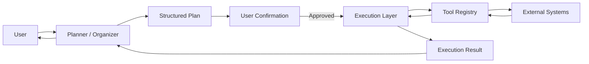
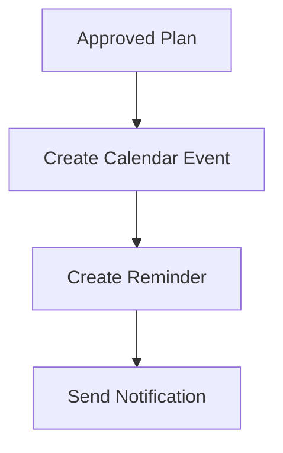
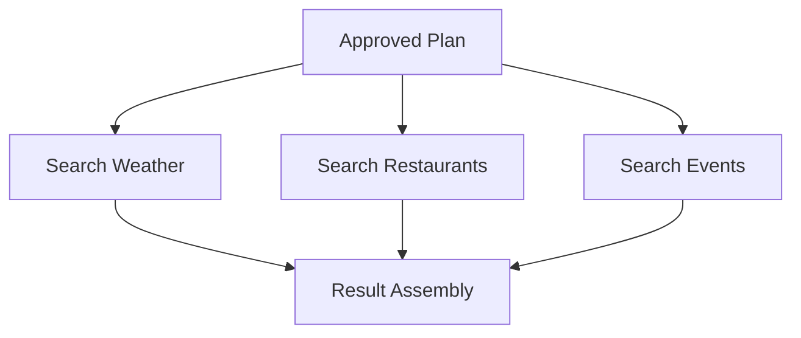
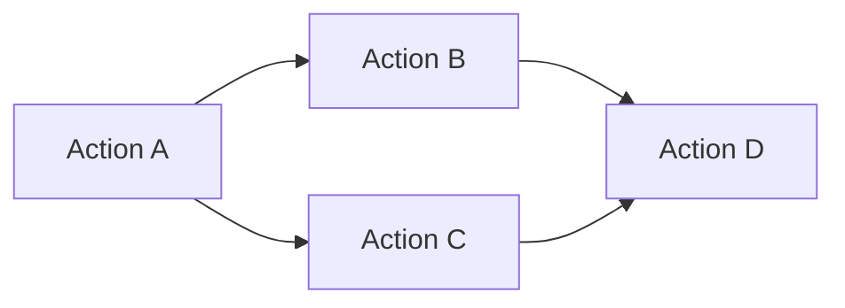
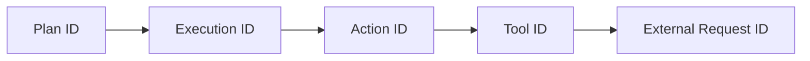
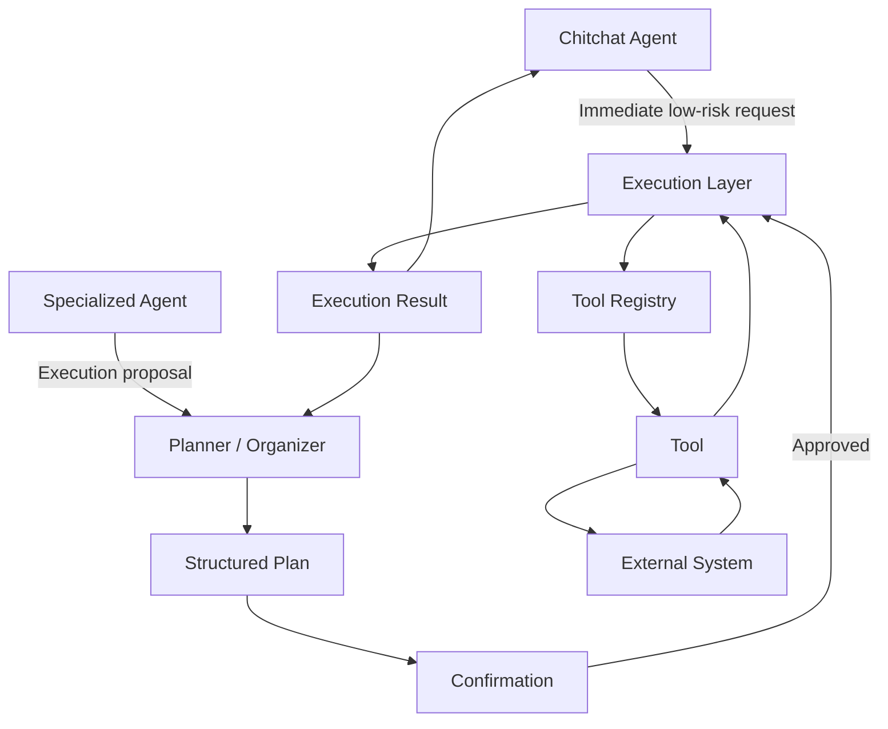
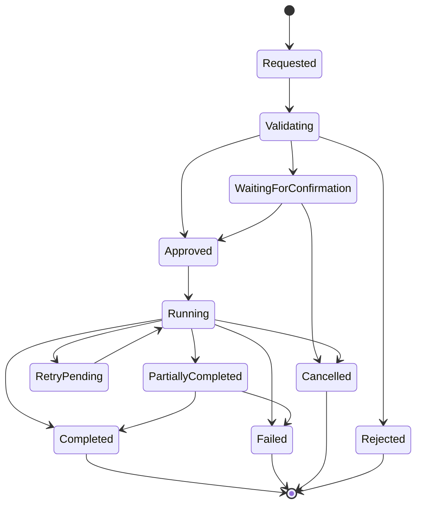

# Execution Layer

## Purpose

The Execution Layer is the controlled runtime responsible for executing approved actions and workflows.

It sits between Purrfect's planning and reasoning systems and the external systems that actually perform work.

The Execution Layer should ensure that:

> A plan proposed by an AI system does not automatically become unrestricted real-world execution.

The Execution Layer receives structured execution requests, validates them against system policies and capability contracts, performs the required actions, records execution activity, and returns structured results.

It is responsible for **execution**, not for deciding what the user wants.

---

## Responsibilities

### 1. Execute Approved Plans

The Execution Layer executes structured plans after the required approval and confirmation requirements have been satisfied.

A plan may originate from:

- Planner / Organizer.
- Specialized Agents.
- Agent War Room consensus.
- Other trusted system workflows.

The Execution Layer should not independently reinterpret the user's intent.

Its responsibility begins when a valid execution request is received.

Example:

```text
Planner / Organizer
        │
        │ Final Plan
        ▼
User Confirmation
        │
        │ Approved
        ▼
Execution Layer
        │
        ├── Validate
        ├── Authorize
        ├── Execute
        ├── Observe
        └── Return Result
```

---

### 2. Enforce the Execution Boundary

The Execution Layer is the architectural boundary between reasoning and real-world side effects.

The general flow should be:



The Execution Layer should prevent the following pattern:

```text
LLM
  ↓
Free-form generated instruction
  ↓
Direct external side effect
```

Instead:

```text
LLM / Agent
  ↓
Structured Plan
  ↓
Validation
  ↓
User Confirmation
  ↓
Execution Policy
  ↓
Controlled Execution
  ↓
Result
```

This boundary is one of the primary safety mechanisms of Purrfect.

---

### 3. Validate Execution Requests

Every execution request should be validated before execution.

Validation may include:

- Valid plan structure.
- Valid action type.
- Valid tool identifier.
- Valid parameters.
- Required parameters present.
- Parameter types correct.
- Tool exists.
- Tool is available.
- Tool is authorized for the requested operation.
- Execution policy allows the operation.
- Confirmation requirements are satisfied.
- Required dependencies are available.

Invalid execution requests should be rejected before reaching external systems.

---

### 4. Validate Tool Contracts

The Execution Layer should rely on the Tool Registry for standardized tool definitions.

Before execution, the system should verify that:

```text
Requested Tool
    ↓
Exists?
    ↓
Enabled?
    ↓
Authorized?
    ↓
Input Schema Valid?
    ↓
Execution Policy Valid?
    ↓
Execute
```

The Execution Layer should not duplicate the entire Tool Registry.

The Tool Registry defines what a tool is and how it should be called.

The Execution Layer is responsible for safely invoking it.

---

### 5. Enforce Execution Policies

Not every action should be treated equally.

The Execution Layer should support different execution policies based on risk and side effects.

Potential policy levels include:

```text
READ_ONLY
    ↓
LOW_RISK
    ↓
USER_CONFIRMED
    ↓
HIGH_RISK
    ↓
DESTRUCTIVE
```

Examples:

```text
Read weather information
→ Immediate execution

Search the web
→ Immediate execution

Create a draft calendar event
→ May execute immediately

Create a real calendar event
→ May require confirmation

Send an important message
→ Require confirmation

Delete files
→ Require explicit confirmation

Perform destructive external operation
→ Strong confirmation and policy checks
```

The exact policy model will be defined separately.

The Execution Layer enforces the policy.

---

### 6. Support Immediate Tool Execution

Not every tool interaction should require Planner mode or a final confirmation.

Some tasks are simple, low-risk, and can be executed immediately from the conversational flow.

For example:

```text
User:
"What is the phone number for the fire department?"

Chitchat Agent:
Detects need for external information.

Chitchat Agent:
Calls Web Search Tool.

Execution Layer:
Executes web traversal.

Chitchat Agent:
Returns the result.
```

The Execution Layer therefore supports execution requests originating from different system flows.

The requirement is not:

> "Everything must go through Planner mode."

The requirement is:

> "Every real execution must pass through the appropriate execution boundary and policy."

This allows Purrfect to remain efficient for simple requests while maintaining execution control.

---

### 7. Support Planner-Based Execution

Complex tasks should normally follow the Planner / Organizer workflow.

Example:

```text
User
  ↓
Chitchat Agent
  ↓
Planner / Organizer
  ↓
Interrogation
  ↓
Specialized Agents
  ↓
Final Plan
  ↓
User Confirmation
  ↓
Execution Layer
  ↓
Multiple Tool Calls
  ↓
Execution Result
```

The Execution Layer should execute the approved plan without taking ownership of the planning process.

---

### 8. Execute Multi-Step Plans

The Execution Layer should support plans containing multiple actions.

Example:

```text
Plan:

1. Create calendar event.
2. Add reminder.
3. Send notification.
```

The Execution Layer should be able to execute the plan according to its defined execution strategy.

Potential execution strategies include:

- Sequential execution.
- Parallel execution.
- Conditional execution.
- Dependency-based execution.
- Retryable execution.
- Partial execution.

The exact strategy depends on the plan and action dependencies.

For example:



If actions are independent:



The Execution Layer should execute actions according to their declared dependencies rather than blindly running everything sequentially.

---

### 9. Manage Execution Dependencies

Execution plans may contain dependencies between actions.

For example:

```text
1. Create calendar event.
2. Get event ID.
3. Add reminder using event ID.
```

The second action cannot execute until the first action succeeds.

The Execution Layer should support explicit dependency relationships.

Potential execution graph:



The Execution Layer should determine execution order based on the plan's dependency graph.

It should not invent new dependencies unless required by the execution contract.

---

### 10. Handle Execution Failures

External systems will fail.

The Execution Layer should handle failures in a controlled manner.

Potential failure categories include:

- Validation failure.
- Authorization failure.
- Tool unavailable.
- External API failure.
- Timeout.
- Rate limit.
- Invalid external response.
- Partial execution.
- Dependency failure.
- Unknown execution failure.

The Execution Layer should return structured failure information.

Example:

```text
Execution Result

Status:
FAILED

Failed Action:
Send Notification

Reason:
External messaging service timeout

Completed Actions:
- Calendar event created
- Reminder created

Remaining Actions:
- Notification not sent
```

The system should never falsely report a successful execution when an action failed.

---

### 11. Support Retry Policies

Some failures may be safely retried.

The Execution Layer may support retry policies such as:

```text
No Retry
Immediate Retry
Exponential Backoff
Fixed Delay
Maximum Attempt Count
```

Retry behavior should be determined by execution policy and tool capabilities.

The Execution Layer should avoid blindly retrying operations that may produce duplicate side effects.

For example:

```text
GET weather data
→ Safe to retry

Send payment
→ Unsafe to blindly retry

Create calendar event
→ May require idempotency protection
```

Retry behavior should therefore be explicit and policy-driven.

---

### 12. Support Idempotency

The Execution Layer should support idempotency where repeated execution could cause duplicate side effects.

Potential examples:

- Creating calendar events.
- Sending messages.
- Creating records.
- Triggering external workflows.

The system should be able to identify repeated execution attempts and prevent unintended duplication where the underlying operation supports idempotency.

Potential model:

```text
Execution Request
        │
        ▼
Idempotency Key
        │
        ├── New Request
        │      ↓
        │   Execute
        │
        └── Existing Request
               ↓
        Return Previous Result
```

The exact implementation will depend on the tool and external system.

---

### 13. Support Partial Execution

A multi-step plan may partially succeed.

The Execution Layer should preserve the actual execution state.

Example:

```text
Plan:

[x] Create calendar event
[x] Add reminder
[ ] Send notification
[FAILED] External messaging service unavailable
```

The system should distinguish:

- Completed.
- Failed.
- Skipped.
- Pending.
- Cancelled.

Partial execution should be explicitly represented in the final result.

The Planner / Organizer or conversational layer can then determine how to communicate the outcome to the user.

---

### 14. Handle User Cancellation

The Execution Layer should support cancellation where technically possible.

Cancellation may occur:

- Before execution starts.
- Between execution steps.
- During long-running workflows.

The system should not assume that every external operation can be safely cancelled.

If cancellation is not possible after an action has started, the execution result should clearly indicate the actual state.

For example:

```text
Cancellation requested.

Completed:
- Calendar event created.

Cancelled:
- Reminder creation.

Already in progress:
- External notification request.

Result:
Notification status unknown.
```

The system should report reality rather than pretending cancellation succeeded.

---

### 15. Return Structured Execution Results

The Execution Layer should return structured results rather than only natural-language responses.

Potential result structure:

```text
Execution Result
├── execution_id
├── plan_id
├── status
├── started_at
├── completed_at
├── actions
│   ├── action_id
│   ├── status
│   ├── output
│   ├── error
│   └── duration
├── partial_success
└── metadata
```

Natural-language response generation should happen outside the Execution Layer.

The Execution Layer reports what actually happened.

The conversational system decides how to communicate it.

---

### 16. Maintain Execution State

Long-running or multi-step executions may require persistent state.

The Execution Layer should track execution state where necessary.

Potential states include:

```text
PENDING
VALIDATING
RUNNING
WAITING
PARTIALLY_COMPLETED
COMPLETED
FAILED
CANCELLED
```

State should be persistent when execution may outlive the current request or process.

This allows Purrfect to recover from interruptions and provide accurate execution status.

---

### 17. Execution Tracing

Every significant execution should produce traceable execution metadata.

Useful metadata includes:

- Execution ID.
- Plan ID.
- Task ID.
- Action ID.
- Tool ID.
- Agent ID where applicable.
- Start time.
- End time.
- Execution status.
- Retry count.
- Error information.
- External request identifiers where available.

Example:



This allows operators to answer:

> "What did Purrfect actually do?"

without exposing private model reasoning.

---

### 18. Auditability

Important execution events should be auditable.

Potential events include:

- Execution requested.
- Execution validated.
- Execution approved.
- Execution rejected.
- Execution started.
- Action started.
- Action completed.
- Action failed.
- Retry attempted.
- Execution cancelled.
- Execution completed.

Audit records should contain enough information to reconstruct the execution lifecycle.

Sensitive data should be handled according to the system's privacy and security requirements.

---

### 19. Security and Authorization

The Execution Layer should enforce authorization boundaries before performing sensitive operations.

Potential checks include:

- User identity.
- User permissions.
- Tool permissions.
- Action risk level.
- Required confirmation.
- Execution policy.
- Resource ownership.
- External service authorization.

The LLM should never be treated as the authorization authority.

The system should make authorization decisions using deterministic application logic and configured policies.

---

### 20. Protect Secrets and Credentials

The Execution Layer should never expose raw secrets to the LLM.

Examples include:

- API keys.
- Access tokens.
- OAuth refresh tokens.
- Passwords.
- Service credentials.

Tools should access credentials through secure application mechanisms.

The execution request should contain only the information necessary to perform the operation.

The model should not receive secrets merely because a tool requires them.

---

### 21. Execution Isolation

Where practical, execution should be isolated from the AI reasoning layer.

The Execution Layer should prevent arbitrary model-generated code or commands from being executed directly.

For example:

```text
LLM Output:
"Run this shell command: ..."

        ↓

Rejected
```

Instead:

```text
LLM
 ↓
Structured Action
 ↓
Registered Tool
 ↓
Validated Parameters
 ↓
Execution Policy
 ↓
Execution Layer
 ↓
Controlled Operation
```

This provides a strong boundary against uncontrolled execution.

---

### 22. Support Tool Execution Exceptions

Some capabilities may require immediate execution within their own runtime.

Examples may include:

- Web traversal.
- Maps.
- Real-time search.
- Other interactive external systems.

The Execution Layer should support these capabilities without forcing every operation through the full Planner / Organizer flow.

The important distinction is:

```text
Planner mode
≠
Execution boundary
```

A simple conversational request may execute a low-risk tool immediately.

A complex task may execute dozens of approved actions after planning.

Both should ultimately pass through the appropriate execution controls.

---

## Responsibility Boundary

The Execution Layer should remain focused on controlled execution.



The responsibility boundaries are:

| Component | Responsibility |
|---|---|
| Chitchat Agent | Handle normal conversation and initiate simple low-risk requests |
| Planner / Organizer | Gather requirements and produce structured plans |
| Specialized Agent | Provide domain-specific reasoning and recommendations |
| Tool Registry | Describe and expose available tools |
| Execution Layer | Validate and execute approved actions |
| External System | Perform the actual external side effect |
| Response Assembly | Convert execution results into user-facing communication |

The Execution Layer should not:

- Decide what the user wants.
- Perform domain-specific reasoning.
- Replace the Planner / Organizer.
- Select agents based on conversational intent.
- Invent plans.
- Directly communicate with the user as the primary conversational interface.
- Bypass authorization.
- Execute arbitrary model-generated code.
- Automatically execute every tool requested by an LLM.
- Hide execution failures.
- Pretend partial execution was fully successful.

---

## Execution Modes

Purrfect should support multiple execution paths.

### Immediate Execution

Used for simple, low-risk operations.

```text
User
  ↓
Chitchat Agent
  ↓
Execution Layer
  ↓
Tool
  ↓
Result
  ↓
Chitchat Agent
```

Example:

```text
"What is the current weather?"
```

---

### Planner Execution

Used for complex multi-step tasks.

```text
User
  ↓
Chitchat Agent
  ↓
Planner / Organizer
  ↓
Interrogation
  ↓
Specialized Agents
  ↓
Final Summary
  ↓
User Confirmation
  ↓
Execution Layer
  ↓
Execution
  ↓
Result
  ↓
Chitchat Agent
```

---

### Agent-Assisted Execution

A Specialized Agent may determine that a tool is required while working on a task.

The agent should provide an execution proposal through the appropriate system flow.

The agent should not bypass the Execution Layer.

```text
Specialized Agent
        ↓
Execution Proposal
        ↓
Planner / Organizer
        ↓
Execution Policy
        ↓
Execution Layer
        ↓
Tool
```

For simple, low-risk operations, the conversational flow may authorize immediate execution according to policy.

For high-risk operations, explicit user confirmation remains required.

---

## Execution Lifecycle

The target lifecycle is:



The exact lifecycle may evolve as long-running workflows are implemented.

---

## Architectural Principles

- Execution is separated from reasoning.
- AI output is not automatically executable.
- Structured execution requests are preferred over free-form commands.
- Every execution passes through appropriate validation.
- Execution policies are enforced deterministically.
- High-risk operations require explicit authorization.
- Low-risk operations may execute immediately when policy permits.
- Planner mode is not required for every tool call.
- The Execution Layer is the final controlled boundary before side effects.
- Tools remain independently registered and discoverable.
- Secrets are never exposed to the LLM unnecessarily.
- Arbitrary model-generated code should not execute directly.
- Multi-step execution should support dependencies.
- Execution failures must be represented accurately.
- Partial execution must be visible.
- Retry behavior must be policy-driven.
- Idempotency should be used where duplicate side effects are possible.
- Important execution events should be traceable.
- Execution results should be structured.
- Natural-language response generation remains outside the Execution Layer.
- The Execution Layer should remain deterministic wherever practical.

---

## Done When

- [ ] Structured execution requests are supported.
- [ ] Execution requests are validated before execution.
- [ ] Tool contracts are validated before invocation.
- [ ] Execution policies are enforced.
- [ ] Immediate low-risk execution is supported.
- [ ] Planner-based execution is supported.
- [ ] Multi-step plans are supported.
- [ ] Action dependencies are supported.
- [ ] Execution failures are represented structurally.
- [ ] Partial execution is represented accurately.
- [ ] Retry policies are supported.
- [ ] Idempotency is supported where required.
- [ ] Execution cancellation is supported where technically possible.
- [ ] Execution state is tracked.
- [ ] Execution results are structured.
- [ ] Execution tracing is implemented.
- [ ] Important execution events are auditable.
- [ ] Authorization boundaries are enforced.
- [ ] Secrets are protected from model context.
- [ ] Arbitrary model-generated code cannot execute directly.
- [ ] Immediate tool execution and Planner-based execution share the same execution boundary.
- [ ] The Execution Layer does not become a hidden planning or reasoning component.