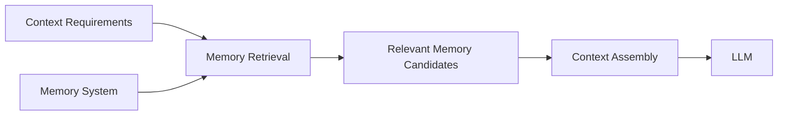
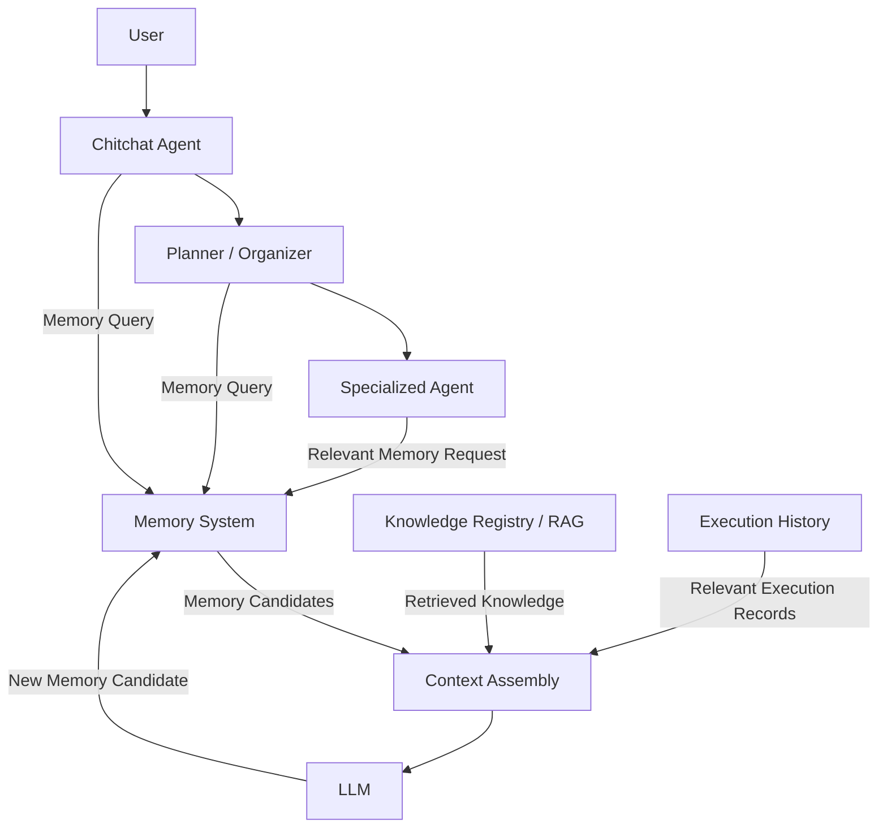
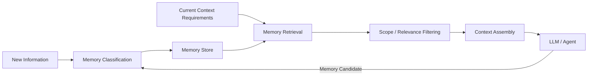

# Memory

## Purpose

Memory is the persistence and retrieval system responsible for retaining information that may be useful beyond the immediate processing step.

Purrfect should not treat every piece of information as permanent memory.

The Memory System should determine how information is:

- Captured.
- Classified.
- Stored.
- Retrieved.
- Updated.
- Expired.
- Forgotten.
- Scoped.
- Presented to Context Assembly.

The central principle is:

> Memory stores information. Context Assembly decides what information should be used now.

Memory is therefore separate from:

- Conversation context.
- Working memory.
- Task state.
- Retrieved knowledge.
- Execution history.

These systems may interact with Memory, but they should not become one undifferentiated storage mechanism.

---

## Memory Responsibilities

### 1. Store Persistent User Information

Memory should retain information about the user when that information is intentionally considered useful for future interactions.

Potential examples include:

- User preferences.
- Stable interests.
- Communication preferences.
- Frequently used choices.
- Long-term project context.
- User-provided facts that are explicitly intended to be remembered.

Example:

```text
User:
"I prefer TypeScript over JavaScript for new projects."

Memory:
Store as long-term user preference.
```

The system should not automatically store every conversational statement as permanent memory.

---

### 2. Separate Memory Types

Purrfect should support multiple memory categories with clearly defined responsibilities.

Potential memory layers include:

```text
Memory
├── Conversation Context
├── Working Memory
├── Task Memory
├── Long-Term User Memory
├── Project Memory
└── Execution History
```

These categories should not be treated identically.

---

### Conversation Context

Short-lived information required to understand the current conversation.

Example:

```text
User:
"Let's use PostgreSQL."

User:
"Actually, let's use Redis instead."

Current context:
The latest decision is Redis.
```

Conversation context may be discarded when it is no longer relevant.

---

### Working Memory

Temporary information used while solving the current problem.

Example:

```text
Current task:
Plan Purrfect 3.0 architecture.

Working memory:
- Current architecture decisions.
- Current unresolved questions.
- Current candidate solutions.
- Current reasoning inputs.
```

Working memory should normally exist only for the active workflow.

---

### Task Memory

Information associated with a specific task or workflow.

Example:

```text
Task:
Plan family vacation.

Task Memory:
- Destination.
- Travel dates.
- Number of travelers.
- Budget.
- Preferences.
- Decisions made.
```

Task memory may survive across multiple interactions while the task remains active.

---

### Long-Term User Memory

Information intentionally retained for future conversations.

Example:

```text
User preference:
Prefers modular architecture.

User preference:
Prefers concise responses.

User preference:
Uses Python and TypeScript frequently.
```

Long-term memory should have explicit retention semantics.

---

### Project Memory

Information associated with a persistent project.

Example:

```text
Project:
Purrfect 3.0

Project Memory:
- Architecture decisions.
- Current technology direction.
- Project constraints.
- Active design decisions.
```

Project memory should be scoped to the relevant project rather than automatically becoming global user memory.

---

### Execution History

Records of previous actions and their results.

Example:

```text
Execution:
Create calendar event.

Result:
Success.

External ID:
12345.
```

Execution history is primarily operational data.

It may be queried by the system when needed, but it should not automatically become conversational memory.

---

## 3. Memory Classification

The Memory System should support classifying information before persistence.

Potential classifications include:

```text
EPHEMERAL
SHORT_TERM
TASK
PROJECT
LONG_TERM
OPERATIONAL
```

Classification may consider:

- Expected lifetime.
- Scope.
- Importance.
- User intent.
- Sensitivity.
- Retrieval frequency.
- Expiration requirements.

Example:

```text
"Remind me that I need to call Mom tomorrow."

→ Task Memory
→ Potentially expires after task completion.
```

```text
"I prefer dark mode."

→ Long-Term User Memory
```

```text
"We decided Purrfect will use FastAPI."

→ Project Memory
```

```text
"Calendar event ID is 12345."

→ Execution History
```

The Memory System should avoid storing information at a broader scope than necessary.

---

## 4. Explicit User Memory Requests

The system should recognize explicit memory instructions.

Examples:

```text
"Remember that I prefer TypeScript."

"Don't remember that."

"Forget my previous preference."

"Keep this for the Purrfect project."
```

Explicit user instructions should have higher priority than automatic memory inference.

The system should support:

- Remember.
- Update.
- Forget.
- Delete.
- Scope.
- Correct.

Memory should not silently override explicit user requests.

---

## 5. Automatic Memory Candidate Detection

Purrfect may identify potential memory candidates from conversations.

For example:

```text
User:
"I always use PostgreSQL for my projects."

Potential Memory Candidate:
User preference / technical preference.
```

However, candidate detection should not automatically guarantee permanent storage.

The system may classify a candidate as:

```text
Candidate
    ↓
Evaluate
    ↓
Store
```

or:

```text
Candidate
    ↓
Needs Confirmation
    ↓
Ask User
    ↓
Store / Reject
```

The exact confirmation policy may depend on the type and sensitivity of the information.

---

## 6. Memory Scope

Memory should have explicit scope.

Potential scopes include:

```text
GLOBAL
USER
PROJECT
TASK
CONVERSATION
EXECUTION
```

Example:

```text
User Memory:
"I prefer concise answers."

Project Memory:
"Purrfect uses an Agent Registry."

Task Memory:
"Current task is defining Core System Boundaries."

Conversation Context:
"We are currently discussing Memory."
```

A memory item should not automatically be visible to every workflow.

Scope should determine where the information is eligible for retrieval.

---

## 7. Memory Retrieval

Memory should be retrievable based on relevance and scope.

The Memory System may support:

- Exact lookup.
- Metadata filtering.
- Semantic retrieval.
- Temporal retrieval.
- Scope filtering.
- Recency weighting.
- Importance weighting.

Example:

```text
Current Task:
Plan Purrfect architecture.

Memory Query:
Find relevant project decisions.

Possible Results:
- Purrfect uses specialized agents.
- Agent Registry supports auto-registration.
- Planner requires final user confirmation.
```

Only relevant memory should be returned.

The system should avoid dumping all stored memory into the LLM context.

---

## 8. Memory Metadata

Memory records should contain metadata sufficient for controlled retrieval.

Potential metadata includes:

- Memory ID.
- Memory type.
- Scope.
- Owner.
- Project ID.
- Task ID.
- Created timestamp.
- Updated timestamp.
- Last accessed timestamp.
- Importance.
- Confidence.
- Source.
- Expiration timestamp.
- Sensitivity classification.
- Tags.
- Version.

Example:

```text
Memory Record

ID:
memory_123

Type:
PROJECT

Scope:
Purrfect 3.0

Content:
"Specialized agents are auto-registerable."

Source:
Architecture discussion

Confidence:
High

Created:
2026-07-27

Last Updated:
2026-07-27
```

Metadata should support retrieval and lifecycle management.

---

## 9. Memory Updates

Memory should support updating existing information.

Example:

```text
Previous:
"Purrfect uses a centralized Planner."

New:
"Purrfect uses Chitchat as the lightweight orchestrator
and activates Planner / Organizer only for focused tasks."
```

The Memory System should avoid blindly creating duplicate memories.

It should be able to identify when new information:

- Updates existing information.
- Contradicts existing information.
- Adds detail.
- Replaces an obsolete decision.

The system should preserve appropriate history when required for auditability.

---

## 10. Conflict Resolution

Memory conflicts should be detectable.

Example:

```text
Memory A:
User prefers Python.

Memory B:
User now prefers TypeScript for frontend projects.
```

These statements may not actually conflict because their scopes differ.

The system should consider:

- Scope.
- Timestamp.
- Specificity.
- Source.
- Confidence.
- Explicit user correction.

More recent or more specific information should not blindly overwrite broader information.

Example:

```text
General preference:
Python.

Specific project preference:
TypeScript for Purrfect frontend.
```

Both may remain valid.

---

## 11. Memory Expiration

Not all memory should exist permanently.

The Memory System should support expiration policies.

Potential policies include:

```text
Permanent
Time-Based
Task Completion
Project Completion
Conversation Lifetime
Manual Deletion
```

Example:

```text
"Call Mom tomorrow at 9 PM."

→ Task Memory
→ Expires after task completion.
```

```text
"Use this temporary API endpoint for today's test."

→ Short-term memory
→ Expires after a defined period.
```

Expiration should prevent stale information from accumulating indefinitely.

---

## 12. Memory Forgetting

The system should support explicit forgetting.

A user should be able to request:

```text
"Forget that."

"Forget my preference about X."

"Delete everything you remember about Project Y."
```

The Memory System should be able to identify and remove the relevant memory scope.

Where complete deletion is technically impossible due to operational or audit requirements, the system should clearly distinguish:

- User memory deletion.
- Operational audit retention.
- System logs.
- External records.

These concerns should not be silently mixed together.

---

## 13. Memory Relevance

Memory retrieval should prioritize relevance.

Potential relevance factors include:

- Semantic similarity.
- Current task.
- Current project.
- User identity.
- Scope.
- Recency.
- Importance.
- Explicit references.

Example:

```text
Current request:
"Continue working on Purrfect 3.0."

Relevant:
- Purrfect architecture decisions.
- Current Planner design.
- Agent Registry design.
- Tool Registry design.

Irrelevant:
- Previous dinner discussion.
- Old unrelated conversations.
```

The Memory System should return the smallest useful set of memories.

This supports the overall Purrfect goal of minimizing unnecessary context and token usage.

---

## 14. Memory and Knowledge Separation

Memory and external knowledge must remain separate systems.

Memory represents information associated with:

- The user.
- The conversation.
- The task.
- The project.
- Previous system interactions.

Knowledge represents external or indexed information that Purrfect can retrieve.

Example:

```text
Memory:
"User is currently building Purrfect 3.0."

Knowledge:
"FastAPI documentation explains dependency injection."
```

The Knowledge Registry and RAG system should manage external knowledge.

The Memory System should manage contextual and user-associated information.

Neither should become a substitute for the other.

---

## 15. Memory and Execution History Separation

Execution history should be treated as operational records rather than automatically becoming conversational memory.

Example:

```text
Execution History:
Calendar event ID = 12345
Created at = 2026-07-27
Status = SUCCESS
```

The system may retrieve this information when needed.

However, the entire execution record should not automatically be inserted into every conversation.

Execution history may be summarized or converted into memory when there is a clear reason to retain it.

---

## 16. Memory and Context Assembly Separation

Memory does not decide what the LLM sees.

The Memory System provides candidate information.

Context Assembly determines what information should enter the current model context.

The boundary is:



This prevents Memory from becoming a direct context dump.

---

## 17. Memory Retrieval During Planner Interrogation

Planner / Organizer workflows may use Memory to reduce unnecessary interrogation.

Example:

```text
User:
"Plan dinner for tonight."

Planner:
Needs:
- Number of people.
- Dietary restrictions.
- Budget.

Memory:
- Household size: 4.
- User prefers Thai food.
- User avoids peanuts.
```

The Planner may use existing memory instead of asking questions that have already been answered.

However, stale or uncertain memory should not silently override current user input.

The Planner should ask for clarification when the current request conflicts with stored memory.

---

## 18. Memory During Specialized Agent Work

Specialized Agents may receive relevant memory as part of their task context.

For example:

```text
Planner / Organizer
        │
        ├── Task Information
        ├── Relevant Memory
        ├── Retrieved Knowledge
        │
        ▼
Specialized Agent
```

The Specialized Agent should receive only the information relevant to its assigned task.

The agent should not automatically receive the user's entire memory store.

---

## 19. Memory During Agent War Room

Agent War Room workflows may require relevant memory to establish shared context.

For example:

```text
War Room Task:
Design Purrfect 3.0 architecture.

Relevant Memory:
- Existing architecture decisions.
- Project constraints.
- Previous rejected approaches.
- Current unresolved decisions.
```

The War Room should receive curated context rather than unrestricted access to all memory.

Context Assembly remains responsible for constructing the appropriate context.

---

## 20. Memory Security and Privacy

Memory may contain sensitive user information.

The system should consider:

- Access control.
- Data isolation.
- Encryption.
- Sensitive data classification.
- Retention policies.
- Deletion policies.
- Auditability.
- Data minimization.

Memory should not be exposed to agents or tools unless required for the current task.

The principle should be:

> Store only what is useful, and expose only what is necessary.

---

## 21. Memory Observability

Memory operations should be traceable without exposing unnecessary private content.

Useful metadata may include:

- Memory operation ID.
- Memory ID.
- Operation type.
- Scope.
- Source.
- Retrieval reason.
- Retrieval timestamp.
- Workflow ID.
- Task ID.

Potential operations:

```text
MEMORY_CREATED
MEMORY_UPDATED
MEMORY_RETRIEVED
MEMORY_EXPIRED
MEMORY_DELETED
MEMORY_CONFLICT_DETECTED
```

Observability should allow developers to understand why a memory was used without logging sensitive content unnecessarily.

---

## Responsibility Boundary

Memory should remain focused on persistence and retrieval of contextual information.



The responsibility boundaries are:

| Component | Responsibility |
|---|---|
| Memory | Store, classify, update, retrieve, expire, and forget contextual information |
| Context Assembly | Decide which retrieved information enters the current model context |
| Knowledge Registry / RAG | Manage external knowledge discovery and retrieval |
| Execution History | Maintain operational records of executed actions |
| Planner / Organizer | Use relevant memory to reduce unnecessary interrogation |
| Specialized Agents | Consume relevant memory for domain-specific work |
| AI Orchestrator | Coordinate system-level memory interactions |

Memory should not:

- Become a dump of the entire conversation history.
- Store every user statement permanently.
- Replace the Knowledge System.
- Replace Execution History.
- Decide what the LLM should see.
- Inject all stored memories into every prompt.
- Become the source of truth for external knowledge.
- Own task planning.
- Own agent reasoning.
- Become a hidden monolithic context manager.

---

## Memory Flow

The target architecture is:



The system should avoid:

```text
Entire Memory Store
        ↓
LLM Context
```

Instead:

```text
Current Task
    ↓
Context Requirements
    ↓
Relevant Memory Retrieval
    ↓
Scope / Relevance Filtering
    ↓
Context Assembly
    ↓
LLM
```

This supports Purrfect's broader goal of minimizing unnecessary token usage.

---

## Architectural Principles

- Memory is not the same as conversation history.
- Memory is not the same as external knowledge.
- Memory is not the same as execution history.
- Memory stores information; Context Assembly decides what is used.
- Memory should be explicitly scoped.
- Memory should have a defined lifecycle.
- Permanent memory should be intentional.
- Explicit user memory instructions take priority.
- The system should avoid storing unnecessary information.
- The system should retrieve only relevant memory.
- Memory should reduce unnecessary user interrogation where appropriate.
- Current user input should be able to override stale memory.
- Memory conflicts should be detectable.
- Memory should support updates and forgetting.
- Sensitive memory should be protected.
- Specialized Agents should receive only relevant memory.
- Agent War Rooms should receive curated memory context.
- Memory retrieval should be traceable.
- Memory operations should be observable without unnecessarily exposing private content.
- Memory should remain separate from Knowledge / RAG.
- Memory should remain separate from Execution History.
- Memory should not become a hidden Context Assembly layer.
- Memory should not become a monolithic "remember everything" system.

---

## Done When

- [ ] Memory categories are explicitly defined.
- [ ] Conversation context is separated from persistent memory.
- [ ] Working memory is separated from long-term memory.
- [ ] Task memory is supported.
- [ ] Project memory is supported.
- [ ] Long-term user memory is supported.
- [ ] Execution history is kept separate from general memory.
- [ ] Memory scope is explicitly represented.
- [ ] Memory metadata is standardized.
- [ ] Memory candidates can be classified.
- [ ] Explicit user memory requests are supported.
- [ ] Memory updates are supported.
- [ ] Memory conflicts can be detected.
- [ ] Memory expiration is supported.
- [ ] Explicit memory deletion is supported.
- [ ] Memory retrieval supports relevance and scope filtering.
- [ ] Memory retrieval minimizes unnecessary context.
- [ ] Memory is clearly separated from Knowledge / RAG.
- [ ] Memory is clearly separated from Execution History.
- [ ] Context Assembly controls what memory reaches the LLM.
- [ ] Planner / Organizer can use memory to reduce unnecessary interrogation.
- [ ] Specialized Agents receive only relevant memory.
- [ ] Memory access is protected by appropriate security controls.
- [ ] Memory operations are observable and traceable.
- [ ] The Memory System does not become a hidden monolithic context manager.