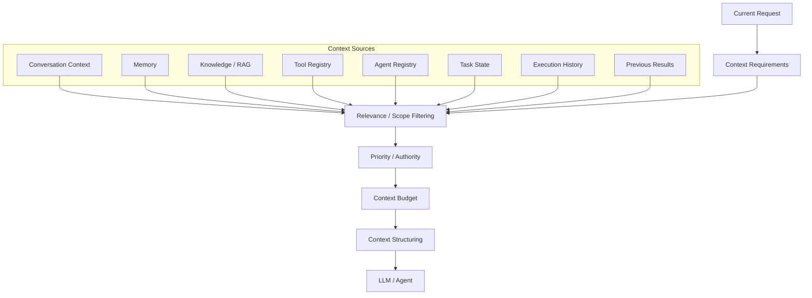

# Context Assembly

## Purpose

Context Assembly is responsible for constructing the context required by an LLM or Agent to perform its current task.

It acts as the controlled boundary between Purrfect's internal information systems and the model execution environment.

Context Assembly determines:

- What information is relevant to the current operation.
- Which information should be included.
- Which information should be excluded.
- How information should be structured.
- How much information should be provided.
- Which context belongs to the current workflow.
- Which context belongs to the current agent.
- Which context should remain available only to the system.

The central principle is:

> Context Assembly should provide the smallest sufficient context required for the current operation.

The goal is not to provide the model with everything Purrfect knows.

The goal is to provide the model with what it needs to perform the current task correctly.

---

## Core Responsibility

Context Assembly owns the transformation from distributed system state into model-consumable context.

Conceptually:

```text
System State
    │
    ├── Conversation Context
    ├── Memory
    ├── Knowledge / RAG
    ├── Task State
    ├── Agent Information
    ├── Tool Information
    ├── Execution History
    └── Current User Input
            │
            ▼
    Context Assembly
            │
            ▼
    Model / Agent Context
```

Context Assembly should ensure that the model receives the appropriate information without requiring each individual subsystem to understand the complete context requirements of every other subsystem.

---

## 1. Gather Relevant Context

Context Assembly should collect relevant information from available sources.

Potential sources include:

- Current user input.
- Recent conversation context.
- Working memory.
- Task memory.
- Project memory.
- Long-term user memory.
- Retrieved knowledge.
- Agent metadata.
- Tool metadata.
- Current task state.
- Execution state.
- Previous execution results.
- System instructions.
- Agent-specific instructions.
- Workflow state.

Context Assembly should not automatically include every available source.

Each source should be considered based on the requirements of the current operation.

---

## 2. Determine Context Requirements

Context Assembly should determine what context is required for the current model or agent invocation.

Different operations require different context.

Example:

```text
Chitchat

Needs:
- Current conversation.
- Relevant user memory.

Does not need:
- Full project memory.
- Complete tool registry.
- Entire knowledge base.
- Historical execution logs.
```

Example:

```text
Planner / Organizer

Needs:
- Current conversation.
- Relevant task state.
- Relevant user memory.
- Relevant project context.
- Relevant specialized-agent capabilities.

May need:
- Knowledge retrieval.
- Tool metadata.

Does not need:
- Entire tool implementation details.
- Unrelated memories.
```

Example:

```text
Specialized Agent

Needs:
- Assigned task.
- Relevant gathered information.
- Relevant memory.
- Relevant knowledge.
- Relevant shared tools.
- Agent-specific instructions.

Does not need:
- Entire conversation history.
- Unrelated tasks.
- Other agents' internal context unless explicitly required.
```

Context Assembly should therefore be **operation-aware**.

---

## 3. Minimize Context

Context Assembly should minimize unnecessary information passed to the model.

The system should avoid:

```text
Entire Conversation
+
Entire Memory
+
Entire Knowledge Base
+
Entire Tool Registry
+
Entire Agent Registry
+
Entire Execution History
```

Instead:

```text
Current Task
    +
Relevant Context
    +
Required Capabilities
    +
Required Knowledge
    +
Required Memory
```

The goal is to:

- Reduce token usage.
- Reduce latency.
- Reduce model confusion.
- Reduce irrelevant information.
- Improve instruction adherence.
- Improve response quality.
- Reduce unnecessary model processing.

Context minimization is a core architectural responsibility rather than an optional optimization.

---

## 4. Context Prioritization

When multiple context sources are available, Context Assembly should prioritize information based on relevance and authority.

Potential priorities include:

1. Current system instructions.
2. Current workflow requirements.
3. Current user request.
4. Explicit user-provided information.
5. Current task state.
6. Relevant agent instructions.
7. Relevant memory.
8. Relevant retrieved knowledge.
9. Relevant execution history.
10. Optional supporting context.

The exact priority hierarchy may evolve.

The responsibility of Context Assembly is to ensure that conflicting or lower-priority information does not unnecessarily override more authoritative context.

---

## 5. Current User Input

Current user input should be treated as a primary context source.

Context Assembly should preserve the user's current request accurately.

Current user input may:

- Add new information.
- Correct previous memory.
- Override stale task information.
- Change task direction.
- Cancel an operation.
- Introduce a new task.
- Clarify an existing task.

Example:

```text
Memory:
User prefers Thai food.

Current User:
"Actually, tonight I want Japanese food."
```

Context Assembly should ensure the current request is clearly available to the model.

Historical memory should not silently override current user intent.

---

## 6. Conversation Context

Context Assembly should provide conversational context required to understand the current interaction.

This may include:

- Recent messages.
- Relevant earlier messages.
- Active conversation topic.
- Current conversational mode.
- Recent decisions.
- Recent user corrections.

The entire conversation history should not automatically be included.

Context Assembly should prefer relevant conversation context over indiscriminate history replay.

Example:

```text
Conversation:

User:
"Let's work on Purrfect."

Assistant:
"Sure."

User:
"Continue with Memory."

Relevant context:
The current project is Purrfect 3.0.
The current topic is Memory.
```

Unrelated historical conversations should not be included.

---

## 7. Memory Context

Context Assembly should retrieve and include relevant memory when required.

Memory may include:

- User preferences.
- Task memory.
- Project memory.
- Relevant previous decisions.
- Relevant historical context.

Context Assembly should work with the Memory System rather than replacing it.

The boundary is:

```text
Memory
    │
    │ Retrieves candidate memories
    ▼
Context Assembly
    │
    │ Selects and structures relevant memory
    ▼
LLM / Agent
```

Memory owns persistence and retrieval.

Context Assembly owns contextual inclusion.

---

## 8. Knowledge Context

Context Assembly should include retrieved knowledge when required by the current operation.

Knowledge may come from:

- RAG retrieval.
- Knowledge Registry.
- External search.
- Tool-provided information.
- Indexed documents.

Context Assembly should prefer relevant retrieved content over unnecessary bulk knowledge.

Example:

```text
User:
"How does our Purrfect Agent Registry work?"

Context Assembly:
- Retrieve relevant Purrfect project knowledge.
- Include the relevant architecture information.
- Exclude unrelated project documentation.
```

Context Assembly should preserve source information when available.

This allows the model or Response Assembly to produce source-aware responses where required.

---

## 9. Tool Context

Context Assembly should provide tools and tool metadata only when relevant to the current operation.

The model may require:

- Tool name.
- Tool description.
- Tool parameters.
- Tool constraints.
- Authorization requirements.
- Execution policies.
- Availability status.

Context Assembly should avoid exposing every registered tool to every model invocation.

Example:

```text
User:
"What is the weather today?"

Relevant:
Weather tool.

Irrelevant:
Calendar tool.
Image generation tool.
Database administration tool.
File deletion tool.
```

The Tool Registry remains responsible for tool discovery and metadata.

Context Assembly decides which discovered tool information belongs in the current model context.

---

## 10. Agent Context

Context Assembly should provide relevant Agent information when an Agent is invoked.

Potential information includes:

- Agent identity.
- Agent role.
- Agent scope.
- Agent expertise.
- Agent instructions.
- Agent capabilities.
- Assigned task.
- Relevant shared tools.
- Relevant knowledge.
- Relevant memory.

The Agent Registry remains responsible for discovering and describing Agents.

Context Assembly prepares the relevant Agent context for execution.

---

## 11. Specialized Agent Context

Specialized Agents should receive focused context rather than the entire Purrfect system state.

Example:

```text
Planner / Organizer
        │
        │ Task Assignment
        ▼
Specialized Agent
        │
        ├── Task
        ├── Gathered Information
        ├── Relevant Memory
        ├── Relevant Knowledge
        ├── Relevant Tools
        └── Agent Instructions
```

The Specialized Agent should not automatically receive:

- Entire conversation history.
- Entire user memory.
- Entire project memory.
- Entire knowledge base.
- Entire Agent Registry.
- Entire Tool Registry.
- Other agents' unrelated context.

This reduces token usage and limits unnecessary information exposure.

---

## 12. Planner / Organizer Context

Planner / Organizer workflows require dynamic context.

During interrogation, Context Assembly may include:

- Current user request.
- Information already gathered.
- Missing information.
- Relevant memory.
- Relevant project context.
- Responses from specialized agents.
- Relevant tool results.
- Current task state.

The context may change after every interrogation step.

Example:

```text
User:
"Plan dinner for tonight."

Planner:
Needs number of people.

User:
"Four people."

Planner:
Needs dietary restrictions.

Specialized Agent:
Suggests dinner options.

Context Assembly:
Updates current task context.
```

Context Assembly should ensure that each subsequent model invocation receives the updated task state without replaying unnecessary historical information.

---

## 13. Dynamic Context During Interrogation

Context Assembly should support evolving context.

Planner / Organizer may:

```text
Ask User
    ↓
Receive Answer
    ↓
Update Task State
    ↓
Call Specialized Agent
    ↓
Receive Result
    ↓
Update Context
    ↓
Continue Interrogation
```

The context provided to the next operation should reflect the latest state.

This allows the Planner / Organizer to dynamically use specialized agents during interrogation rather than waiting until all questions have been completed.

---

## 14. Agent War Room Context

Agent War Room workflows require shared context between participating agents.

Context Assembly should provide a controlled common context.

Potential shared information includes:

- Original task.
- Current objective.
- Relevant user requirements.
- Relevant constraints.
- Relevant knowledge.
- Relevant memory.
- Relevant previous agent proposals.
- Current unresolved disagreement.

The War Room should not automatically share every agent's complete context.

Instead:

```text
Shared War Room Context
        │
        ├── Task
        ├── Requirements
        ├── Constraints
        ├── Relevant Knowledge
        └── Relevant Memory
```

Individual agents may additionally receive their own specialized context.

Context Assembly should prevent irrelevant information from expanding the War Room context unnecessarily.

---

## 15. Context Between Agent Rounds

When agents participate in multiple rounds of discussion, Context Assembly should manage what information is carried forward.

Example:

```text
Round 1
Agent A Proposal
Agent B Proposal
Agent C Proposal

        ↓

Context Assembly

        ↓

Round 2
Relevant Proposals
Known Conflicts
Open Questions

        ↓

Context Assembly

        ↓

Round 3
Remaining Disagreement
User Constraints
Final Decision Request
```

The system should avoid repeatedly sending the full history of every round when a compact representation is sufficient.

---

## 16. Context Compression

Context Assembly may compress or summarize information when the full content is no longer required.

Potential candidates include:

- Old conversation turns.
- Completed interrogation steps.
- Previous Agent War Room rounds.
- Large tool outputs.
- Large retrieved documents.
- Historical execution results.

Compression should preserve information necessary for correct execution.

The system should avoid compressing information when doing so would remove important details or change meaning.

---

## 17. Context Freshness

Context Assembly should consider whether information is still valid.

Potential freshness concerns include:

- Stale memory.
- Outdated tool results.
- Expired task information.
- Old external data.
- Previous execution state.

Example:

```text
Tool Result:
Weather was retrieved 12 hours ago.

Current Request:
"What is the weather right now?"
```

The previous result may not be appropriate.

Context Assembly should avoid presenting stale information as current information.

Where freshness matters, the system should allow the relevant source to be queried again.

---

## 18. Context Conflicts

Context Assembly should identify or preserve conflicts between information sources rather than silently merging contradictory information.

Example:

```text
Memory:
Dinner preference = Thai.

Current User:
"Let's have Japanese tonight."
```

The current request should take precedence for the active task.

Another example:

```text
Knowledge:
Document A says configuration X.

Knowledge:
Document B says configuration Y.
```

The conflict should remain visible to the relevant Agent or workflow when the difference affects correctness.

Context Assembly should not invent a resolution that does not exist.

---

## 19. Context Provenance

Context Assembly should preserve the origin of important contextual information where practical.

Potential sources include:

```text
USER_INPUT
CONVERSATION
MEMORY
KNOWLEDGE
TOOL_RESULT
AGENT_RESULT
EXECUTION_RESULT
SYSTEM_INSTRUCTION
```

Provenance allows downstream components to understand where information originated.

Example:

```text
Information:
"Project uses PostgreSQL."

Source:
PROJECT_MEMORY
```

```text
Information:
"Current weather is 31°C."

Source:
WEATHER_TOOL
Retrieved:
2026-07-27 18:30
```

Context provenance should support traceability and debugging.

---

## 20. Context Trust and Authority

Context Assembly should preserve information about the authority of context sources.

Potential distinctions include:

- Explicit user input.
- System-defined constraints.
- Verified tool results.
- Retrieved knowledge.
- Agent-generated suggestions.
- Historical memory.
- Unverified external information.

Context Assembly should not present all sources as equally authoritative when their reliability differs.

Example:

```text
User Instruction:
"Use PostgreSQL."

Agent Suggestion:
"Redis may be better."

Context Assembly:
Preserve both, but distinguish instruction from suggestion.
```

The model should be able to understand which information is a requirement and which is a recommendation.

---

## 21. Context Boundaries

Context Assembly should enforce boundaries between different workflows.

For example:

```text
Conversation A
    │
    └── Context A

Conversation B
    │
    └── Context B
```

Information from one unrelated workflow should not automatically leak into another.

Potential boundaries include:

- User.
- Conversation.
- Project.
- Task.
- Agent.
- War Room.
- Execution.

Context Assembly should include information only when the relevant scope permits it.

---

## 22. Context Security

Context Assembly should prevent unnecessary exposure of sensitive information.

Before information enters a model context, the system should consider:

- Whether the model needs it.
- Whether the current Agent is authorized to receive it.
- Whether the information contains sensitive data.
- Whether the information belongs to another scope.
- Whether the information can be minimized or redacted.

The principle should be:

> If the model does not need the information, do not send it.

This applies especially to:

- Personal memory.
- Credentials.
- Secrets.
- Private documents.
- Sensitive tool outputs.
- Unrelated user data.

Context Assembly should minimize unnecessary data exposure.

---

## 23. Context Budget Management

Context Assembly should consider the available model context budget.

Potential constraints include:

- Input token limits.
- Output token requirements.
- Tool call overhead.
- System instructions.
- Agent instructions.
- Retrieved knowledge size.
- Conversation history size.

When context exceeds the available budget, Context Assembly should prioritize information rather than blindly truncating data.

Potential actions include:

- Remove irrelevant context.
- Reduce historical conversation.
- Summarize completed work.
- Reduce redundant metadata.
- Retrieve fewer knowledge results.
- Compress previous Agent War Room rounds.

The system should preserve the information most important to the current task.

---

## 24. Context for Chitchat

Chitchat is the default conversational entry point.

Context Assembly should keep Chitchat context lightweight.

Typical context:

```text
Current User Input
+
Recent Conversation
+
Relevant User Memory
+
Relevant Knowledge / Tool Result
```

Chitchat should not automatically receive:

- Planner state.
- Full task planning context.
- Entire Agent Registry.
- Entire Tool Registry.
- Full War Room history.

This supports Purrfect's goal of minimizing token usage for simple conversations.

---

## 25. Context for Planner / Organizer

Planner / Organizer requires more structured context than Chitchat.

Potential context:

```text
Current User Request
+
Task State
+
Gathered Information
+
Missing Information
+
Relevant Memory
+
Relevant Agent Capabilities
+
Relevant Knowledge
+
Relevant Tool Capabilities
```

The context should evolve as interrogation progresses.

The Planner should receive enough information to continue the workflow without receiving irrelevant system state.

---

## 26. Context for Specialized Agents

Specialized Agents should receive task-specific context.

Potential context:

```text
Assigned Task
+
Relevant User Requirements
+
Relevant Gathered Information
+
Relevant Memory
+
Relevant Knowledge
+
Relevant Shared Tools
+
Agent Instructions
```

Specialized Agents should not need to understand the complete Purrfect architecture.

They should receive the minimum context necessary to perform their assigned responsibility.

---

## 27. Context for Execution

Before execution, Context Assembly may provide the Execution Layer with the relevant structured execution context.

Potential information includes:

- Approved plan.
- User confirmation.
- Validated parameters.
- Selected tools.
- Required execution policies.
- Relevant task state.

The Execution Layer remains responsible for executing actions.

Context Assembly should not execute actions.

---

## 28. Context for Response Generation

After an operation completes, Context Assembly may provide the information required for response generation.

Potential information includes:

- User request.
- Relevant conversation context.
- Execution result.
- Relevant tool result.
- Relevant knowledge.
- Relevant task outcome.
- Relevant errors.
- Current conversational state.

The Response Assembly layer remains responsible for determining how the result should be communicated.

Context Assembly provides the information required for response generation but does not own response style or user-facing communication.

---

## 29. Context Assembly and Memory Boundary

The boundary between Memory and Context Assembly is:

```text
Memory
    │
    │ Store / Retrieve
    ▼
Memory Candidates
    │
    ▼
Context Assembly
    │
    │ Select / Filter / Structure
    ▼
Model Context
```

Memory answers:

> "What information do we have that may be relevant?"

Context Assembly answers:

> "What information does this model or agent need right now?"

---

## 30. Context Assembly and Knowledge Boundary

The boundary between Knowledge / RAG and Context Assembly is:

```text
Knowledge Registry / RAG
        │
        │ Discover / Retrieve
        ▼
Relevant Knowledge
        │
        ▼
Context Assembly
        │
        │ Select / Structure
        ▼
Model Context
```

Knowledge / RAG answers:

> "What external information is relevant?"

Context Assembly answers:

> "Which of that information should be provided to this model or agent?"

---

## 31. Context Assembly and Tool Registry Boundary

The Tool Registry is responsible for discovering and describing tools.

Context Assembly is responsible for deciding which tool information should be presented to the model.

```text
Tool Registry
    │
    │ Available Tools
    ▼
Context Assembly
    │
    │ Relevant Tool Definitions
    ▼
LLM / Agent
```

Context Assembly should not become the owner of tool discovery.

---

## 32. Context Assembly and Agent Registry Boundary

The Agent Registry is responsible for discovering and describing Agents.

Context Assembly determines what Agent information is relevant to the current operation.

```text
Agent Registry
    │
    │ Agent Metadata
    ▼
Context Assembly
    │
    │ Relevant Agent Context
    ▼
Planner / Organizer
```

Context Assembly should not become responsible for Agent registration or Agent lifecycle.

---

## 33. Context Assembly and Execution Boundary

Context Assembly prepares execution context.

The Execution Layer performs execution.

```text
Context Assembly
    │
    │ Approved Execution Context
    ▼
Execution Layer
    │
    │ Execute
    ▼
Result
```

Context Assembly should not:

- Execute tools.
- Modify external systems.
- Approve execution.
- Bypass confirmation.
- Override execution policies.

---

## 34. Context Assembly and Response Assembly Boundary

Context Assembly prepares information required for response generation.

Response Assembly determines how that information becomes a user-facing response.

```text
Context Assembly
    │
    │ Response Context
    ▼
Response Assembly
    │
    │ User-Facing Response
    ▼
User
```

Context Assembly should not own:

- Final response wording.
- Tone.
- Presentation style.
- User-facing formatting.

---

## 35. Context Assembly and AI Orchestrator Boundary

The AI Orchestrator coordinates context assembly but does not manually construct every model context.

The Orchestrator may request:

```text
"Build context for Chitchat."

"Build context for Planner interrogation."

"Build context for Specialized Agent X."

"Build context for War Room round 2."
```

Context Assembly owns the actual context construction process.

The boundary is:

```text
AI Orchestrator
    │
    │ Request Context
    ▼
Context Assembly
    │
    │ Construct Context
    ▼
LLM / Agent
```

The AI Orchestrator should not become a hidden context-management monolith.

---

## Context Assembly Flow

The target architecture is:



The intended flow is:

```text
Current Operation
        ↓
Determine Context Requirements
        ↓
Retrieve Candidate Context
        ↓
Filter by Scope and Relevance
        ↓
Prioritize by Authority
        ↓
Apply Context Budget
        ↓
Structure Context
        ↓
LLM / Agent
```

---

## Context Assembly Principles

- Context Assembly provides the smallest sufficient context.
- Context Assembly should be operation-aware.
- Context Assembly should be scope-aware.
- Context Assembly should be relevance-aware.
- Context Assembly should preserve important source provenance.
- Context Assembly should preserve authority differences between sources.
- Context Assembly should minimize token usage.
- Context Assembly should minimize unnecessary latency.
- Context Assembly should prevent irrelevant information from entering model context.
- Context Assembly should prevent unnecessary sensitive-data exposure.
- Context Assembly should support dynamic task context.
- Context Assembly should support evolving Planner / Organizer workflows.
- Context Assembly should support Specialized Agent delegation.
- Context Assembly should support Agent War Room workflows.
- Context Assembly should support context compression where appropriate.
- Context Assembly should account for context budgets.
- Context Assembly should preserve important information when reducing context.
- Context Assembly should detect or preserve meaningful conflicts.
- Context Assembly should consider information freshness.
- Context Assembly should maintain workflow boundaries.
- Context Assembly should not become an execution layer.
- Context Assembly should not become a memory store.
- Context Assembly should not become a knowledge store.
- Context Assembly should not become a tool registry.
- Context Assembly should not become an agent registry.
- Context Assembly should not become a response generator.
- Context Assembly should not become a hidden monolithic orchestrator.

---

## Responsibility Boundary

| Component | Responsibility |
|---|---|
| Memory | Store and retrieve contextual information |
| Knowledge Registry / RAG | Discover and retrieve external knowledge |
| Tool Registry | Discover and describe available tools |
| Agent Registry | Discover and describe available agents |
| Context Assembly | Select, filter, prioritize, structure, and prepare relevant context |
| AI Orchestrator | Coordinate when context is required |
| Planner / Organizer | Define task requirements and consume assembled context |
| Specialized Agents | Consume focused context for assigned work |
| Execution Layer | Execute approved actions |
| Response Assembly | Convert results and relevant context into user-facing communication |

---

## Context Assembly Must Not

Context Assembly must not:

- Dump all available memory into the model context.
- Dump the entire knowledge base into the model context.
- Expose every registered tool unnecessarily.
- Expose every registered agent unnecessarily.
- Execute tools.
- Register tools.
- Register agents.
- Store long-term memory.
- Own external knowledge.
- Replace the Memory System.
- Replace the Knowledge System.
- Replace the Tool Registry.
- Replace the Agent Registry.
- Approve execution.
- Bypass execution policies.
- Replace the Planner / Organizer.
- Replace Response Assembly.
- Become a hidden general-purpose orchestrator.

---

## Done When

- [ ] Context Assembly has a clearly defined responsibility boundary.
- [ ] Context requirements can be determined per operation.
- [ ] Context can be gathered from multiple system sources.
- [ ] Context can be filtered by relevance.
- [ ] Context can be filtered by scope.
- [ ] Context can be prioritized by authority.
- [ ] Current user input can override stale contextual information.
- [ ] Conversation context can be selectively included.
- [ ] Relevant memory can be selectively included.
- [ ] Relevant knowledge can be selectively included.
- [ ] Relevant tool metadata can be selectively included.
- [ ] Relevant agent metadata can be selectively included.
- [ ] Task state can be selectively included.
- [ ] Relevant execution history can be selectively included.
- [ ] Specialized Agents receive focused task context.
- [ ] Planner / Organizer receives dynamically updated context.
- [ ] Agent War Room receives controlled shared context.
- [ ] Context can evolve across multi-step workflows.
- [ ] Context compression is supported where appropriate.
- [ ] Context freshness can be considered.
- [ ] Context conflicts can be detected or preserved.
- [ ] Context provenance can be tracked.
- [ ] Context authority can be distinguished.
- [ ] Context boundaries prevent unrelated information leakage.
- [ ] Sensitive information is minimized before model exposure.
- [ ] Context budget constraints are handled.
- [ ] Context Assembly does not execute actions.
- [ ] Context Assembly does not own memory persistence.
- [ ] Context Assembly does not own external knowledge.
- [ ] Context Assembly does not own tool registration.
- [ ] Context Assembly does not own agent registration.
- [ ] Context Assembly does not own final user-facing responses.
- [ ] Context Assembly does not become a hidden monolithic orchestrator.