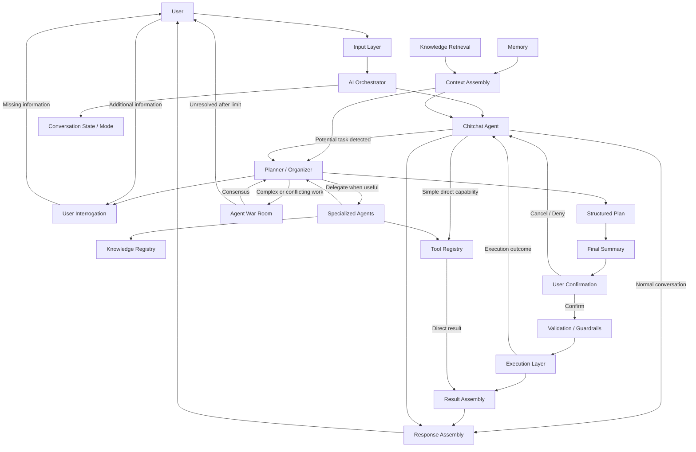

## 1.2 Target Architecture

The target architecture defines how Purrfect's major components interact during normal conversation, focused task planning, specialized-agent delegation, execution, and result delivery.

The architecture is designed around a lightweight conversational default.

Purrfect should not enter a heavyweight planning workflow for every user message.

The default flow is:

```text
User
    ↓
Input Layer
    ↓
AI Orchestrator
    ↓
Chitchat Agent
    │
    ├── Normal conversation
    │       ↓
    │   Response Assembly
    │       ↓
    │      User
    │
    └── Potential task detected
            ↓
        Planner / Organizer
            ↓
        User Interrogation
            │
            ├── Specialized Agents
            │       │
            │       ├── Shared Tools
            │       └── Knowledge Retrieval
            │
            ├── Agent War Room
            │
            └── Additional Clarification
                    ↓
              Structured Plan
                    ↓
             Final User Summary
                    ↓
             User Confirmation
                │       │
             Deny     Confirm
                │       │
                ↓       ↓
            Chitchat  Validation
                        ↓
                   Execution Layer
                        ↓
                  Execution Result
                        ↓
                  Result Assembly
                        ↓
                     Chitchat
                        ↓
                       User
```

The architecture should support lightweight direct handling when a request does not require planning.

For example, Chitchat may directly use an appropriate exceptional tool when the task can be safely resolved immediately.

```text
User
    ↓
Chitchat Agent
    ↓
Exceptional Tool
    ↓
Result
    ↓
Response Assembly
    ↓
User
```

Examples may include:

- Web traversal for a simple factual lookup.
- Maps for a simple location lookup.
- Other low-risk tools that do not require planning or multi-step execution.

This does not bypass execution controls when the selected capability performs an external side effect.

---

### Target Architecture Flow



---

### Core Architectural Flow

The target runtime lifecycle is:

```text
1. User Input
       ↓
2. Input Layer
       ↓
3. AI Orchestrator
       ↓
4. Chitchat Agent
       ↓
5. Determine conversational path

   ┌──────────────────────────────┐
   │                              │
   ▼                              ▼

Normal Conversation          Focused Task
   │                              │
   ▼                              ▼
Response Assembly          Planner / Organizer
   │                              │
   │                              ▼
   │                       User Interrogation
   │                              │
   │                    ┌─────────┴─────────┐
   │                    │                   │
   │                    ▼                   ▼
   │             Specialized Agents   Agent War Room
   │                    │                   │
   │                    └─────────┬─────────┘
   │                              ▼
   │                       Structured Plan
   │                              ↓
   │                       Final Summary
   │                              ↓
   │                       User Confirmation
   │                              │
   │                    ┌─────────┴─────────┐
   │                    │                   │
   │                  Deny                Confirm
   │                    │                   │
   │                    ▼                   ▼
   │                Chitchat           Validation
   │                                        ↓
   │                                   Execution
   │                                        ↓
   │                                  Result Assembly
   │                                        ↓
   └──────────────────────────────────────→ Chitchat
                                            ↓
                                      Response Assembly
                                            ↓
                                           User
```

---

### Chitchat as the Default Entry Point

Chitchat Agent is the default conversational entry point after the AI Orchestrator.

Its primary responsibilities are:

- Handle normal conversation.
- Maintain lightweight conversational interaction.
- Detect potential transitions into focused task workflows.
- Request a transition to Planner / Organizer when appropriate.
- Handle simple tasks that do not require planning.
- Use exceptional direct capabilities when appropriate.
- Return naturally to normal conversation after task completion or cancellation.

The system should optimize for the common case.

A simple request should not automatically activate the entire planning pipeline.

For example:

```text
User:
"How are you?"

        ↓

Chitchat Agent

        ↓

Response Assembly

        ↓

User
```

While:

```text
User:
"I need to organize my daughter's birthday party."

        ↓

Chitchat Agent
        ↓
Potential focused task detected
        ↓
Planner / Organizer
```

---

### Planner / Organizer Activation

Planner / Organizer should be activated when a request requires focused task planning, information gathering, clarification, coordination, or multi-step execution.

The transition may occur when:

- The user explicitly requests planning.
- Chitchat detects a potential task.
- The task requires missing information.
- Multiple actions must be coordinated.
- Specialized expertise is required.
- The task requires structured execution.
- The user agrees to enter a focused planning workflow.

The Planner / Organizer should not be activated unnecessarily.

The goal is to preserve a lightweight conversational experience while still supporting complex workflows.

---

### Dynamic Planner Delegation

Planner / Organizer should be able to dynamically delegate work to Specialized Agents during interrogation and planning.

The Planner does not need to gather every piece of information before contacting an agent.

For example:

```text
User:
"Also, what should I buy for dinner?"

        ↓

Planner / Organizer

        ↓
Need information:
- Number of people
- Dietary constraints
- Desired meal

        ↓

Call relevant Specialized Agent

        ↓

Agent provides:
- Recommendation
- Relevant questions
- Missing information

        ↓

Planner continues interrogation
```

This allows the Planner / Organizer to use specialized expertise while the conversation is still in progress.

The resulting workflow should feel like one continuous conversation rather than a sequence of disconnected agent handoffs.

---

### Specialized Agent Collaboration

Specialized Agents should be independently discoverable and auto-registerable.

The Planner / Organizer should delegate only when specialized expertise provides meaningful value.

The system should prefer the minimum number of agents required to solve the task.

Multiple agents should not be invoked simply because they are available.

Shared Tools and Knowledge sources may be used by multiple Specialized Agents.

Conceptually:

```text
Planner / Organizer
        │
        ├── Specialized Agent A
        │       ├── Shared Tools
        │       └── Knowledge
        │
        ├── Specialized Agent B
        │       ├── Shared Tools
        │       └── Knowledge
        │
        └── Specialized Agent C
                ├── Shared Tools
                └── Knowledge
```

If one Specialized Agent can complete a task using shared capabilities, additional agents should not be invoked unnecessarily.

This reduces:

- Token usage.
- Latency.
- Coordination overhead.
- Unnecessary model calls.

---

### Agent War Room

Agent War Room is an optional collaboration mechanism for complex or conflicting tasks.

It should not be used for ordinary tasks.

The Planner / Organizer may invoke the War Room when:

- Multiple specialized agents disagree.
- The task has significant complexity.
- Multiple valid approaches require comparison.
- A higher-confidence decision is required.
- No single specialized agent can confidently resolve the problem.

The War Room should operate within a defined limit.

If the agents cannot reach sufficient agreement after the allowed number of rounds, the system should request user judgment rather than continuing indefinitely.

Conceptually:

```text
Planner / Organizer
        ↓
Agent War Room
        ↓
 ┌───────────────┐
 │               │
 ▼               ▼
Consensus     No Consensus
 │               │
 ▼               ▼
Planner       User Judgment
```

---

### Structured Planning and Confirmation

Planner / Organizer should produce a structured plan after sufficient information has been gathered.

The workflow is:

```text
Interrogation
    ↓
Gather Information
    ↓
Delegate to Specialized Agents
    ↓
Resolve Conflicts
    ↓
Structured Plan
    ↓
Final Summary
    ↓
User Confirmation
```

The user must have the opportunity to:

- Confirm execution.
- Deny execution.
- Cancel the workflow.

A denied or cancelled plan should return the conversational flow to Chitchat.

---

### Execution Boundary

The Execution Layer is responsible for controlled execution after the appropriate confirmation and validation requirements have been satisfied.

The architecture should distinguish:

```text
Plan
    ≠
Execution
```

And:

```text
User Intent
    ≠
Execution Permission
```

The flow is:

```text
Planner / Organizer
        ↓
Structured Plan
        ↓
Final Summary
        ↓
User Confirmation
        ↓
Validation / Guardrails
        ↓
Execution Layer
        ↓
Result
```

Specialized Agents, Chitchat, and the AI Orchestrator should not bypass the Execution Layer when an action requires controlled execution.

---

### Post-Execution Conversational Return

After execution completes, the system should return the user to the normal conversational flow.

```text
Execution
    ↓
Execution Result
    ↓
Result Assembly
    ↓
Chitchat
    ↓
Response Assembly
    ↓
User
```

The user should not remain trapped in Planner mode after the task is complete.

Likewise, if the user cancels or denies the final confirmation:

```text
Planner
    ↓
Cancel / Deny
    ↓
Chitchat
```

The system should resume normal conversation naturally.

---

### Context and Knowledge Flow

Memory and external knowledge should contribute to Context Assembly rather than being treated as direct conversational outputs.

Conceptually:

```text
Memory ────────────┐
                   │
Knowledge Retrieval ─┼──→ Context Assembly
                   │
Current Input ─────┘
                         │
                         ▼
                   Active Component
```

The relevant active component may be:

- Chitchat Agent.
- Planner / Organizer.
- Specialized Agent.
- Other system component requiring contextual information.

Context Assembly should provide the information required by the active workflow without unnecessarily exposing the entire available memory or knowledge base.

---

### Exceptional Direct Capability Usage

Not every capability requires Planner / Organizer.

For simple, low-risk requests, Chitchat may directly use an appropriate capability.

Example:

```text
User:
"What is the phone number for the fire department?"

        ↓

Chitchat Agent
        ↓
Web Traversal / Search Tool
        ↓
Result
        ↓
Response Assembly
        ↓
User
```

This is an exception to the normal planning flow.

The decision should be based on the task requirements and execution safety.

A direct capability call must not bypass required validation or execution controls for actions with external side effects.

---

### Target Architectural Principles

The target architecture follows these principles:

- Chitchat is the default conversational entry point.
- The AI Orchestrator remains a thin coordination layer.
- Planner / Organizer is activated only when focused task workflows are required.
- Simple requests should remain lightweight.
- Complex requests should receive deeper orchestration.
- Planner / Organizer owns user interrogation and task information gathering.
- Planner / Organizer can dynamically delegate to Specialized Agents during interrogation.
- Specialized Agents should be used only when their expertise provides meaningful value.
- The minimum number of agents required should be preferred.
- Shared Tools and Knowledge should be reusable across Specialized Agents.
- Agent War Room should be reserved for complex or conflicting work.
- War Room debate should have a bounded number of rounds.
- Unresolved decisions should be escalated to the user.
- Structured plans should be separated from execution.
- Final user confirmation should occur before controlled execution.
- Execution should be controlled by the Execution Layer.
- Execution results should return to the conversational flow.
- Completed or cancelled workflows should return to Chitchat.
- Context Assembly should provide relevant information to the active workflow.
- Knowledge Retrieval should avoid unnecessary context expansion.
- Exceptional direct capability usage should be supported for simple requests.
- Internal agent complexity should remain invisible to the user by default.
- The system should optimize for token efficiency and unnecessary model-call avoidance.
- New agents, tools, and knowledge sources should be addable without rewriting unrelated core orchestration logic.

---

## Done When

- [ ] The target runtime flow from user input to final response is documented.
- [ ] Chitchat is clearly defined as the default conversational entry point.
- [ ] The AI Orchestrator remains a thin coordination layer in the target architecture.
- [ ] Planner / Organizer activation conditions are documented.
- [ ] Planner / Organizer interrogation and dynamic delegation flow is documented.
- [ ] Specialized Agent collaboration flow is documented.
- [ ] Shared Tool and Knowledge usage by Specialized Agents is documented.
- [ ] Minimum-agent selection is represented as an architectural principle.
- [ ] Agent War Room activation and bounded-debate flow is documented.
- [ ] User escalation after unresolved War Room conflict is documented.
- [ ] Structured planning is clearly separated from execution.
- [ ] Final user confirmation is clearly positioned before controlled execution.
- [ ] Cancellation and confirmation-denial flows return naturally to Chitchat.
- [ ] Execution results return naturally to the conversational flow.
- [ ] Context Assembly is represented in the target architecture.
- [ ] Memory and Knowledge Retrieval interaction with Context Assembly is documented.
- [ ] Exceptional direct capability usage by Chitchat is documented.
- [ ] Direct capability usage does not bypass required execution controls.
- [ ] Major architecture boundaries are represented in implementation-level documentation.
- [ ] Major boundaries are stable enough to begin MVP implementation.
- [ ] Architecture decisions are recorded before large implementation work begins.
- [ ] The architecture can support adding new Agents, Tools, and Knowledge sources without rewriting unrelated core orchestration logic.