# Project Purrfect 3.0 Planner

Last updated: 2026-07-27

## Baseline Snapshot

- [x] Original Purrfect 2.0 architecture reviewed.
- [x] Original dynamic tool discovery architecture reviewed.
- [x] Original mocked calendar tool reviewed.
- [x] Original conversation/task memory architecture reviewed.
- [x] Original prompt-driven task detection reviewed.
- [x] Original local ML classification architecture reviewed.
- [x] Original user-driven retraining workflow reviewed.
- [x] Original Telegram / terminal input switching reviewed.
- [x] Purrfect 3.0 positioned as an AI/LLM engineering flagship portfolio project.
- [x] Initial README architecture documented.
- [x] Metadata-first Tool Registry concept identified.
- [x] Metadata-first Knowledge Registry concept identified.
- [x] Metadata-first Agent Registry concept identified.
- [x] Planner / Organizer concept identified as the replacement for the original intent-centric interaction model.
- [x] User interrogation concept identified.
- [x] Specialized agent delegation concept identified.
- [x] Parallel agent execution concept identified.
- [x] Agent War Room concept identified.
- [x] Execution Layer identified as a boundary between planning and real-world side effects.
- [x] Automatic return to general conversation after execution identified as a target behavior.

---

# 1. Architecture Foundation

## 1.1 Core System Boundaries

- [x] Define the responsibility of the AI Orchestrator.
- [x] Define the responsibility of the Planner / Organizer.
- [x] Define the responsibility of specialized agents.
- [x] Define the responsibility of the Tool Registry.
- [x] Define the responsibility of the Knowledge Registry.
- [x] Define the responsibility of the Agent Registry.
- [x] Define the responsibility of the Execution Layer.
- [x] Define the responsibility of Memory.
- [x] Define the responsibility of Context Assembly.
- [x] Define the responsibility of Response Assembly.

## Done When

- [x] Every major component has a clearly defined responsibility.
- [x] Every major component has a documented responsibility boundary.
- [x] No component becomes a hidden monolithic "god object".
- [x] No component duplicates another component's primary responsibility.
- [ ] Data flow between major components is documented.
- [x] Major component interactions have clearly defined ownership boundaries.
- [x] Agent, tool, and knowledge responsibilities are clearly separated.
- [x] Planner / Organizer and AI Orchestrator responsibilities are clearly separated.
- [x] Planning, reasoning, and execution responsibilities are clearly separated.
- [x] User-facing response assembly is clearly separated from internal system orchestration.
- [x] Memory, Context Assembly, and Response Assembly responsibilities are clearly separated.
- [x] Registry components are responsible for discovery and metadata rather than owning execution logic.
- [x] Execution is controlled by the Execution Layer rather than directly by agents or the AI Orchestrator.
- [x] Specialized Agents cannot bypass the defined orchestration and execution boundaries.
- [ ] The architecture can support adding new agents, tools, and knowledge sources without modifying unrelated core components.
- [ ] The documented boundaries are consistent across the architecture diagrams and component responsibility documents.

---

## 1.2 Target Architecture

Define the target runtime architecture and major component interaction flow.

The target architecture should reflect the decisions established in `1.1 Core System Boundaries`.

Key architectural goals:

- Chitchat Agent is the default conversational entry point.
- AI Orchestrator remains a thin coordination layer.
- Planner / Organizer is activated only when focused task workflows are required.
- Planner / Organizer can interrogate the user and dynamically delegate to Specialized Agents.
- Specialized Agents can use shared Tools and Knowledge when appropriate.
- Agent War Room supports complex or conflicting specialized-agent work.
- War Room debate is bounded and unresolved conflicts can be escalated to the user.
- Structured planning is separated from controlled execution.
- Final user confirmation occurs before execution.
- Completed or cancelled workflows return to Chitchat mode.
- Simple requests may use direct capabilities without entering Planner mode when appropriate.
- Context Assembly provides relevant Memory and Knowledge to the active workflow.
- The architecture prioritizes minimal unnecessary agent calls and token usage.

Target architecture:

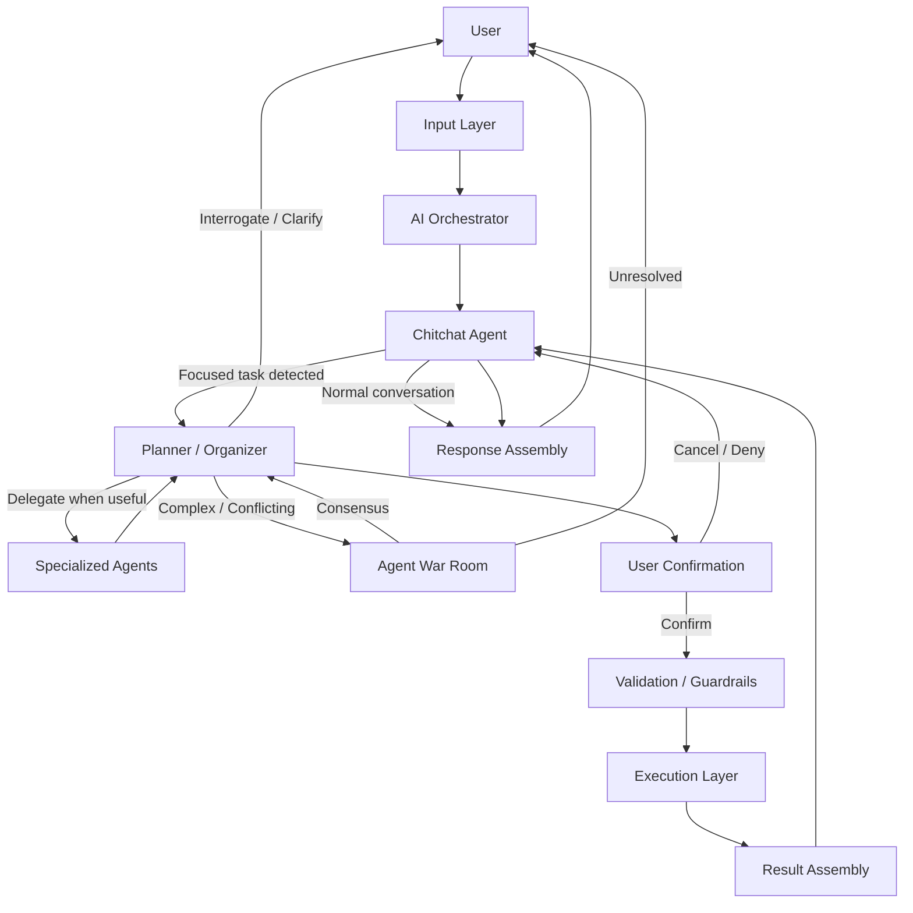

Detailed architecture documentation:

`docs/architecture-foundation/target-architecture.md`

Done when:

- [x] The target runtime flow is documented.
- [x] Major component interactions are documented.
- [x] Architecture decisions are recorded before large implementation work begins.
- [ ] Major boundaries are stable enough to begin MVP implementation.

---

# 2. LLM Provider Layer

Purrfect should not couple the application directly to one model provider.

## Must Have

- [x] Define LLM provider interface.
- [x] Define structured response contract.
- [x] Define model configuration.
- [x] Define provider-specific adapter boundary.
- [x] Define timeout behavior.
- [x] Define retry behavior.
- [x] Define provider failure handling.
- [x] Define token usage metadata.
- [x] Define model selection / routing strategy.

Potential providers:

- OpenAI
- Local LLM provider
- Future provider adapters

Done when:

- [x] Core orchestration does not depend directly on provider-specific APIs.
- [x] Provider can be replaced without rewriting the orchestration layer.
- [x] Structured outputs are validated before entering system workflows.

---

# 3. Conversation Mode System

Purrfect should maintain a high-level conversational state instead of treating every message as an isolated intent classification problem.

The conversation mode system manages the user's current interaction state and transitions between conversational workflows.

The MVP uses two primary conversation modes:

- `chitchat`
- `planner`

The exact mode names are implementation details.

## Must Have

- [x] Define conversation mode state.
- [x] Define mode transition rules.
- [x] Define task signal detection.
- [x] Define planning mode entry and user confirmation.
- [x] Define planning acceptance and rejection behavior.
- [x] Define automatic return to chitchat after execution.
- [x] Define active planning state across multiple turns.
- [x] Define behavior when the user changes topic during planning.

Target flow:

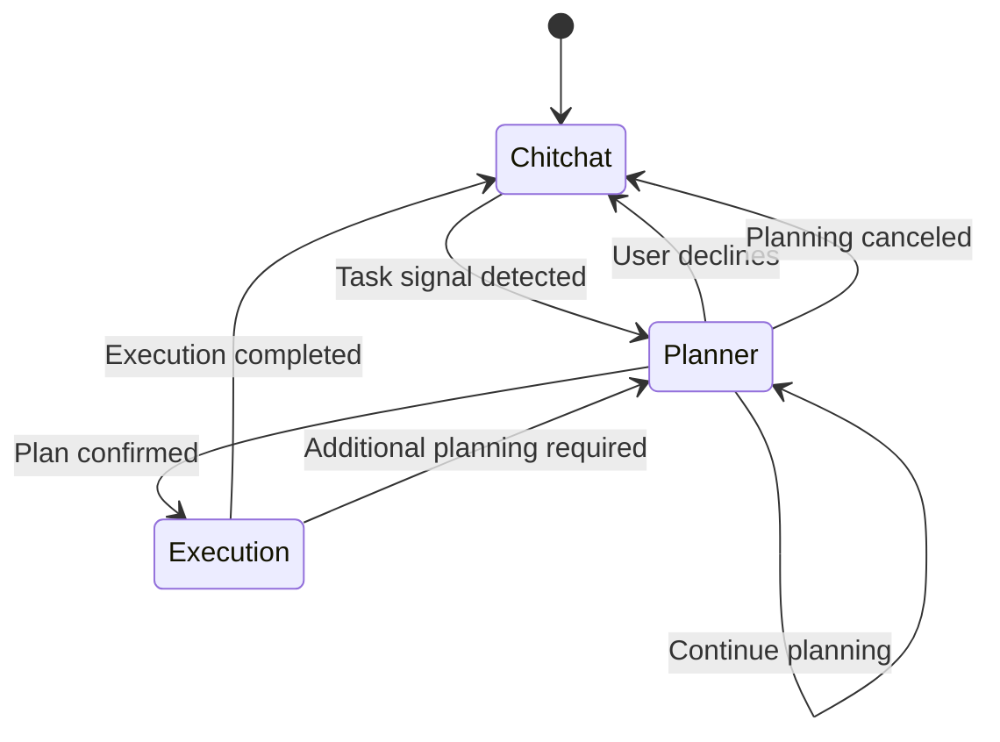

Note: `Execution` is represented in the flow for clarity but is not part of the conversational mode state.

## Done When

- [ ] Casual conversation does not unnecessarily trigger planning workflows.
- [ ] Task signals can naturally transition into planning.
- [ ] Active planning survives multiple turns.
- [ ] Execution remains separate from conversation mode state.
- [ ] Completed execution returns the conversation to general interaction.
- [ ] The user does not feel like they are jumping between disconnected systems.

---

# 4. Planner / Organizer Agent

The Planner / Organizer is the central conversational coordinator.

It replaces the original architecture's heavy reliance on direct intent classification.

The Planner should understand what the user is trying to accomplish rather than simply assigning one label to every message.

## Responsibilities

- [ ] Detect one or more user objectives.
- [ ] Separate unrelated objectives.
- [ ] Maintain active planning state.
- [ ] Track known information.
- [ ] Track missing information.
- [ ] Ask clarification questions.
- [ ] Ask follow-up questions.
- [ ] Delegate questions to specialized agents when useful.
- [ ] Continue interrogation after receiving delegated answers.
- [ ] Maintain context across multiple turns.
- [ ] Determine when enough information has been collected.
- [ ] Produce a structured plan.
- [ ] Request final confirmation.
- [ ] Hand confirmed plans to the execution layer.

## Planner State

Potential state:

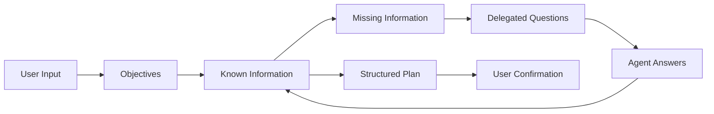

Done when:

- [ ] Planner can manage a multi-turn planning session.
- [ ] Planner can track missing parameters.
- [ ] Planner can ask questions naturally.
- [ ] Planner can delegate questions without losing conversation state.
- [ ] Planner can produce a structured plan.
- [ ] Planner can request confirmation before side effects.

---

# 5. User Interrogation

"Interrogation" is the working concept for actively gathering missing information.

The system should not silently wait until every detail is known.

The Planner may ask questions incrementally and intelligently.

## Must Have

- [ ] Define missing-information representation.
- [ ] Define required vs optional information.
- [ ] Define question prioritization.
- [ ] Define clarification handling.
- [ ] Define answer validation.
- [ ] Define correction handling.
- [ ] Define context preservation.
- [ ] Define cancellation behavior.

Example:

```text
User:
"I need to call my mom at 9 PM tomorrow."

Planner:
"What is the purpose of the call?"

User:
"Business stuff."

Planner:
"Got it. I'll prepare that as a business-related reminder."
```

The Planner should also support mixed conversational requests:

```text
User:
"Also, what should I buy for dinner?"
```

The Planner may delegate to a Chitchat / General Conversation Agent:

```text
Planner -> Chitchat Agent
"Answer the dinner question and identify useful follow-up information."

Chitchat Agent -> Planner
"Ask how many people are eating and whether the user wants a shopping list."

Planner -> User
"For three to four people, I suggest X.
Do you want me to make a shopping list?"
```

Done when:

- [ ] Interrogation feels conversational rather than form-like.
- [ ] Planner can delegate questions during interrogation.
- [ ] Planner can continue interrogation after agent responses.
- [ ] Planner can combine information gathered from multiple turns and agents.
- [ ] Planner can stop interrogating when requirements are satisfied.

---

# 6. Agent Registry

Specialized agents should be dynamically discoverable in a similar manner to tools.

## Agent Metadata

Potential metadata:

- Agent name
- Display name
- Description
- Capabilities
- Supported task types
- Input schema
- Output schema
- Required context
- Optional context
- Risk level
- Cost profile
- Model preference
- Priority
- Version
- Execution constraints

## Must Have

- [ ] Define agent metadata contract.
- [ ] Define agent registration mechanism.
- [ ] Define automatic agent discovery.
- [ ] Define agent validation.
- [ ] Define agent capability metadata.
- [ ] Define agent lifecycle.
- [ ] Define agent versioning.
- [ ] Define agent routing.

Target architecture:

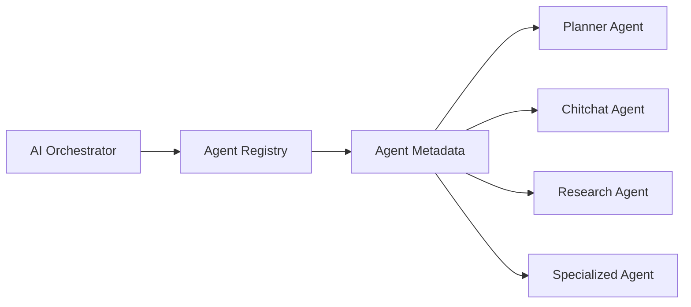

Done when:

- [ ] New specialized agents can be added without modifying central orchestration logic.
- [ ] Agent capabilities can be discovered dynamically.
- [ ] Only relevant agent metadata is provided to the LLM.
- [ ] Agent selection is traceable.

---

# 7. Specialized Agent Architecture

Potential initial agents:

### Planner / Organizer Agent

Responsible for:

- [ ] Conversation planning.
- [ ] User interrogation.
- [ ] Task decomposition.
- [ ] Delegation.
- [ ] Final plan assembly.

### Chitchat / General Conversation Agent

Responsible for:

- [ ] Casual conversation.
- [ ] General questions.
- [ ] Lightweight recommendations.
- [ ] Natural conversational responses.
- [ ] Supporting Planner interrogation when appropriate.

### Task / Execution Specialist

Responsible for:

- [ ] Task-specific preparation.
- [ ] Tool selection support.
- [ ] Parameter validation.
- [ ] Execution preparation.

### Research Agent

Responsible for:

- [ ] Research tasks.
- [ ] Knowledge retrieval.
- [ ] Source comparison.
- [ ] Evidence gathering.

Future agents may include:

- [ ] Writing Agent.
- [ ] Coding Agent.
- [ ] Analysis Agent.
- [ ] Project Planning Agent.
- [ ] Domain-specific agents.

Done when:

- [ ] Each agent has a narrow, defensible responsibility.
- [ ] Agents communicate through structured contracts.
- [ ] Agents do not require access to the entire conversation by default.

---

# 8. Agent Collaboration

Agents should be able to request assistance from other agents when required.

Target flow:

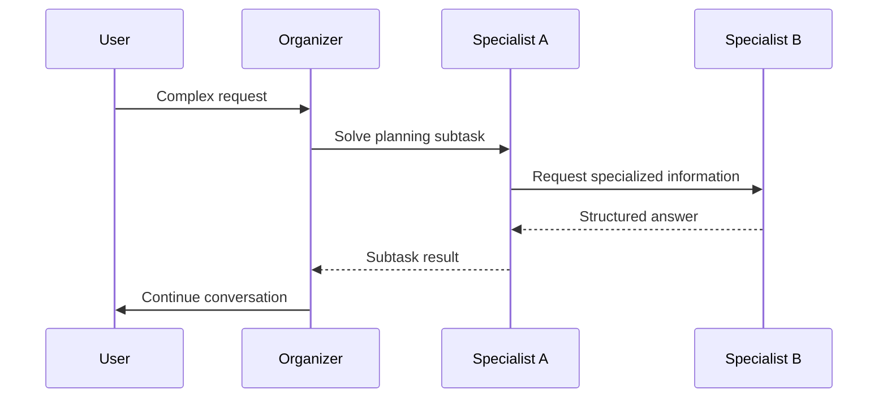

## Must Have

- [ ] Define agent-to-agent communication contract.
- [ ] Define delegation metadata.
- [ ] Define context boundaries.
- [ ] Define timeout behavior.
- [ ] Define failure handling.
- [ ] Define recursion limits.
- [ ] Define maximum delegation depth.
- [ ] Define circular delegation protection.

Done when:

- [ ] Agents can collaborate safely.
- [ ] Delegation is observable.
- [ ] Infinite agent loops are prevented.
- [ ] Agent failures do not destroy the parent planning session.

---

# 9. Agent War Room

The Agent War Room is an advanced orchestration concept for complex problems.

The system should be capable of bringing multiple specialized agents together to independently analyze, challenge, and improve a solution.

Potential participants:

- Planner
- Researcher
- Analyst
- Architect
- Critic
- Domain Specialist
- Reviewer
- Execution Specialist

## War Room Flow

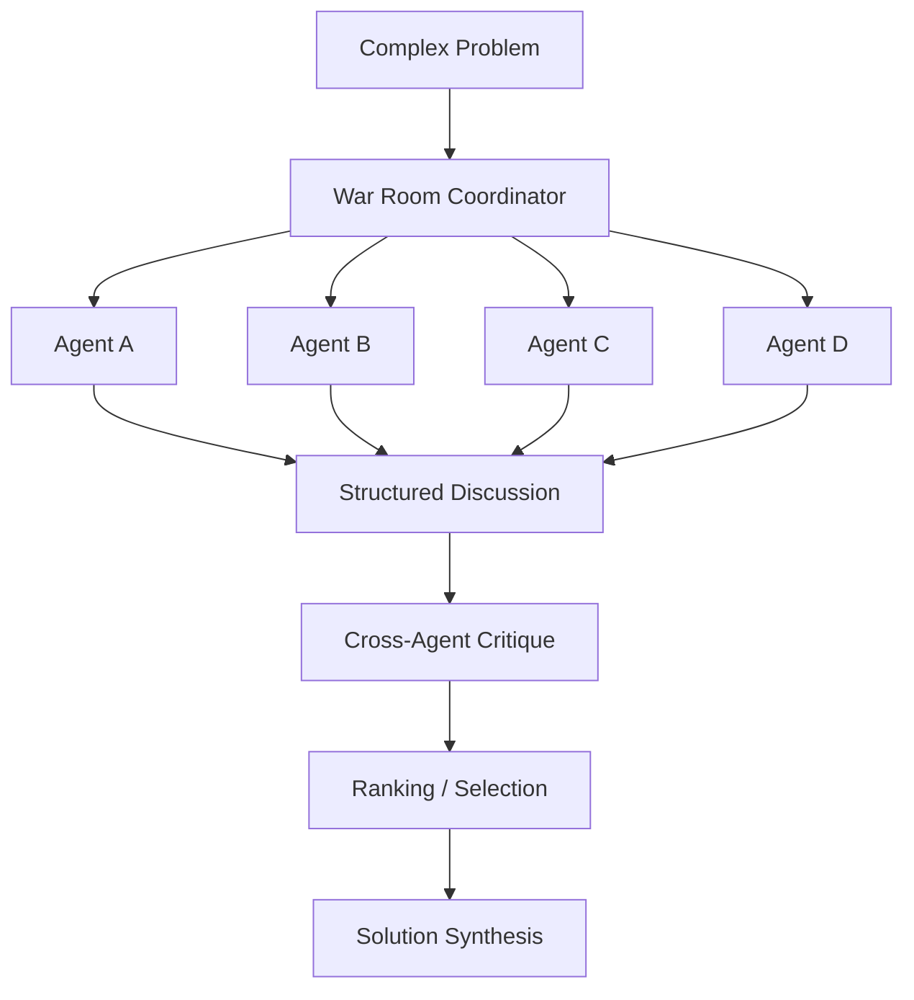

## Must Have

- [ ] Define when War Room activation is justified.
- [ ] Define participating agent selection.
- [ ] Define agent budget limits.
- [ ] Define maximum rounds.
- [ ] Define discussion protocol.
- [ ] Define critique protocol.
- [ ] Define ranking or voting mechanism.
- [ ] Define final synthesis.
- [ ] Define failure and disagreement handling.
- [ ] Define observability.

## Battle Royale Concept

Purrfect may support competitive agent workflows.

Agents may independently propose solutions and challenge competing proposals.

This should remain bounded by the War Room Coordinator.

The coordinator should prevent:

- Infinite debate.
- Unbounded token usage.
- Repeated arguments.
- Circular delegation.
- Unproductive agent interaction.

Done when:

- [ ] Complex problems can be solved through multi-agent collaboration.
- [ ] Agent disagreement can be represented.
- [ ] Competing solutions can be compared.
- [ ] Final synthesis is deterministic enough to test.
- [ ] War Room activity is traceable.

---

# 10. Tool Registry

Tools should be dynamically discoverable and registered through metadata.

## Must Have

- [ ] Define tool metadata contract.
- [ ] Define automatic tool discovery.
- [ ] Define tool registration.
- [ ] Define action discovery.
- [ ] Define parameter schema.
- [ ] Define required vs optional parameters.
- [ ] Define tool validation.
- [ ] Define authorization.
- [ ] Define execution policy.
- [ ] Define tool versioning.

Target flow:

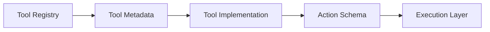

Done when:

- [ ] New tools can be added without rewriting the AI core.
- [ ] Tool metadata can be discovered dynamically.
- [ ] Only relevant tool metadata is sent to the LLM.
- [ ] Tool execution is schema-validated.

---

# 11. Knowledge / RAG System

Purrfect 3.0 should support external knowledge as a separate system from conversational memory.

The system should use metadata-first discovery where possible.

## Knowledge Pipeline

- [ ] Define supported document types.
- [ ] Implement document ingestion.
- [ ] Implement document chunking.
- [ ] Implement metadata extraction.
- [ ] Implement embeddings.
- [ ] Implement vector storage.
- [ ] Implement semantic retrieval.
- [ ] Implement metadata filtering.
- [ ] Implement context assembly.
- [ ] Track retrieval metadata.
- [ ] Define Knowledge Registry.
- [ ] Define knowledge source metadata.
- [ ] Define selective knowledge loading.

Target flow:

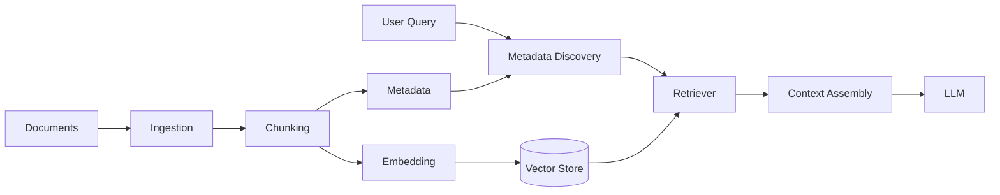

Done when:

- [ ] Purrfect can answer questions using external knowledge.
- [ ] Retrieved context can be traced.
- [ ] Knowledge retrieval is separate from user memory.
- [ ] Metadata can be used to identify relevant knowledge before retrieval.
- [ ] Unnecessary knowledge is not loaded into LLM context.

---

# 12. Memory Architecture

Memory should be divided into deliberate layers.

Potential layers:

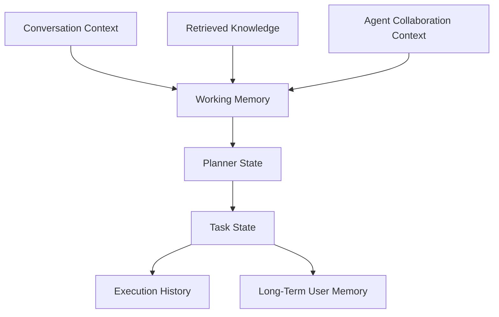

## Must Have

- [ ] Define conversation memory.
- [ ] Define working memory.
- [ ] Define Planner state.
- [ ] Define task state.
- [ ] Define long-term memory.
- [ ] Define retrieved knowledge boundaries.
- [ ] Define execution history.
- [ ] Define agent collaboration context.
- [ ] Define memory retention policies.
- [ ] Define memory cleanup policies.

Done when:

- [ ] Conversation history is not treated as the only memory mechanism.
- [ ] Planner state can survive multi-turn interactions.
- [ ] Temporary planning data can be separated from persistent memory.
- [ ] Memory retrieval is traceable.

---

# 13. Structured Planning and Execution

AI-generated plans should not directly trigger unrestricted side effects.

Target flow:

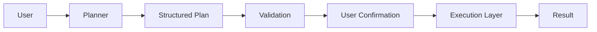

## Must Have

- [ ] Define structured plan schema.
- [ ] Define plan validation.
- [ ] Define confirmation requirements.
- [ ] Define execution policy.
- [ ] Define side-effect classification.
- [ ] Define destructive action handling.
- [ ] Define retry behavior.
- [ ] Define failure behavior.
- [ ] Define partial execution behavior.

Done when:

- [ ] Plans are validated before execution.
- [ ] Side effects are explicitly controlled.
- [ ] User confirmation can be required where appropriate.
- [ ] Failed execution does not incorrectly report success.

---

# 14. Execution Layer as System Switch

The Execution Layer should act as the boundary between planning and real-world side effects.

After a plan is executed and results are assembled, the system should normally return to general conversation.

Target lifecycle:

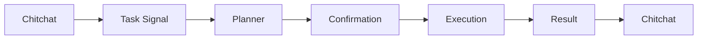

Done when:

- [ ] Execution completion automatically returns the system to general conversation.
- [ ] User can continue chatting naturally after execution.
- [ ] A new task signal can start a new planning session.
- [ ] Previous execution context does not accidentally trigger repeated actions.

---

# 15. Observability and Tracing

AI systems require visibility into how a response was produced.

## Must Have

- [ ] Trace user request.
- [ ] Trace mode transitions.
- [ ] Trace Planner decisions.
- [ ] Trace interrogation rounds.
- [ ] Trace agent selection.
- [ ] Trace agent delegation.
- [ ] Trace War Room participation.
- [ ] Trace knowledge retrieval.
- [ ] Trace tool selection.
- [ ] Trace tool execution.
- [ ] Trace execution results.
- [ ] Track token usage.
- [ ] Track latency.
- [ ] Track failures.

Trace concept:

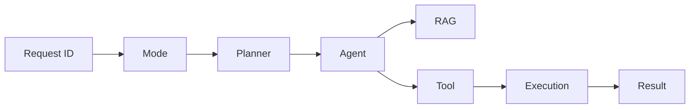

Done when:

- [ ] A complex request can be reconstructed from execution traces.
- [ ] Agent and tool decisions are observable.
- [ ] Retrieval and execution are traceable.
- [ ] Debugging does not require exposing private model reasoning.

---

# 16. Security and Guardrails

## Must Have

- [ ] Validate all structured model outputs.
- [ ] Validate tool parameters.
- [ ] Enforce tool authorization.
- [ ] Enforce execution policies.
- [ ] Define confirmation requirements.
- [ ] Prevent unauthorized side effects.
- [ ] Prevent unbounded agent recursion.
- [ ] Prevent unbounded War Room execution.
- [ ] Protect sensitive memory.
- [ ] Protect API credentials.
- [ ] Audit important actions.

Done when:

- [ ] LLM output cannot directly bypass execution controls.
- [ ] Agents cannot arbitrarily execute tools.
- [ ] High-risk actions require explicit policy enforcement.
- [ ] Agent collaboration has bounded resource usage.

---

# 17. Testing Strategy

Testing should cover individual AI system components and complete workflows.

## Unit Tests

- [ ] Planner state transitions.
- [ ] Mode transitions.
- [ ] Agent registry.
- [ ] Tool registry.
- [ ] Knowledge registry.
- [ ] Structured output validation.
- [ ] Parameter validation.
- [ ] Memory boundaries.
- [ ] Retrieval metadata.
- [ ] Execution policies.

## Integration Tests

- [ ] User -> Planner -> Tool.
- [ ] User -> Planner -> Agent.
- [ ] Planner -> Agent -> Agent.
- [ ] Planner -> RAG -> Agent.
- [ ] Planner -> Tool -> Execution.
- [ ] Multi-objective planning.
- [ ] Multi-turn interrogation.
- [ ] Agent War Room.
- [ ] Execution -> Chitchat transition.

## Failure Tests

- [ ] LLM provider unavailable.
- [ ] Invalid structured output.
- [ ] Agent timeout.
- [ ] Agent failure.
- [ ] Tool failure.
- [ ] RAG retrieval failure.
- [ ] User cancels planning.
- [ ] User changes objective.
- [ ] Agent recursion limit reached.
- [ ] War Room budget exceeded.

Done when:

- [ ] Core orchestration has automated test coverage.
- [ ] Critical execution paths are covered.
- [ ] Failure behavior is explicitly tested.
- [ ] Multi-agent workflows are deterministic enough to validate.

---

# 18. MVP Definition

The first Purrfect 3.0 MVP should prove the architecture end-to-end without attempting to implement every planned capability.

## MVP Scope

- [ ] One LLM provider.
- [ ] One Planner / Organizer Agent.
- [ ] One Chitchat Agent.
- [ ] One specialized task agent.
- [ ] Dynamic Agent Registry.
- [ ] Dynamic Tool Registry.
- [ ] One real or mocked tool.
- [ ] Basic conversation mode system.
- [ ] Multi-turn interrogation.
- [ ] Structured plan generation.
- [ ] User confirmation.
- [ ] Controlled execution.
- [ ] Execution result.
- [ ] Automatic return to chitchat.
- [ ] Basic memory.
- [ ] Basic execution tracing.

Target MVP flow:

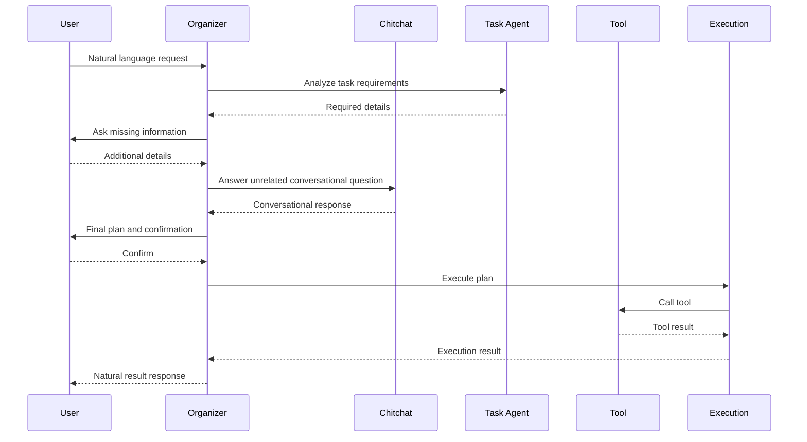

Done when:

- [ ] Complete MVP flow works end-to-end.
- [ ] System can handle at least one multi-turn planning workflow.
- [ ] System can delegate to a specialized agent.
- [ ] System can execute a controlled tool.
- [ ] System can return naturally to chitchat.

---

# 19. Future Expansion

## Advanced Agent System

- [ ] More specialized agents.
- [ ] Agent capability scoring.
- [ ] Agent cost-aware routing.
- [ ] Agent model routing.
- [ ] Agent performance metrics.
- [ ] Agent version management.

## Advanced War Room

- [ ] Multi-round debate.
- [ ] Critic agents.
- [ ] Independent solution generation.
- [ ] Solution ranking.
- [ ] Consensus synthesis.
- [ ] Competitive agent evaluation.
- [ ] Budget-aware War Room execution.

## Advanced Knowledge System

- [ ] Automatic knowledge source registration.
- [ ] Knowledge source health checks.
- [ ] Incremental indexing.
- [ ] Hybrid search.
- [ ] Reranking.
- [ ] Knowledge source versioning.

## Advanced Memory

- [ ] Long-term user preferences.
- [ ] Memory importance scoring.
- [ ] Memory expiration.
- [ ] Memory correction.
- [ ] User-controlled memory management.

## Production Hardening

- [ ] Authentication.
- [ ] Authorization.
- [ ] Rate limiting.
- [ ] Secret management.
- [ ] Distributed tracing.
- [ ] Metrics.
- [ ] Alerting.
- [ ] Deployment automation.
- [ ] Disaster recovery.

---

# 20. Recommended Execution Order

1. Define core architecture boundaries.
2. Define LLM provider abstraction.
3. Define structured data contracts.
4. Define Conversation Mode system.
5. Define Planner / Organizer state.
6. Define User Interrogation flow.
7. Define Agent contract.
8. Implement Agent Registry.
9. Implement first Chitchat Agent.
10. Implement first specialized Agent.
11. Define Tool contract.
12. Implement Tool Registry.
13. Implement controlled Execution Layer.
14. Connect Planner -> Agent -> Tool -> Execution.
15. Implement basic Memory.
16. Implement execution tracing.
17. Add Knowledge / RAG architecture.
18. Add Knowledge Registry and metadata-first discovery.
19. Implement multi-agent delegation.
20. Implement parallel agent execution.
21. Implement Agent War Room.
22. Expand testing.
23. Harden security and execution guardrails.
24. Validate complete MVP.
25. Begin production-readiness work.

---

# Final Target

The long-term target for Purrfect 3.0 is not simply:

> User -> LLM -> Tool

The intended architecture is closer to:

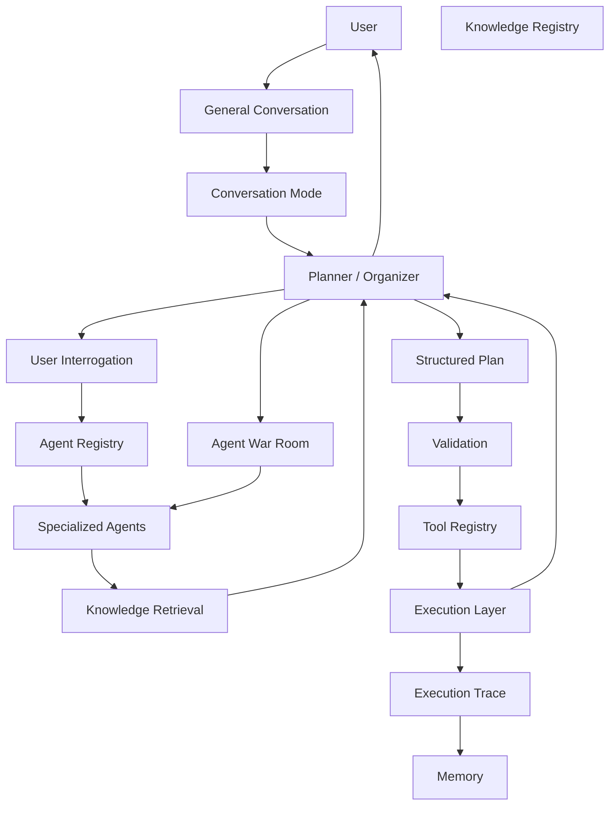

The final ambition is to build an AI system that can:

1. Talk naturally.
2. Recognize when a user has something they want to accomplish.
3. Transition into a focused planning flow without feeling abrupt.
4. Interrogate the user when information is missing.
5. Delegate questions to specialized agents when useful.
6. Discover agents dynamically.
7. Discover tools dynamically.
8. Discover knowledge dynamically.
9. Retrieve only relevant knowledge.
10. Coordinate multiple agents.
11. Allow agents to challenge competing solutions.
12. Plan before executing.
13. Validate before creating side effects.
14. Execute real-world tasks safely.
15. Explain results naturally.
16. Return to casual conversation when the work is done.

The ultimate goal is not to build a chatbot with more features.

It is to build a **credible AI/LLM engineering system capable of coordinating intelligence, knowledge, capabilities, and execution around a user's actual objective**.