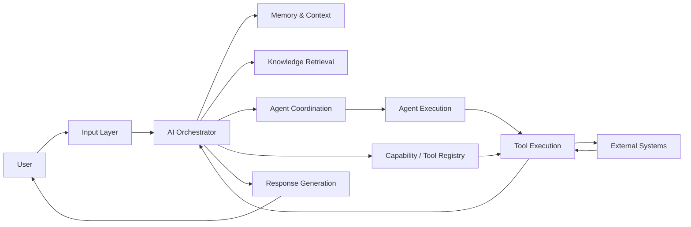
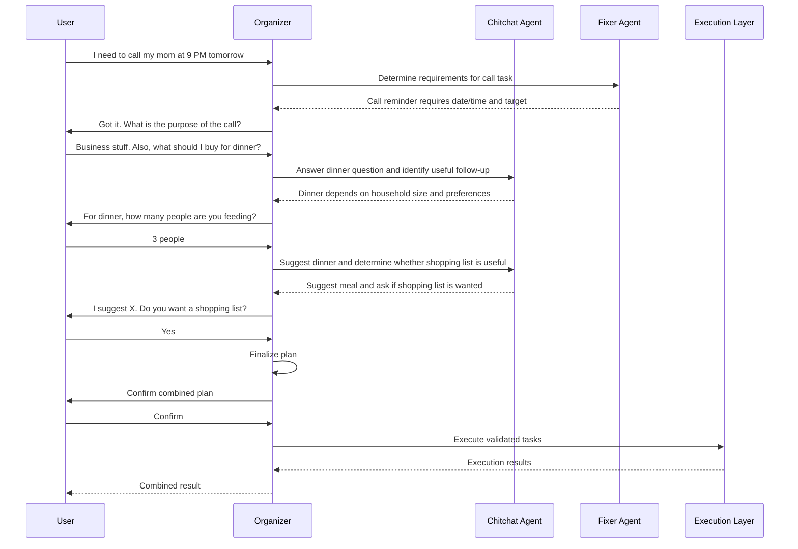
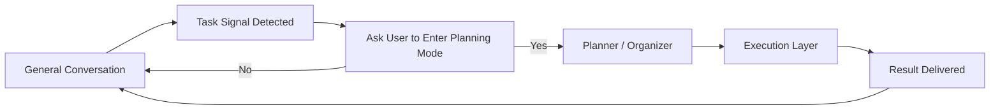
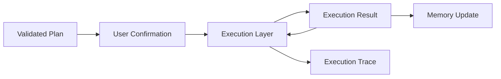
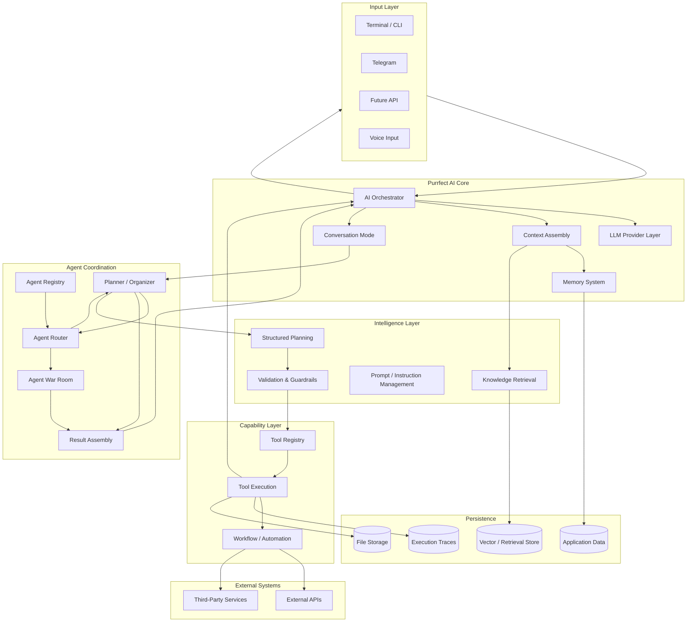
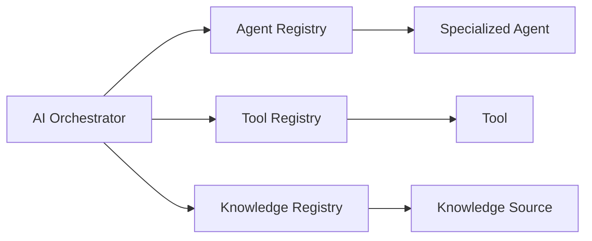
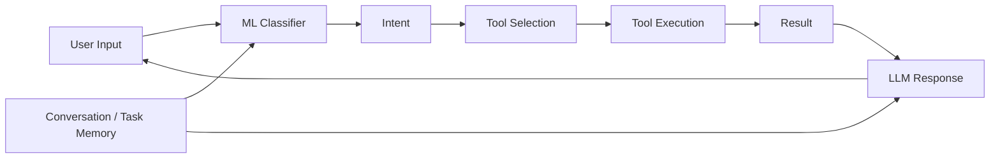
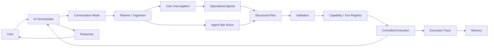
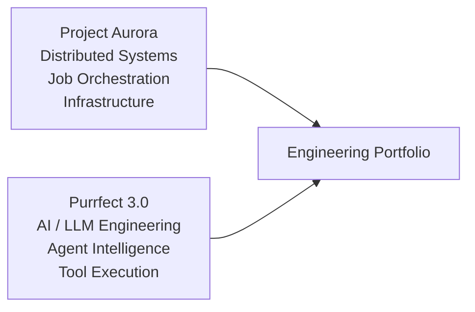

# Purrfect 3.0

> **AI/LLM Engineering Flagship Project**

Purrfect 3.0 is the next-generation evolution of the original Purrfect AI assistant concept.

The project explores how to design and engineer a practical AI/LLM system that can understand natural language, maintain contextual memory, reason over available capabilities, retrieve relevant knowledge, coordinate specialized agents, interact with tools, and safely execute real-world tasks.

This project is being built as a **portfolio flagship for AI/LLM engineering**, with an emphasis on architecture, system design, reliability, extensibility, and practical execution rather than a simple LLM chatbot demo.

---

## Project Status

**Status: WIP — Active Development**

Purrfect 3.0 is currently in the architecture and foundation phase.

The system is expected to evolve significantly as new AI/LLM capabilities are implemented and validated.

The architecture and implementation may change during development as design decisions are tested against real execution requirements.

### Current Implemented Foundation

The first working orchestration foundation has been implemented.

Currently available:

* Reception flow
* Intent extraction pipeline
* Planner-based execution planning
* Agent Registry
* Specialized agents
* Confirmation gate
* Structured execution engine
* Execution retry policy
* Execution failure handling
* Execution reporting
* Response generation
* End-to-end orchestration testing

Current validated flow:

User Request
    |
    v
Reception Agent
    |
    v
Intent Secretary
    |
    v
Planner Agent
    |
    v
Confirmation Gate
    |
    v
Execution Engine
    |
    v
Execution Report
    |
    v
Response Builder

---

## Why Purrfect 3.0 Exists

The original Purrfect project was built at a time when the available AI tooling and the author's own knowledge were significantly more limited.

The original system already explored several concepts that remain relevant today:

* Natural-language intent detection
* Tool discovery
* Dynamic tool loading
* Parameter extraction
* Tool execution
* Conversation memory
* Task memory
* User-driven classification
* Model-assisted responses
* Local ML experimentation
* Multi-platform input
* Voice input
* External-service integrations through mocked implementations

However, the original architecture relied heavily on manually designed intent classification, early ML experimentation, and direct prompt-driven execution.

Purrfect 3.0 revisits the same fundamental problem with modern AI/LLM architecture and a stronger engineering foundation.

The goal is not to reproduce the old implementation.

The goal is to **build the system that the original Purrfect was trying to become**.

---

## Core Vision

Purrfect is designed around a simple idea:

> **An AI assistant should be able to understand what a user wants, determine what capabilities are required, gather missing information, coordinate the right intelligence and capabilities, execute appropriate actions, and communicate the result naturally.**

The system should therefore operate as more than a conversational interface.

At a high level:

The exact architecture will evolve as implementation progresses.

---

## Engineering Goals

Purrfect 3.0 is intended to demonstrate practical capability across the AI/LLM engineering stack.

### 1. LLM Application Architecture

Design an AI system around modern LLM capabilities rather than treating the model as a simple text-generation endpoint.

Areas of interest include:

* Structured model outputs
* Tool calling
* Function execution
* Context management
* Prompt architecture
* Model routing
* Agent workflows
* Agent coordination
* Retrieval-augmented generation
* Conversation state
* Long-term memory
* Guardrails
* Failure handling

---

### 2. Agent and Orchestration Architecture

Purrfect 3.0 should move beyond a single monolithic "AI brain".

The system should be capable of coordinating specialized agents that are responsible for specific classes of work.

Potential agent roles may include:

* Planner / Organizer
* Chitchat / General Conversation
* Task Execution
* Research
* Knowledge Retrieval
* Scheduling
* Writing
* Analysis
* Project Planning
* Other domain-specific agents

Agents should be treated as modular capabilities that can be discovered, described, selected, and coordinated dynamically.

Specialized agents should ideally support an architecture similar to tools and knowledge sources:

* Agents expose metadata describing their capabilities.
* The system discovers available agents through an agent registry.
* The orchestrator determines which agents are relevant to the current request.
* Agents receive only the context required for their assigned responsibility.
* Agents may collaborate or request assistance from other agents.
* Multiple agents may work in parallel when the task benefits from it.
* Results are assembled into a coherent response.

The system should not require the central orchestrator to be rewritten whenever a new specialized agent is introduced.

---

### 3. Human-in-the-Loop Planning and Interrogation

Purrfect 3.0 should avoid treating every user message as an isolated intent classification problem.

Instead, the system should be able to maintain a conversational planning state.

A user may express multiple thoughts naturally:

* "I need to call my mom at 9 PM tomorrow."
* "Also, what should I buy for dinner?"
* "Oh, and I need to finish the project plan."

Rather than forcing the entire message into a single intent, Purrfect should be able to recognize that multiple objectives may exist and coordinate them.

A central **Planner / Organizer Agent** should act as the conversational coordinator.

The Planner may:

* Detect multiple objectives.
* Break complex requests into manageable units.
* Ask clarification questions.
* Identify missing information.
* Request additional details.
* Call specialized agents to answer questions during the interrogation process.
* Continue gathering information after receiving partial answers.
* Maintain task state across multiple conversational turns.
* Determine when enough information has been collected.
* Summarize the resulting plan.
* Request final user confirmation when appropriate.
* Hand validated work to the execution layer.

This creates a more natural interaction model where the system does not immediately "panic" into a tool execution flow whenever it detects a possible task.

For example:

The Planner is therefore not a silent aggregator.

It is an active conversational coordinator.

It can temporarily delegate questions to specialized agents and continue the interrogation process based on their answers.

---

### 4. Conversational Modes

Purrfect 3.0 may support explicit conversational modes as a higher-level orchestration mechanism.

The system should not rely on a large collection of fragile intent categories to determine every interaction.

Instead, the user may naturally move between:

* General conversation
* Planning / Organizer mode
* Focused task execution
* Specialized agent workflows

A possible flow is:

The purpose of modes is not to create rigid system boundaries for the user.

Instead, modes provide additional orchestration context.

For example:

> "I just remembered I need to call my mom at 9 PM tomorrow."

The system may recognize a task signal during casual conversation and naturally ask whether the user wants to switch into a more focused planning flow.

Once execution is complete, the system can return to general conversation automatically.

This approach aims to replace the original Purrfect 2.0 style of direct intent-driven switching with a more natural conversational state machine.

---

### 5. Agent Collaboration and Agent War Room

Purrfect 3.0 should be designed with the possibility of multiple agents collaborating on complex problems.

For straightforward requests, this may be unnecessary overhead.

For complex tasks, projects, planning, research, or ambiguous problems, multiple specialized agents may provide better results.

The long-term concept is an **Agent War Room**.

The War Room would allow multiple capable agents to participate in a controlled collaborative process.

Possible participants may include:

* Planner
* Researcher
* Analyst
* Critic
* Architect
* Domain Specialist
* Execution Specialist
* Reviewer

Agents may:

* Propose solutions.
* Challenge other proposals.
* Identify missing information.
* Review assumptions.
* Compare competing approaches.
* Critique plans.
* Vote or rank candidate solutions.
* Request additional research.
* Produce a final consensus.

The system should also be capable of supporting competitive agent workflows where appropriate.

In other words:

> **Agent battle royale is allowed — but the orchestrator remains the referee.**

The goal is not to create agents arguing endlessly.

The goal is to create a bounded mechanism where multiple agents can independently reason about a difficult problem, challenge each other, and produce a stronger final result.

This concept is primarily intended for complex workloads rather than simple requests such as "What should I eat for dinner?"

---

### 6. Tool and Capability Architecture

Tools should be treated as first-class capabilities that can be discovered, described, validated, authorized, and executed.

Potential capabilities include:

* Calendar
* Communication
* File operations
* Search
* External APIs
* Automation workflows
* Internal application services

The system should be able to grow without requiring the AI core to be rewritten every time a new capability is added.

Tools should ideally support automatic registration through metadata and a registry system.

---

### 7. Knowledge and Retrieval

Purrfect should be able to work with external knowledge rather than relying entirely on the model's built-in knowledge.

Knowledge should be treated as a separate system from conversational memory and should support a metadata-first architecture where the system can discover relevant knowledge sources without sending entire knowledge bases to the LLM.

Potential areas include:

* Document ingestion
* Knowledge indexing
* Document chunking
* Metadata extraction
* Semantic retrieval
* Metadata filtering
* RAG pipelines
* Context assembly
* Source-aware responses
* Knowledge source registry
* Metadata-first knowledge discovery
* Selective retrieval of relevant knowledge
* Retrieval traceability

The knowledge system should aim to minimize unnecessary context sent to the LLM.

Instead of providing an entire knowledge base, Purrfect should first use lightweight metadata to identify relevant knowledge sources and retrieve only the information required for the current request.

This follows a similar architectural principle to the Tool Registry and Agent Registry:

* Tools expose metadata describing available capabilities.
* Agents expose metadata describing specialized intelligence.
* Knowledge sources expose metadata describing available information.
* The system uses metadata to determine what should be activated or retrieved.
* Only relevant content is passed into the appropriate context.

The goal is to reduce token usage, improve execution speed, and keep context focused while maintaining traceable knowledge retrieval.

---

### 8. Memory

The system should distinguish between different forms of memory.

Potential memory layers include:

* Short-term conversation context
* Working memory
* Planner / interrogation state
* Task state
* Long-term user memory
* Retrieved knowledge
* Execution history
* Agent collaboration context

Memory should be designed deliberately rather than treating the entire conversation history as one undifferentiated context window.

Planner state should be considered separately from long-term memory.

For example, during an active planning session, the system may maintain:

* User goals
* Known parameters
* Missing parameters
* Clarifications
* Decisions
* Delegated subtasks
* Agent responses
* Pending confirmations
* Execution status

Once the planning session is complete, only appropriate information should be persisted as long-term memory.

---

### 9. Reliable Execution

AI-generated intent should not directly equal unrestricted execution.

The system should progressively introduce:

* Structured action plans
* Parameter validation
* Tool schema validation
* Execution policies
* Confirmation requirements
* Error handling
* Retry behavior
* Execution tracing
* Auditability

The execution layer should also act as a boundary between conversational orchestration and real-world side effects.

Once a plan is validated and confirmed:

After execution is complete, the system should be able to return naturally to general conversation.

---

## High-Level Architecture

The target architecture is expected to follow a layered approach:

This represents the **architectural direction**, not a final implementation contract.

---

## Registry-Driven Architecture

Purrfect 3.0 should aim to make major extensibility points discoverable through registries.

The long-term architecture may include:

The underlying principle is consistent:

> **Describe capabilities first. Load only what is relevant.**

This allows Purrfect to avoid sending every tool description, every agent instruction, and every knowledge source into every LLM request.

Instead, lightweight metadata can be used as a discovery layer.

The system can then selectively activate:

* Relevant agents
* Relevant tools
* Relevant knowledge sources

This architecture is intended to improve:

* Token efficiency
* Latency
* Context quality
* Modularity
* Extensibility
* Observability

---

## Design Principles

### AI is not the entire system

The LLM is one component of Purrfect.

The system around the model is responsible for:

* Context
* Memory
* Retrieval
* Agent discovery
* Tool discovery
* Planning
* Validation
* Execution
* Safety
* Observability

### Structured data over fragile text parsing

Where possible, important system boundaries should use structured data instead of relying on parsing natural-language output.

### Capabilities should be modular

Adding a new capability should ideally involve registering a new tool, agent, or knowledge source rather than modifying the central AI orchestration logic.

### The Planner is a coordinator, not a classifier

The system should not reduce every user message to a single intent label.

The Planner should be able to understand conversational context, identify multiple objectives, ask questions, delegate subtasks, and coordinate execution.

### Execution must be controlled

The model should propose or select actions.

The system should validate and control execution.

### Agents should be bounded

Specialized agents should operate within defined responsibilities and receive only the context necessary for their work.

### Collaboration should be observable

Multi-agent workflows should expose useful execution metadata without exposing private model reasoning.

### Every important action should be observable

AI systems are difficult to debug when only the final response is visible.

Purrfect should therefore expose useful execution metadata and traces without exposing private model reasoning.

### Real implementation over conceptual demos

Purrfect 3.0 is intended to become a working MVP and eventually a system capable of surviving realistic usage.

Architecture decisions should therefore be validated through actual implementation wherever practical.

---

## Relationship to the Original Purrfect

Purrfect 3.0 is not a clean-room project disconnected from the original work.

It is the architectural continuation of the same idea.

The original project explored:

The original system was effective as an early exploration, but the interaction model was largely driven by intent classification and direct task routing.

Purrfect 3.0 aims to evolve this into a more capable architecture:

The fundamental ambition remains the same:

> Turn natural-language intent into useful, controlled action.

The engineering approach is what changes.

The original Purrfect attempted to classify the user's message and route it.

Purrfect 3.0 aims to **understand the user's ongoing objective, interrogate when necessary, coordinate intelligence, plan before execution, and maintain a natural conversation throughout the process**.

---

## Expected Technology Direction

Technology choices are intentionally not completely locked at this stage.

The project is expected to explore technologies relevant to modern AI/LLM engineering, potentially including:

* Python
* LLM APIs
* Local LLM providers
* Structured tool calling
* Embeddings
* Vector databases
* RAG
* Agentic workflows
* FastAPI
* PostgreSQL
* Redis
* Docker
* Automated testing
* Observability and tracing

Specific technologies will be selected based on architectural requirements rather than added for the sake of demonstrating a technology list.

---

## Development Philosophy

Purrfect 3.0 follows the same general philosophy used across the author's flagship engineering projects:

> **Build systems that actually work.**

The project should prioritize:

1. Correctness
2. Clear architecture
3. Maintainability
4. Testability
5. Reliability
6. Observability
7. Security
8. Extensibility

The objective is not to build the largest AI system possible.

The objective is to build a **credible, technically defensible AI/LLM engineering system** that demonstrates the ability to design, implement, and operate AI-enabled software.

---

## Current Focus

The initial development phase focuses on establishing the foundations required for the system:

* [x] Define Purrfect 3.0 architecture
* [x] Define AI orchestration boundaries
* [x] Define conversation mode architecture
* [x] Define Planner / Organizer responsibilities
* [ ] Define user interrogation flow
* [x] Define specialized agent contract
* [x] Define Agent Registry
* [ ] Define agent collaboration model
* [ ] Define Agent War Room architecture
* [ ] Define LLM provider abstraction
* [x] Define tool/capability contract
* [x] Define Tool Registry
* [x] Define structured task execution flow
* [ ] Define memory architecture
* [ ] Define knowledge/RAG architecture
* [ ] Define Knowledge Registry
* [x] Define execution tracing
* [x] Define validation and guardrails
* [x] Establish test strategy
* [x] Implement the first end-to-end MVP flow

See `PLANNER.MD` for the current implementation roadmap.

---

## Project Positioning

Purrfect 3.0 is intended to serve as a flagship portfolio project demonstrating:

* AI/LLM application architecture
* LLM integration
* Agent and orchestration patterns
* Multi-agent coordination
* Human-in-the-loop planning
* Tool calling
* Dynamic capability discovery
* RAG and knowledge systems
* Metadata-first context selection
* Memory architecture
* AI safety and execution controls
* Production-minded backend engineering
* System observability
* Practical AI product engineering

It complements **Project Aurora**, which focuses primarily on distributed systems and infrastructure orchestration.

Together, the two projects demonstrate different sides of modern backend and AI engineering:

---

## Disclaimer

Purrfect 3.0 is a work in progress.

Some architectural concepts are currently planned but not yet implemented.

The project should not be considered production-ready until the relevant components have been implemented, tested, and validated.

The architecture will evolve as implementation reveals new requirements and constraints.